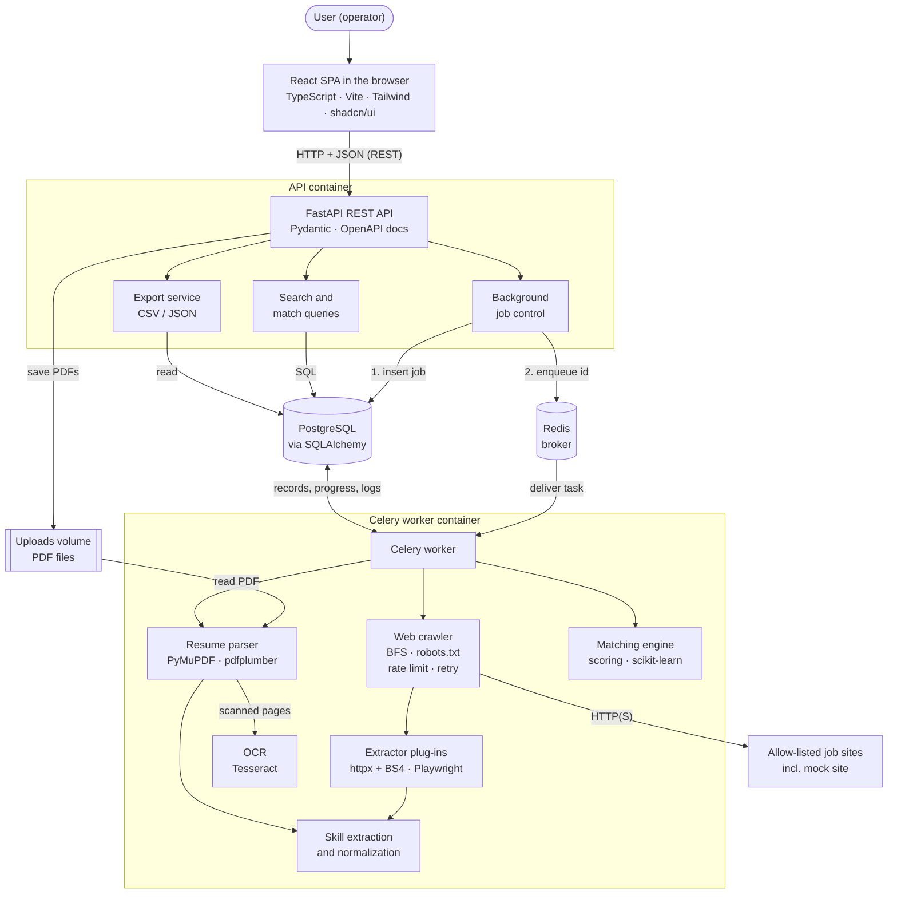

# Job–Candidate Matching Platform — High-Level Design (HLD)

| Item | Detail |
|---|---|
| Version | 1.2 (concise edition for review) |
| Date | 12 November 2026 |
| Status | Draft for review. This is a design document; nothing has been implemented. |
| Requirement source | `Intern_Assignment_Flexible_Brief.pdf` ("the brief") |
| Detailed version | `HLD_Job_Candidate_Matching_Platform_Full.md` (v1.2: field lists, API examples, failure scenarios, matching benchmark, traceability matrix) and `ARCHITECTURE_DECISIONS.md` |

Statements are tagged **[PDF]** where the brief requires them, **[Decision]** where they are design choices made in this HLD, and **[Assumption]** where the brief is silent.

## 1. Project Overview

The platform collects job openings by crawling websites, reads candidate resumes from PDF files and matches the two. Each candidate gets a ranked list of their **top 10 jobs**, and each job a list of its **top 10 candidates**. Every match has a score from 0 to 100 and shows the matched skills, the missing skills and the reason for the score. Crawling and resume parsing run as background jobs with visible progress and logs. Results can be searched and exported as CSV or JSON **[PDF]**.

**Problem addressed.** Manual resume screening is slow and inconsistent, and the same skill is written in many ways ("JS", "JavaScript"). The platform automates job collection, resume extraction, skill normalization and scoring, and explains every recommendation. Hiring decisions remain with people.

**Users [Assumption].** The brief defines no user roles, so the design assumes a single operator role, such as a recruiter, with no login.

**Terminology.** A *job* is a job posting. A *background job* is a unit of asynchronous work (crawl, resume parsing or matching) run by the worker.

## 2. Scope and Key Requirements

| Capability | What the brief requires | Priority |
|---|---|---|
| Background jobs | Crawl and resume jobs created via API and UI, run in a background worker with status queued → running → completed / failed / cancelled, progress and timestamped logs. | Must |
| Crawler | Breadth-first crawl from a seed URL (`max_depth`, `max_pages`) on allow-listed domains only; normalized URLs fetched once; robots.txt; per-domain rate limit; retries with backoff. One bad page never crashes a job. | Must |
| Extractors | Plug-ins: a new site means one new file. Plain HTTP by default; headless browser only when a page needs JavaScript. | Must |
| Resume parsing | Upload one or many PDFs (≤ 20 MB, verified as PDF). Extract name, contact, current title, skills, years of experience, education and summary; handle two-column layouts; clear errors for encrypted or corrupt files. | Must |
| OCR | OCR scanned (image-only) resumes, or flag them. | Should |
| Skills | Extract skills from job descriptions and resumes, and normalize synonyms and spellings. | Must |
| Matching | Score every candidate against every job (0–100). Show the top 10 in both directions with matched skills, missing skills and the reason. | Must |
| API | REST API with OpenAPI docs: create, list and cancel jobs; logs; search jobs and candidates; `GET /candidates/{id}/matches`; `GET /jobs/{id}/matches`; CSV and JSON export. | Must |
| UI | Job list with live progress and logs; searchable jobs and candidates tables; candidate and job pages showing best fits with matched and missing skills. | Must |
| Data quality | Every record validated (e.g. Pydantic) and normalized: ISO dates, numbers as numbers, absolute URLs, no duplicates. | Must |

The brief's **Could** features are listed in Section 11 and are not part of the baseline design.

**Deliverables [PDF].** A repository started by `docker compose up` with `.env.example`, README (including a hand check of 5 candidates' top 3 jobs), `DATA_SOURCES.md`, offline tests, sample outputs, a demo video (≤ 7 minutes) and `AI_USAGE.md`.

**Out of scope [Decision].** User accounts and authentication, multi-tenancy, notifications or job applications, automated hiring decisions and cloud production infrastructure.

## 3. Technology Stack

| Layer | Technology | Purpose |
|---|---|---|
| Backend | Python + FastAPI | REST API with automatically generated OpenAPI docs |
| Database | PostgreSQL | Durable relational storage; constraints prevent duplicates |
| ORM / validation | SQLAlchemy + Pydantic | Safe, parameterized database access; validation of all inputs and records |
| Background processing | Celery + Redis | Celery runs long tasks in worker processes; Redis is the message broker |
| Frontend | React + TypeScript + Vite | Single-page UI with type-checked API data |
| UI | Tailwind CSS + shadcn/ui | Consistent styling and ready-made tables, badges and progress bars |
| Web scraping | httpx + BeautifulSoup + Playwright | Fetch and parse static pages; Playwright renders JavaScript pages only when needed |
| Resume parsing | PyMuPDF + pdfplumber | Text with layout positions (two-column handling) and table extraction |
| OCR | Tesseract | Text from scanned, image-only pages |
| Matching | scikit-learn + custom scoring | Explainable formula-based score; TF-IDF similarity used only to order equal scores |
| Testing | Pytest | Unit and integration tests using saved HTML and PDF files |
| Deployment | Docker Compose | One command starts every service |

## 4. System Architecture

The system is a **modular monolith with a separate background worker [Decision]**. One Python backend codebase runs as two kinds of process: the **FastAPI API**, which serves the UI and answers quickly, and the **Celery worker**, which performs long work (crawling, PDF parsing, OCR and matching). The **React** single-page application is a separate frontend that talks only to the API. **PostgreSQL is the single source of truth** for all records, background-job status, progress and logs. **Redis** only carries task messages from the API to the worker.

This structure suits a single-developer project deployed with Docker Compose. Microservices would add network calls, deployment work and data-consistency problems without a matching benefit. Separating the API from the worker keeps long operations from blocking users.

**How the parts communicate.** The browser calls the API over HTTP with JSON (REST). To start long work, the API first saves a background job in PostgreSQL ("1. insert job" in Figure 1), then sends only its ID to Redis ("2. enqueue id"). A worker picks up the ID, does the work, and writes records, progress and logs to PostgreSQL; the UI polls the API to display them. Uploaded PDFs pass from the API to the worker through a shared storage volume.

<!-- diagram: 01-system-architecture | System architecture: components, containers and communication paths -->


## 5. Core Components

| Component | Responsibility |
|---|---|
| React frontend | Crawl form, resume upload, background-job list with live progress and logs, searchable tables, candidate and job match pages, export buttons. |
| FastAPI backend | REST endpoints and OpenAPI docs; validation; starting and cancelling background jobs; search, match retrieval and export. |
| Background job system | Celery workers run crawl, resume and match tasks, recording status, progress and timestamped logs in PostgreSQL. |
| Web crawler | Polite, bounded breadth-first crawl that isolates per-page errors (rules in Section 9). |
| Extractor plug-ins | One file per website that turns pages into job records and links to follow. |
| Resume parser and OCR | Reads PDFs, including two-column layouts and tables; OCRs scanned pages or flags them; rejects encrypted and corrupt files clearly. |
| Skill normalizer | Maps skill synonyms to canonical names ("ReactJS" → React) for jobs, resumes and search. |
| Matching engine | Scores every candidate–job pair and stores matched skills, missing skills and an explanation. |
| Export service | Streams jobs, candidates and matches as CSV or JSON, using the same filters as search. |

## 6. Key Workflows

**Job crawling.**

1. The user submits a seed URL, `max_depth`, `max_pages` and allowed domains.
2. The API validates the request, stores a `queued` background job and enqueues its ID.
3. A worker sets the job to `running` and crawls breadth-first, applying the allow-list, robots.txt, rate limits and retries.
4. For each page, the matching extractor produces job records. These are normalized, their skills are extracted, and they are validated and saved without duplicates.
5. Progress and logs are updated after each page. The UI polls and displays them until the job is `completed`, `failed` or `cancelled`.

**Resume upload and parsing.**

1. The user uploads one or more PDFs.
2. The API checks each file's size and PDF signature and stores valid files under random names. It rejects invalid files with a clear reason and enqueues a background job for the rest.
3. For each file, the worker extracts text in reading order, OCRs scanned pages, identifies candidate fields and skills, then validates and saves the record. Encrypted, corrupt or unreadable files are logged with a clear message, and the remaining files continue.

**Candidate–job matching.**

1. The user starts a `match` background job ("Recompute matches") **[Decision]**.
2. The worker scores every candidate against every job and stores each score with its matched skills, missing skills and explanation, replacing the previous results in one transaction.
3. The candidate and job pages show the top 10 results from indexed queries.

## 7. Matching Approach

The baseline formula from the brief is used unchanged:

```text
score = 70 × (required skills the candidate has / total required skills)
      + 15 × (nice-to-have skills the candidate has / total nice-to-have)
      + 10 × experience fit   (1 if years ≥ minimum, scaled down below it)
      +  5 × location fit     (same city or remote = 1)
```

Each factor is between 0 and 1 and the weights sum to 100, so the score is always between 0 and 100. Skills are compared after normalization, so spelling differences do not affect the result. Because every score is built from the extracted skills, extraction accuracy is the main quality risk; it is measured on hand-labelled examples (Section 10).

**Where the brief is silent [Decision]:**

- experience fit scales linearly, `min(1, years / minimum)`;
- a job with no nice-to-have skills gives full credit for that part;
- a job with no identified required skills scores zero for that part and is flagged in the explanation;
- a job without a minimum experience requirement counts as a full experience fit;
- scores are computed exactly and ranked at full precision, and are rounded to 2 decimals only for display, so rounding never changes a ranking.

**Example.** A candidate who has 3 of 4 required skills, 1 of 2 nice-to-have skills, 2 of 3 required years and lives in the job's city scores 52.50 + 7.50 + 6.67 + 5.00 = **71.67**.

**Explainability.** Every match stores its matched skills, missing skills, a per-component score breakdown and a plain-language explanation. scikit-learn's TF-IDF text similarity is used **only to order candidates or jobs with equal scores**; it never changes the score **[Decision]**.

## 8. Database and API Overview

**Database.** PostgreSQL is accessed through SQLAlchemy. The record fields named in the brief keep their names.

| Table | Contents |
|---|---|
| `jobs` | Job postings with the brief's minimum job fields |
| `candidates` | Parsed resumes with the brief's minimum candidate fields, including the OCR flag |
| `skills`, `job_skills`, `candidate_skills` | Canonical skills and their links to jobs (required or nice-to-have) and candidates |
| `matches` | One row per candidate–job pair: score, matched and missing skills, explanation |
| `background_jobs`, `background_job_logs` | Status, progress and timestamped logs of crawl, resume and match jobs |

Duplicates are prevented by unique keys and insert-or-update writes. Identifiers are UUIDs, and indexes make both top-10 lookups fast **[Decision]**.

**API.** REST over HTTP with JSON. Interactive documentation is generated by FastAPI at `/docs`.

| Area | Main endpoints |
|---|---|
| Background jobs | `POST /background-jobs/crawl`, `POST /background-jobs/resume`, `POST /background-jobs/match`, `GET /background-jobs`, `POST /background-jobs/{id}/cancel`, `GET /background-jobs/{id}/logs` |
| Jobs | `GET /jobs` (search), `GET /jobs/{id}`, `GET /jobs/{id}/matches` |
| Candidates | `GET /candidates` (search), `GET /candidates/{id}`, `GET /candidates/{id}/matches` |
| Export | `GET /exports/jobs`, `GET /exports/candidates`, `GET /exports/matches` (format CSV or JSON) |

The two match routes are kept exactly as required **[PDF]**. Asynchronous work uses `/background-jobs` because the required route fixes `/jobs` to mean job postings. Long operations return *202 Accepted* immediately, and the UI polls for progress **[Decision]**.

## 9. Key Design and Security Decisions

| Decision | Rationale | Type | Detail |
|---|---|---|---|
| Modular monolith with a separate Celery worker | Simple to build and explain; long work never blocks the API | Decision | ADR-001 |
| PostgreSQL is the single source of truth | One queryable place for status, progress, logs and results; survives broker restarts | Decision | ADR-003 |
| Redis only as message broker, Celery for task execution; messages carry only an ID | Small messages; no personal data in the broker | Decision | ADR-004 |
| Required lifecycle with safe state changes and cooperative cancellation | No race between "start" and "cancel"; partial results kept | PDF + Decision | ADR-005, 006 |
| BFS crawling on allow-listed domains with robots.txt, rate limits, retries and per-page error isolation | Polite, bounded and robust crawling | PDF | ADR-008 |
| Auto-discovered plug-in extractors; Playwright only when needed | New site = one new file; static fetching keeps crawls fast | PDF + Decision | ADR-011 |
| PyMuPDF and pdfplumber for parsing; Tesseract OCR with a flagging fallback | Each library used for its strength; OCR fallback allowed by the brief | Decision | ADR-013, 014 |
| Own skills list and one shared normalizer | Jobs, resumes and searches use the same skill names | Decision | ADR-015 |
| Baseline formula unchanged; exact scores ranked at full precision; TF-IDF only as a tie-breaker | Score stays fully explainable; neither rounding nor floating-point error changes a ranking | Decision | ADR-016, 017, 018 |
| All matches precomputed by a `match` background job | Fast match pages and exports; atomic replacement | Decision | ADR-019 |

**Security measures.**

| Measure | Type |
|---|---|
| Uploads limited to 20 MB and verified as real PDFs; encrypted or corrupt files rejected with clear messages | PDF |
| Validation of all API input and extracted records with Pydantic | PDF |
| URL validation: only http/https, normalized, re-checked on every redirect | Decision |
| SSRF protection: the crawler refuses private, loopback and link-local addresses (including Playwright sub-requests), with an explicit exception for the local mock site | Decision |
| Uploaded resumes stored under random names on a private volume and never served directly; no personal data in logs or broker messages | Decision |
| Parameterized SQL via SQLAlchemy; secrets in environment variables; only the UI and API ports exposed | Decision |
| Authentication is outside the brief's scope and must be added before any deployment beyond a local demo | Boundary |

## 10. Deployment and Testing

**Deployment.** `docker compose up` starts every service **[PDF]**: `frontend` (the React app), `api` (FastAPI, which also applies database migrations), `worker` (Celery with Playwright and Tesseract), `db` (PostgreSQL on a persistent volume), `redis` (the message broker) and an optional `mock-site` with static and JavaScript-rendered job pages for a reproducible demo **[Decision]**. Configuration comes from environment variables documented in `.env.example`. Health checks control start-up order. Uploaded PDFs live on a volume shared by `api` and `worker`, and only the frontend and API ports are exposed to the host.

**Testing.** Pytest, with **no internet access in tests [PDF]**:

| Area | Approach |
|---|---|
| Extractors and crawler | Saved HTML pages; mocked HTTP responses for robots.txt, retries and limits |
| Resume parsing | Saved PDFs: one-column, two-column, skills table, scanned, encrypted, corrupt |
| Skill extraction | Hand-labelled job and resume texts: expected canonical skills, ambiguous names ("Go", "R"), required versus nice-to-have; measured precision and recall |
| Matching | Formula checks including the worked example; rounding only for display, never in ranking (scores that display the same keep their exact order) |
| API and integration | Test client and test database; tasks run directly |

The README's hand check of 5 candidates' top 3 jobs complements the automated tests. Each skill-extraction error it finds becomes a new labelled test case.

## 11. Assumptions and Future Enhancements

**Assumptions:**

- One operator role without login, because the brief defines no users.
- 20 MB means 20 × 1024 × 1024 bytes.
- A job's posted date may be missing if the website does not show one.
- Data volumes are assignment-sized, so scoring all candidate–job pairs is acceptable.
- The final job and resume sources (a mock site plus a real static site) will be recorded in `DATA_SOURCES.md`.

**Future enhancements (the brief's Could features):**

| Feature | Readiness in this design |
|---|---|
| Adjustable scoring weights in the UI | Weights are already configuration values |
| Semantic matching with embeddings | Matching engine is isolated; explainability rules still apply |
| Re-matching when new jobs arrive | The `match` task exists and could be triggered automatically |
| Resuming a stopped crawl | Would require persisting the crawl frontier |
| CI pipeline | Tests are offline and containerized, so they can run in CI |

**Scale path [Decision].** If data grows far beyond assignment size, scoring can switch to sparse-matrix operations, and storage to each candidate's and each job's top 10 only. On synthetic data this was about 15× faster and stored 90–99.5% fewer rows with identical top-10 lists (detailed HLD, Section 10.10). Neither change is needed at assignment scale.
