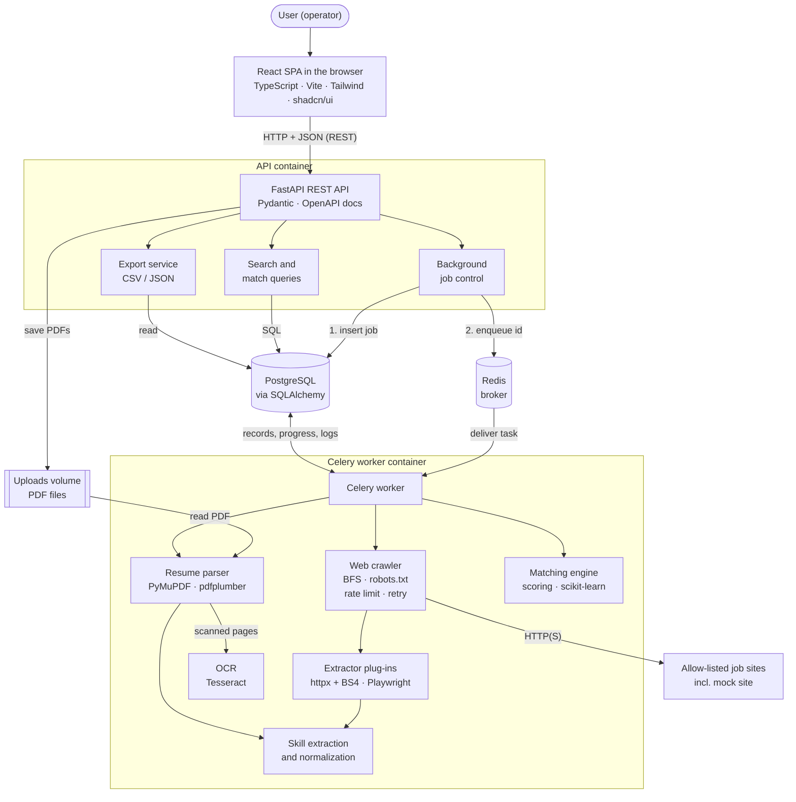
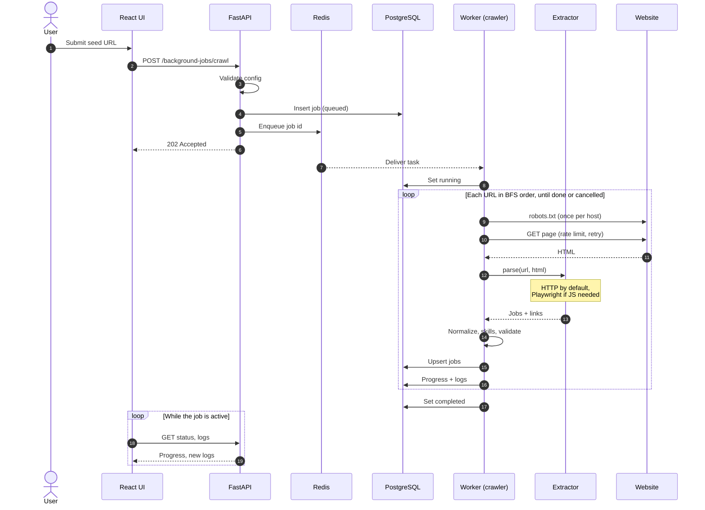
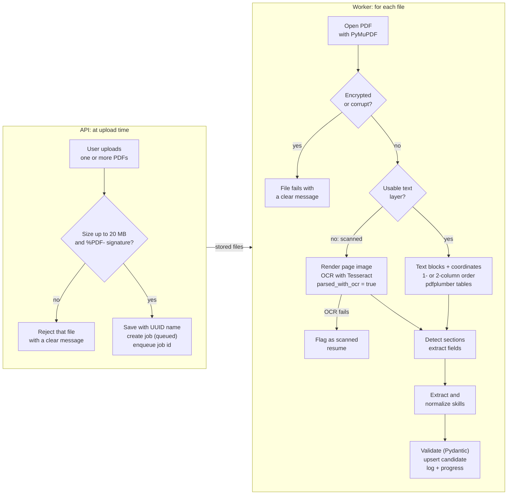
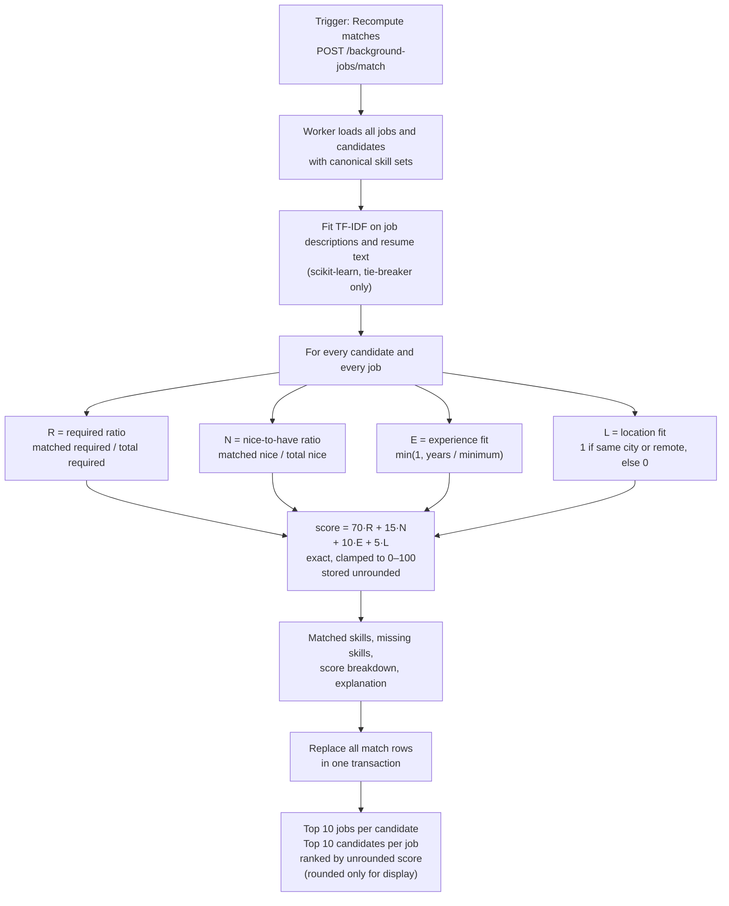
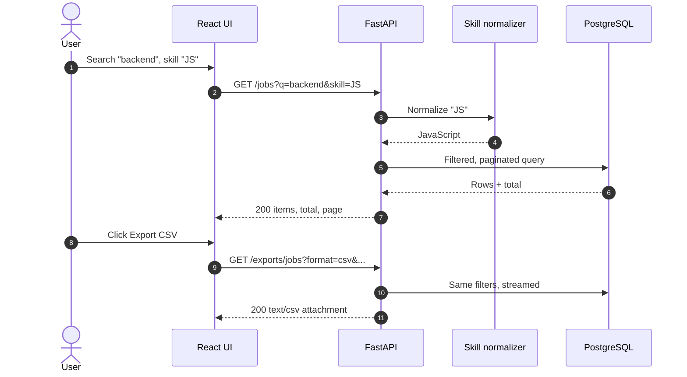
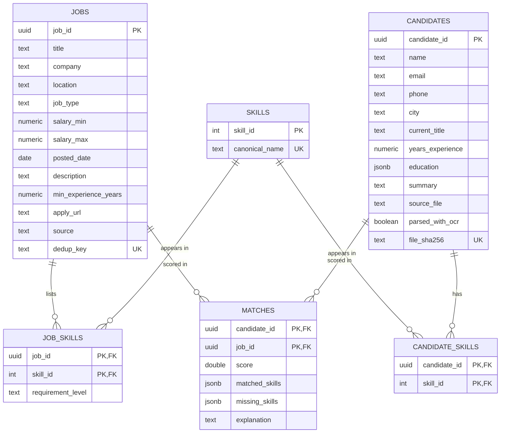
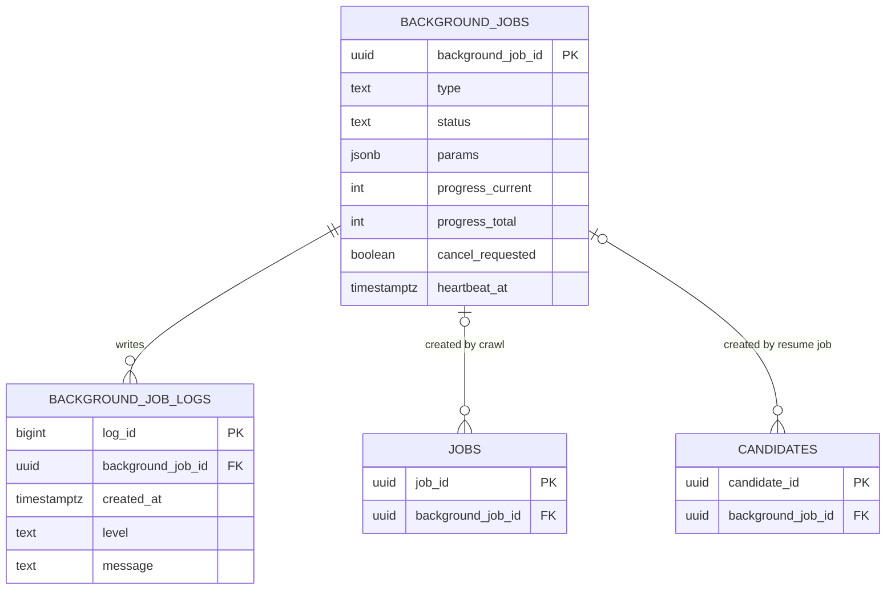
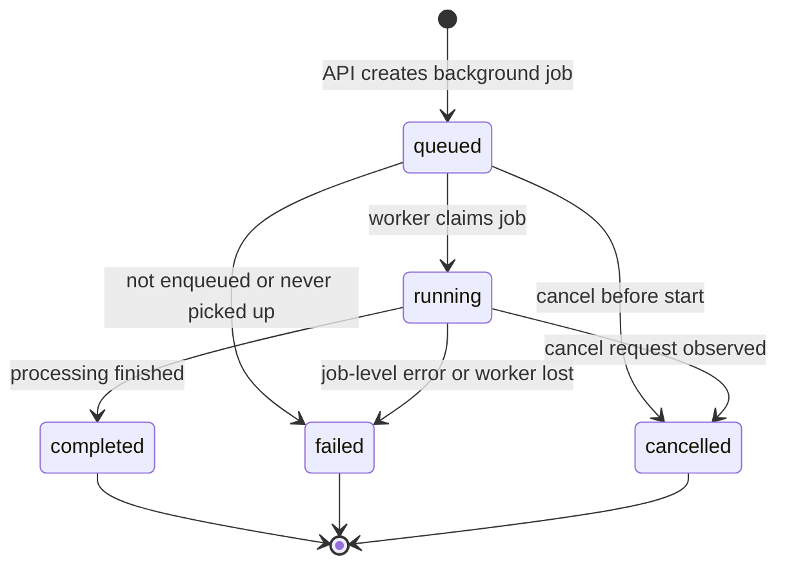
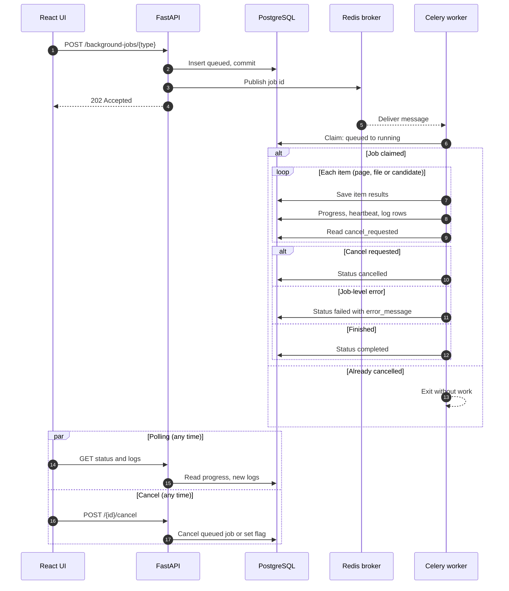
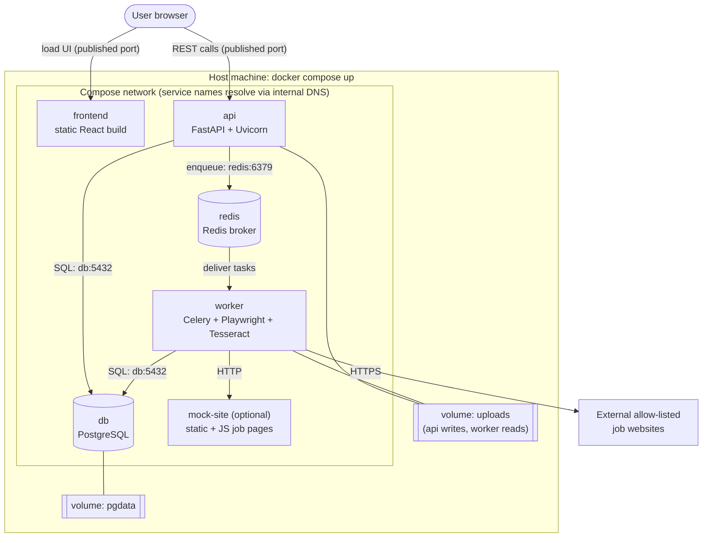

# Job–Candidate Matching Platform — High-Level Design (HLD)

<!-- docx:skip-start -->
**Version 1.2 · 18 November 2026 · Status: Draft for review (design phase — no implementation exists yet)**

**Contents:** 1 Document Information · 2 Introduction · 3 Problem Statement · 4 Project Scope · 5 Functional Requirements · 6 Non-Functional Requirements · 7 System Architecture · 8 Component-Level Design · 9 End-to-End Data Flow · 10 Matching Algorithm Design · 11 Database High-Level Design · 12 API High-Level Design · 13 Background Processing Architecture · 14 Error Handling and Failure Scenarios · 15 Security Considerations · 16 Deployment Architecture · 17 Project Folder Structure · 18 Testing Strategy · 19 Future Enhancements · 20 Assumptions and Design Decisions · 21 Conclusion · Appendix A Requirement Traceability Matrix · Appendix B Validation Checklist
<!-- docx:skip-end -->

<!-- docx:start -->

## 1. Document Information

| Item | Value |
|---|---|
| Project title | Job–Candidate Matching Platform |
| Document title | High-Level Design (HLD) |
| Document version | 1.2 |
| Date | 18 November 2026 |
| Status | Draft for review. This is a design document; no part of the system has been implemented. |
| Requirement source | `Intern_Assignment_Flexible_Brief.pdf` (2 pages), referred to below as "the brief" |
| Intended readers | Developer, assignment reviewers, interviewers |

### 1.1 Technology Stack Summary

| Layer | Technology |
|---|---|
| Backend API | Python + FastAPI |
| Database | PostgreSQL |
| ORM / validation | SQLAlchemy + Pydantic |
| Background processing | Celery (workers) + Redis (message broker) |
| Frontend | React + TypeScript + Vite |
| UI components and styling | Tailwind CSS + shadcn/ui |
| Web scraping | httpx + BeautifulSoup (static pages), Playwright (JavaScript-rendered pages) |
| PDF parsing | PyMuPDF + pdfplumber |
| OCR | Tesseract |
| Matching | Custom scoring formula + scikit-learn |
| Testing | Pytest |
| Deployment | Docker Compose |

### 1.2 Conventions Used in This Document

The brief is the only source of requirements. To keep requirements and design choices separate, statements are tagged as follows:

| Tag | Meaning |
|---|---|
| **[PDF]** | Explicitly required by the brief. |
| **[Decision]** | An architectural or design choice made in this HLD. It is not stated in the brief and can be changed. |
| **[Assumption]** | Something the brief leaves unspecified, filled in with a reasonable interpretation. |
| **[Open]** | An uncertainty that must be resolved during low-level design or implementation. |
| **Must / Should / Could** | Priorities exactly as assigned in the brief. |

### 1.3 Terminology

The word "job" has two meanings in the brief. This HLD keeps them apart:

| Term | Meaning in this document |
|---|---|
| **Job** or **job posting** | A job opening collected by the crawler (title, company, skills and so on). Stored in the `jobs` table and served at `/jobs`, matching the required route `GET /jobs/{id}/matches`. |
| **Background job** | A unit of asynchronous work (crawl, resume parsing or matching) executed by a Celery worker. Stored in `background_jobs` and served at `/background-jobs`. |
| **Task** | The Celery message and function that executes one background job. |
| **Seed URL** | The starting URL of a crawl. |
| **Extractor** | A plug-in that understands the HTML of one website and turns pages into job records. |
| **Canonical skill** | The single normalized name of a skill, for example `JavaScript` for "JS", "javascript" or "Java Script". |
| **Match** | The scored comparison of one candidate against one job. |
| **OCR** | Optical Character Recognition: turning an image of text (a scanned page) into machine-readable text. |

### 1.4 Revision History

| Version | Date | Description |
|---|---|---|
| 1.0 | 10 November 2026 | First complete HLD, derived from the brief. |
| 1.1 | 12 November 2026 | Score precision: scores are computed exactly, ranked at full precision and rounded only for display (Sections 10.5, 10.7, 11.2). Measured cost and scale path for matching (Section 10.10). Skill-extraction quality measures (Section 8.8). Score-precision and skill-extraction tests (Section 18). |
| 1.2 | 18 November 2026 | Decisions approved in the Low-Level Design (`docs/LLD/`, decisions LLD-4 and LLD-6 to LLD-10) copied in. Upload with no valid file returns 422 with per-file reasons (Sections 12.1, 14). Experience filter `max_required_years` (Section 9.4). Stale-job detection: heartbeat timeout and never-picked-up queued jobs (Sections 13.4, 13.7, 14, 16.3, 16.4). Polling every 2 seconds (Section 8.1). Match-table export on the Candidates page with candidate filters (Sections 8.1, 8.10, 12.6). Open questions O4 and O5 resolved (Section 20.3). Corrections: the ER diagram now shows `score` as `double` (Section 11.1), and the explanation in the Section 12.5 example follows the Section 10.8 template. Documentation clean-up: the error-format example in Section 12.1 uses the documented code `NO_VALID_FILES` instead of the undefined `INVALID_PDF`, and the Section 17 tree shows the documentation folders. Version 1.1 is kept in `docs/archive/v1.1/`. |

## 2. Introduction

### 2.1 What the Project Is

The Job–Candidate Matching Platform is a web application with three main capabilities:

1. It **collects job openings** by crawling job websites.
2. It **reads candidate resumes** uploaded as PDF files.
3. It **matches** each candidate to the jobs where their skills fit best, and each job to its best candidates.

Crawling and parsing run as **background jobs**. Users watch their progress, browse jobs and candidates, inspect matches and export data as CSV or JSON **[PDF]**.

### 2.2 Why It Is Being Developed

The project is an engineering assignment. The brief states that the evaluation focuses on *how well the system is built*, not on which data sources are chosen. The design therefore emphasizes correctness, robustness, explainability and clean structure over breadth of data.

### 2.3 What Problem It Solves

Recruiters must find suitable candidates among many resumes and compare them with many job descriptions. Reading each resume and checking it against each job's requirements is slow and inconsistent. The platform automates the repetitive parts: collecting jobs, extracting structured data from resumes, normalizing skills and scoring every candidate–job pair. Every score comes with an explanation.

### 2.4 Who Will Use It

**[Assumption]** The brief does not define user roles. This design assumes a single role: an **operator**, such as a recruiter or hiring-team member, who:

- starts crawls and uploads resumes;
- monitors background jobs and their logs;
- searches jobs and candidates;
- reviews the top matches in both directions;
- exports results.

Assignment reviewers use the same interface and the OpenAPI documentation.

### 2.5 What the System Is Expected to Achieve

- Turn unstructured job pages and resume PDFs into **validated, normalized, de-duplicated records** **[PDF]**.
- Produce a **0–100 score** for every candidate–job pair, with **matched skills, missing skills and a reason** **[PDF]**.
- Show the **top 10 jobs per candidate** and the **top 10 candidates per job** **[PDF]**.
- Run long operations in the background with **status, progress and timestamped logs** **[PDF]**.
- Start completely with **`docker compose up`** **[PDF]**.

## 3. Problem Statement

| Recruitment problem | Why it is a problem | How the platform addresses it |
|---|---|---|
| Manual resume screening | Reading resumes one by one is slow. Different reviewers notice different things. | The resume parser extracts the same fields from every PDF: name, contact, current title, skills, years of experience, education and summary. |
| Comparing candidate skills with job requirements is difficult | The same skill is written in many ways ("JS", "JavaScript", "ReactJS", "React"). Manual comparison misses equivalences. | Skills from both jobs and resumes go through one normalizer that maps synonyms and spellings to canonical names **[PDF]**. |
| Shortlisting takes a long time | With many candidates and many jobs, the number of comparisons grows multiplicatively. | The matching engine scores every candidate against every job and stores ranked results for instant retrieval. |
| Job openings must be collected | Copying jobs from websites by hand is tedious and error-prone. | A polite, rule-respecting crawler (allow-listed domains, robots.txt, rate limits) collects jobs into structured records **[PDF]**. |
| Recommendations must be explainable | An unexplained number cannot be trusted or checked by a recruiter. | The score uses a transparent formula. Each match shows matched skills, missing skills and a plain-language reason **[PDF]**. |

**Boundary.** The platform supports a human decision; it does not make hiring decisions. It scores the information it can extract and does not claim to judge candidate quality beyond that.

## 4. Project Scope

### 4.1 In Scope (Must)

All items below are **Must** in the brief:

1. **Background job system.** Create crawl and resume jobs via API and UI. Jobs run in a background worker with status (queued → running → completed / failed / cancelled), progress and timestamped logs.
2. **Crawler.** Breadth-first crawl from a seed URL with `max_depth` and `max_pages`, restricted to allow-listed domains. It normalizes URLs, fetches each URL once, enforces robots.txt automatically, rate-limits per domain and retries timeouts, HTTP 429 and HTTP 5xx with backoff. One bad page never crashes a job.
3. **Extractors.** Plug-in design where adding a new site means adding one new file. Plain HTTP is the default; a headless browser (Playwright) is used only when a page needs JavaScript.
4. **Resume parsing (text).** Upload one or many PDFs (at most 20 MB each, verified to be real PDFs). Extract name, contact, current title, skills, years of experience, education and summary. Handle two-column layouts. Encrypted or corrupt files fail with a clear message.
5. **Skill extraction.** Extract skills from both job descriptions and resumes. Normalize synonyms and spellings using an own skills list or a taxonomy such as ESCO.
6. **Matching.** Score every candidate against every job (0–100). Show the top 10 jobs per candidate and the top 10 candidates per job, with matched skills, missing skills and the reason for the score.
7. **API.** REST API with OpenAPI docs: create, list and cancel jobs; logs; search jobs and candidates; `GET /candidates/{id}/matches`; `GET /jobs/{id}/matches`; export CSV and JSON.
8. **UI.** Job list with live progress and logs; jobs and candidates tables with search; a candidate page listing best-fit jobs and a job page listing best-fit candidates, each with matched and missing skills. "Simple is fine."
9. **Data quality.** Every record is validated (for example with Pydantic) and normalized: ISO dates, numbers as numbers, absolute URLs, no duplicates.

### 4.2 Should Features

| Feature | Note from the brief |
|---|---|
| OCR of scanned (image-only) resumes | Resume parsing is "Must (text) / Should (OCR)". The brief allows the alternative of **flagging** scanned resumes instead of running OCR on them. This design implements OCR with Tesseract and falls back to flagging when OCR is unavailable or fails. |

OCR is the only item marked **Should** in the brief.

### 4.3 Optional Features (Could)

| Could feature | Design treatment |
|---|---|
| Adjustable scoring weights in the UI | Section 19. The weights are kept as configuration from the start so this is easy to add later. |
| Semantic matching with embeddings | Section 19. |
| Re-matching when new jobs arrive | Section 19. The baseline uses a manual "recompute matches" action. |
| Resuming a stopped crawl | Section 19. |
| CI pipeline | Section 19. |

### 4.4 Out of Scope (Design Boundaries)

These are **design boundaries chosen in this HLD**, not requirements from the brief:

- **User accounts, authentication and authorization.** The brief does not mention them. The system is designed for local or demo deployment. Section 15 recommends protections if it is ever exposed publicly.
- **Multi-tenant or organization separation.**
- **Applying to jobs, contacting candidates, emails or notifications.**
- **Automated hiring decisions.** Scores are decision support only.
- **Large-scale distributed crawling** (many workers coordinating one crawl, or internet-wide discovery). The crawler is restricted to allow-listed domains.
- **Editing parsed records in the UI.** Records are produced by crawling and parsing.
- **Cloud or production infrastructure** (Kubernetes, managed databases, CDN). Deployment is Docker Compose.

### 4.5 Submission Deliverables (from the Brief)

The architecture must make these deliverables possible **[PDF]**:

| Deliverable | How the architecture supports it |
|---|---|
| GitHub repository where `docker compose up` starts API, worker, database, UI and mock site (if built), plus `.env.example` | Section 16 defines every container. Configuration comes from environment variables documented in `.env.example`. |
| README: setup (at most 3 commands), done / not done, design decisions, how matching works, 5-candidate hand check, known limitations, time spent | Setup is `git clone`, `cp .env.example .env`, `docker compose up`. This HLD and `ARCHITECTURE_DECISIONS.md` feed the design-decision and matching sections. |
| `DATA_SOURCES.md`: sources, reasons and robots.txt check or data-generation method | Section 4.6. The robots.txt module also logs its decision per domain. |
| Tests for extractors, resume parsing, skill normalization and scoring, using saved HTML and PDF files, with no internet | Section 18. |
| Sample outputs in `samples/`: jobs, parsed candidates, match table (top 10 per candidate) | Produced with the export endpoints (Section 12.6). |
| Demo video (at most 7 minutes): start system, scrape one static and one dynamic site, upload resumes including a scanned one, open best-fit pages, show one handled failure, export a CSV | The static and dynamic paths of the extractor system (Section 8.6), OCR (Section 8.7), failure handling (Section 14) and exports (Section 8.10) cover every demo step. |
| `AI_USAGE.md` | Documentation file in the repository root (Section 17). |

### 4.6 Data Sources

The brief lets the developer choose real sources, generated fake data or both, for jobs and resumes **[PDF]**. The design is **source-agnostic**: any site can be added through an extractor, and any PDF can be uploaded.

- **[Decision]** Include an optional **mock job site** container with both a static HTML page and a JavaScript-rendered page. The demo needs "one static, one dynamic" scrape, and a local mock site makes that reproducible without depending on a third-party website. The brief's suggestion of Fake Python Jobs can serve as the static real-world source.
- **[Decision]** Generate fake resumes with varied layouts (one-column, two-column, skills in a table and at least one scanned, image-only resume), as the brief suggests. The generation script is a development tool, not part of the runtime system.
- **[Open]** The final choice of sources is recorded in `DATA_SOURCES.md` during implementation.

## 5. Functional Requirements

Priorities are copied from the brief. Rows tagged **[Decision]** are derived requirements the design needs in order to satisfy a brief requirement.

### 5.1 Background Job Management

| ID | Requirement | Priority |
|---|---|---|
| FR-BJ-01 | Create a **crawl** background job via API and UI. | Must |
| FR-BJ-02 | Create a **resume** parsing background job via API and UI. | Must |
| FR-BJ-03 | Execute background jobs in a background worker, never in the API request. | Must |
| FR-BJ-04 | Track status: queued → running → completed / failed / cancelled. | Must |
| FR-BJ-05 | Track and expose progress. | Must |
| FR-BJ-06 | Record timestamped logs per background job and expose them. | Must |
| FR-BJ-07 | List background jobs. | Must |
| FR-BJ-08 | Cancel a background job. | Must |
| FR-BJ-09 | Run full matching as a third background job type (`match`). **[Decision]** | Supports Must (matching) |

### 5.2 Web Crawling

| ID | Requirement | Priority |
|---|---|---|
| FR-CR-01 | Breadth-first crawl from a seed URL. | Must |
| FR-CR-02 | Respect `max_depth` and `max_pages`. | Must |
| FR-CR-03 | Follow only allow-listed domains. | Must |
| FR-CR-04 | Normalize URLs and fetch each URL at most once per crawl. | Must |
| FR-CR-05 | Enforce robots.txt automatically. | Must |
| FR-CR-06 | Rate-limit requests per domain. | Must |
| FR-CR-07 | Retry timeouts, HTTP 429 and HTTP 5xx with backoff. | Must |
| FR-CR-08 | A single failing page never crashes the crawl. | Must |

### 5.3 Pluggable Extractors

| ID | Requirement | Priority |
|---|---|---|
| FR-EX-01 | Adding support for a new site requires adding exactly one new file. | Must |
| FR-EX-02 | Fetch with plain HTTP by default. | Must |
| FR-EX-03 | Use a headless browser (Playwright) only when the page needs JavaScript. | Must |
| FR-EX-04 | Produce job records with: job_id, title, company, location, job_type, salary (if given), posted_date, description (clean text), required_skills, nice_to_have_skills (if found), min_experience_years (if found), apply_url, source. | Must |

### 5.4 Resume Parsing and OCR

| ID | Requirement | Priority |
|---|---|---|
| FR-RP-01 | Upload one or many PDF files. | Must |
| FR-RP-02 | Reject files larger than 20 MB. | Must |
| FR-RP-03 | Verify each file is a real PDF. | Must |
| FR-RP-04 | Extract name, contact (email, phone), current title, skills, years of experience, education and summary. | Must |
| FR-RP-05 | Handle two-column layouts. | Must |
| FR-RP-06 | Encrypted or corrupt files fail with a clear message. | Must |
| FR-RP-07 | Produce candidate records with: candidate_id, name, email, phone, city, current_title, skills, years_experience, education, summary, source_file, parsed_with_ocr (bool). | Must |
| FR-OCR-01 | OCR scanned (image-only) resumes, **or** flag them. | Should |

### 5.5 Skill Extraction and Normalization

| ID | Requirement | Priority |
|---|---|---|
| FR-SK-01 | Extract skills from job descriptions. | Must |
| FR-SK-02 | Extract skills from resumes. | Must |
| FR-SK-03 | Normalize synonyms and spellings (for example "JS" = "JavaScript", "ReactJS" = "React") using an own skills list or a taxonomy such as ESCO. | Must |
| FR-SK-04 | Separate job skills into required and nice-to-have where the job text allows. | Must (implied by the record fields) |

### 5.6 Matching and Ranking

| ID | Requirement | Priority |
|---|---|---|
| FR-MA-01 | Score every candidate against every job on a 0–100 scale. | Must |
| FR-MA-02 | Use the baseline formula (Section 10). The brief allows changes, but the score must stay explainable. | Must (explainability) |
| FR-MA-03 | For each match, store and show matched skills, missing skills and an explanation. | Must |
| FR-MA-04 | Show the top 10 jobs per candidate. | Must |
| FR-MA-05 | Show the top 10 candidates per job. | Must |
| FR-MA-06 | Hand-check 5 candidates' top 3 jobs in the README. | Deliverable |

### 5.7 Search, Export and API

| ID | Requirement | Priority |
|---|---|---|
| FR-AP-01 | REST API with OpenAPI documentation. | Must |
| FR-AP-02 | Search jobs. | Must |
| FR-AP-03 | Search candidates. | Must |
| FR-AP-04 | `GET /candidates/{id}/matches`. | Must |
| FR-AP-05 | `GET /jobs/{id}/matches`. | Must |
| FR-AP-06 | Export CSV. | Must |
| FR-AP-07 | Export JSON. | Must |

### 5.8 User Interface

| ID | Requirement | Priority |
|---|---|---|
| FR-UI-01 | Background job list with live progress and logs. | Must |
| FR-UI-02 | Jobs table with search. | Must |
| FR-UI-03 | Candidates table with search. | Must |
| FR-UI-04 | Candidate page listing best-fit jobs with matched and missing skills. | Must |
| FR-UI-05 | Job page listing best-fit candidates with matched and missing skills. | Must |
| FR-UI-06 | Forms to start a crawl and upload resumes; cancel button; export buttons. **[Decision]** | Supports Must |

### 5.9 Data Validation and Normalization

| ID | Requirement | Priority |
|---|---|---|
| FR-DV-01 | Validate every record (Pydantic). | Must |
| FR-DV-02 | Dates in ISO format. | Must |
| FR-DV-03 | Numbers stored as numbers, not text. | Must |
| FR-DV-04 | Absolute URLs. | Must |
| FR-DV-05 | No duplicate records. | Must |

### 5.10 Could Features

Adjustable scoring weights in the UI, semantic matching with embeddings, re-matching when new jobs arrive, resuming a stopped crawl and a CI pipeline are **Could** features. They are described only in Section 19.

## 6. Non-Functional Requirements

**Important.** The brief states no numerical service-level targets (no response-time, throughput or availability figures), and this HLD invents none. The **Source** column shows whether a quality attribute comes directly from the brief or is an architectural consideration.

| Quality attribute | What it means for this system | How the design addresses it | Source |
|---|---|---|---|
| Reliability | Long-running work finishes or fails cleanly. A single bad input does not stop the whole job. | Each page and file is processed in its own error boundary. Retries with backoff handle transient errors. Background-job state is persisted in PostgreSQL. A stale-heartbeat check marks jobs whose worker died. | **[PDF]** "One bad page never crashes a job"; rest **[Decision]** |
| Maintainability | Code is easy to understand, change and explain. | Layered backend (API, services, domain modules, persistence). One module per concern. Extractor plug-ins. Typed schemas on both ends. | Architectural; brief requires being able to explain all code |
| Scalability | The system can handle more data or work without redesign. | API and worker scale independently. Tasks carry only IDs. Indexed queries for top-10 lookups. Matching is a batch job. Section 10.10 gives its measured cost and the scale path for all-pairs growth. | Architectural |
| Performance | The UI stays responsive while heavy work runs. | Heavy work is never done inside an HTTP request. Lists are paginated. Top-10 queries use composite indexes. Exports are streamed. | Architectural (no targets defined) |
| Security | Uploaded resumes (personal data) and the crawler are not abused. | PDF validation, size limits, safe storage, input validation, parameterized SQL, SSRF protection, secrets in environment variables (Section 15). | **[PDF]** for size limit and PDF check; rest **[Decision]** |
| Data consistency | Records are valid, normalized and unique. | Pydantic validation before every write. Unique constraints and upserts. Transactional replacement of match results. | **[PDF]** "validated … normalised … no duplicates" |
| Error handling | Failures are visible and understandable. | Per-item error logging. Clear user-facing messages for invalid, encrypted and corrupt PDFs. Consistent API error format. | **[PDF]** "fail with a clear message"; rest **[Decision]** |
| Extensibility | New sites and new scoring methods can be added. | One-file extractor plug-ins **[PDF]**. Scoring weights held in configuration. The matching engine is isolated behind one interface. | **[PDF]** for extractors; rest **[Decision]** |
| Testability | Components can be tested in isolation and offline. | Pure functions for parsing, normalization and scoring. Saved HTML and PDF fixtures. HTTP is mocked, with no internet in tests. | **[PDF]** "no internet in tests" |
| Explainability | Users can see why a score was given. | Score breakdown per component, matched and missing skills, and a generated explanation string stored with every match. | **[PDF]** |
| Politeness (crawling) | The crawler does not harm target sites. | robots.txt enforcement, per-domain rate limiting, honoring `Retry-After`, bounded depth and page counts. | **[PDF]** |
| Portability | Runs the same on any machine with Docker. | Everything containerized. One `docker compose up`. | **[PDF]** |

## 7. System Architecture

### 7.1 Architectural Style

**[Decision]** The system is a **modular monolith with an asynchronous worker**:

- One **backend codebase** (Python) contains the API, the domain modules (crawler, extractors, resume parser, skill normalizer, matching engine) and the database models.
- That codebase runs as **two kinds of process**: the **FastAPI API server** and one or more **Celery workers**.
- The **React single-page application (SPA)** is a separate frontend codebase that talks to the API only over HTTP.
- **PostgreSQL** stores all durable data. **Redis** carries task messages from the API to the workers.

**Why not microservices?** The assignment is built by one developer, runs on Docker Compose and has no independent scaling or team-ownership needs that would justify separate services. Microservices would add network calls, deployment complexity and data-consistency problems without benefit. Separating the API and worker processes already gives the most important benefit: heavy work never blocks user requests.

### 7.2 Components

| # | Component | Responsibility | Runs in |
|---|---|---|---|
| 1 | React frontend | User interface: forms, tables, progress, logs, match pages, export links. | Browser (served by the frontend container) |
| 2 | FastAPI backend | REST endpoints, OpenAPI docs, request validation, orchestration of background jobs, search, export. | API container |
| 3 | PostgreSQL | Durable storage of jobs, candidates, skills, matches, background jobs and logs. | Database container |
| 4 | SQLAlchemy ORM | Maps Python classes to tables, builds parameterized SQL and manages sessions and transactions. | API and worker (library) |
| 5 | Pydantic validation | Validates and normalizes API input/output and extracted records. | API and worker (library) |
| 6 | Celery workers | Execute crawl, resume and match tasks. Report progress and logs. | Worker container |
| 7 | Redis | Message broker: queue between API (producer) and workers (consumers). | Redis container |
| 8 | Web crawler | BFS traversal, URL normalization, allow-list, robots.txt, rate limiting, retries. | Worker (module) |
| 9 | Extractor plug-ins | Site-specific parsing of HTML into job records and links. Static or JavaScript-rendered fetching. | Worker (module) |
| 10 | Resume parsing service | PDF validation, text and layout extraction, field extraction. | Worker (module); quick checks in API |
| 11 | OCR service | Converts scanned pages to text with Tesseract. | Worker (module + Tesseract binary) |
| 12 | Skill extraction and normalization | Finds skills in text and maps them to canonical names. Shared by jobs, resumes and search. | Worker and API (module) |
| 13 | Matching engine | Computes scores, matched and missing skills, explanations and rankings. | Worker (module) |
| 14 | Export service | Streams CSV and JSON exports of jobs, candidates and matches. | API (module) |

### 7.3 System Architecture Diagram

<!-- diagram: 01-system-architecture | System architecture: components, containers and communication paths -->


### 7.4 How the Components Communicate

| From | To | Mechanism | Style | What is exchanged |
|---|---|---|---|---|
| Browser (React) | FastAPI | HTTP/1.1, JSON (REST); multipart for uploads | Synchronous request/response | Commands (start crawl, upload, cancel), queries (lists, matches), file downloads |
| FastAPI | PostgreSQL | SQLAlchemy over the PostgreSQL wire protocol | Synchronous, transactional | Background-job rows, search queries, match lookups |
| FastAPI | Redis | Celery client publishes a message | Asynchronous (fire and forget) | Task name + `background_job_id` only |
| Redis | Celery worker | Worker consumes from the queue | Asynchronous | The same task message |
| Celery worker | PostgreSQL | SQLAlchemy | Synchronous, short transactions | Upserted jobs and candidates, matches, progress, log rows |
| Celery worker | Job websites | httpx (HTTP) or Playwright (headless Chromium) | Synchronous per request, rate-limited | robots.txt, HTML pages |
| FastAPI and worker | Uploads volume | Shared Docker volume (file system) | File I/O | PDF files (API writes, worker reads) |
| React | FastAPI (progress) | Periodic polling of status and log endpoints | Pull | Status, progress, new log lines |

**Key rule [Decision]: PostgreSQL is the single source of truth.** The API never asks the worker directly how a job is doing, and the worker never returns results to the API through Redis. The worker writes progress and results to PostgreSQL; the API reads them from PostgreSQL. Redis only carries "please run background job X" messages. Section 13 explains why.

### 7.5 Technology Responsibilities and Rationale

| Technology | Responsibility in this system | Why it is appropriate |
|---|---|---|
| Python | Language of the whole backend, including scraping, PDF processing and matching. | It has the strongest ecosystem for scraping, PDF parsing, OCR bindings and scikit-learn, so one language covers every backend concern. |
| FastAPI | HTTP API, routing, dependency injection, automatic OpenAPI docs. | The brief requires OpenAPI docs, which FastAPI generates from the code. It integrates natively with Pydantic and supports streaming responses for exports and multipart uploads. |
| Pydantic | Validation and normalization of API requests and responses and of every extracted job and candidate record. | The brief names Pydantic as an example. One schema both validates and documents the data. Type coercion helps enforce "numbers as numbers" and ISO dates. |
| SQLAlchemy | ORM and SQL toolkit; session and transaction management; upserts. | Parameterized queries prevent SQL injection. Models are plain Python classes shared by API and worker. It supports PostgreSQL-specific features (JSONB, `ON CONFLICT`). |
| PostgreSQL | Durable relational storage, constraints, indexes, text search. | The data is highly relational (jobs, skills, candidates, many-to-many links, pairwise matches). Unique constraints enforce "no duplicates". JSONB fits match explanations. Transactions keep match replacement atomic. |
| Celery | Background task execution, worker processes, task routing, time limits. | It is the standard Python task queue. It keeps long crawls and OCR out of the API process and supports revocation and time limits. |
| Redis | Message broker for Celery. | It is lightweight and fast, has first-class Celery support and needs one small container. |
| React + TypeScript | Single-page UI with typed API models. | The UI is component-based (tables, badges, progress bars). TypeScript catches mismatches between UI and API data shapes at build time. |
| Vite | Frontend dev server and production build. | Fast builds, simple configuration, first-class React and TypeScript templates. |
| Tailwind CSS | Utility-first styling. | Consistent spacing and colors without writing custom CSS files. It is required by shadcn/ui. |
| shadcn/ui | Accessible UI components (Table, Badge, Progress, Dialog, Button, Input, Tabs, Card). | Components are copied into the project, so there is no heavy runtime dependency, and they are easy to restyle. "Simple is fine" UI can be built quickly. |
| httpx | Plain HTTP fetching of pages and robots.txt. | Modern HTTP client with timeouts, redirects control and a mock transport for offline tests. |
| BeautifulSoup | HTML parsing inside extractors. | Tolerates malformed HTML and has a simple selector API. |
| Playwright | Headless Chromium for JavaScript-rendered pages only. | The brief names it. It renders client-side pages and can intercept requests, which is used to enforce the allow-list. |
| PyMuPDF | Primary PDF engine: open and validate PDFs, detect encryption, extract text with coordinates and font sizes, render pages to images for OCR. | Fast and robust. Block coordinates enable two-column detection. Font sizes help find the candidate's name. |
| pdfplumber | Table extraction (for example skills in a table) and fallback word-level extraction. | Strong table detection and precise character positions complement PyMuPDF. |
| Tesseract | OCR for image-only pages. | Mature open-source OCR engine; it runs locally, so no resume data leaves the system. |
| scikit-learn | TF-IDF vectorization and cosine similarity, used only as a secondary ranking signal (Section 10.7). | Reliable, well-known implementation. Leaves room for TF-IDF-based improvements the brief explicitly allows. |
| Custom scoring | The explainable baseline formula. | The brief requires an explainable score. Hand-written rules make every point traceable. |
| Pytest | Unit and integration tests. | Fixtures and parametrization suit table-driven tests of extractors, normalizers and scoring. |
| Docker Compose | Local multi-container deployment. | The brief requires `docker compose up` to start everything. |

**Supporting libraries [Decision].** These are small, standard companions to the fixed stack. They do not replace any of its technologies.

| Library | Purpose |
|---|---|
| Alembic | Database schema migrations for SQLAlchemy models. |
| pydantic-settings | Load configuration from environment variables. |
| email-validator | Required by Pydantic's `EmailStr` type. |
| pytesseract | Python binding that calls the Tesseract binary. |
| Python standard library `urllib.robotparser`, `urllib.parse`, `ipaddress`, `csv` | robots.txt parsing, URL normalization, private-IP checks, CSV writing. |
| React Router | Client-side page routing in the SPA. |
| ReportLab (development only) | Generating fake resume PDFs for fixtures and demo data, as suggested by the brief. |

### 7.6 Architectural Principles

1. **Heavy work is asynchronous.** Any operation that can take more than one HTTP request's worth of time (crawling, PDF parsing, OCR, all-pairs matching) runs in a Celery task.
2. **The database is the source of truth.** Status, progress, logs and results all live in PostgreSQL.
3. **Tasks carry identifiers, not data.** A task message contains only `background_job_id`. The worker loads parameters from the database, which keeps messages small and keeps personal data out of Redis.
4. **One normalizer for all skills.** Jobs, resumes and search queries use the same skill normalizer, so "JS" in a search box finds candidates whose resumes say "JavaScript".
5. **Fail small.** Errors are contained at the smallest unit (one page, one file, one record), logged and counted.
6. **Explainability by construction.** The score is always computed from components that are stored and shown.
7. **Extension through plug-ins and configuration.** New sites are new extractor files. Scoring weights live in configuration.

## 8. Component-Level Design

### 8.1 Frontend (React, TypeScript, Vite, Tailwind CSS, shadcn/ui)

| Aspect | Description |
|---|---|
| Purpose | Give the operator a simple interface to run and monitor background jobs, browse data, review matches and export. |
| Responsibilities | Crawl form; resume upload; background-job list with live progress; log viewer; jobs and candidates tables with search and pagination; candidate detail page (top 10 jobs); job detail page (top 10 candidates); matched and missing skill badges; export buttons; clear error messages. |
| Technology | React + TypeScript (components and types), Vite (build), Tailwind CSS (styling), shadcn/ui (Table, Badge, Progress, Dialog, Input, Button, Tabs, Card, Toast), React Router (routing). |
| Inputs | User actions; JSON responses from the API; CSV/JSON file downloads. |
| Outputs | HTTP requests to the API. |
| Dependencies | FastAPI backend (base URL from build-time environment variable, for example `VITE_API_BASE_URL`). |
| Interactions | Calls REST endpoints only. Has no direct access to the database, Redis or workers. |

**Pages [Decision]:**

| Route | Page | Main content |
|---|---|---|
| `/` or `/background-jobs` | Background jobs | Table of background jobs with type, status badge, progress bar and timestamps. "New crawl" form (seed URL, max_depth, max_pages, allowed domains). "Upload resumes" dialog (multiple files). "Recompute matches" button. Cancel button for active jobs. |
| `/background-jobs/:id` | Background job detail | Parameters, counters (succeeded, failed), live log viewer with level filter. |
| `/jobs` | Jobs | Searchable, paginated table (title, company, location, job type, posted date, required skills). Export CSV/JSON. |
| `/jobs/:id` | Job detail | Job fields and a list of the top 10 candidates, each with score, matched skills (green badges), missing skills (red badges) and explanation. |
| `/candidates` | Candidates | Searchable, paginated table (name, current title, city, years of experience, skills, OCR flag). Export CSV/JSON. "Export match table" (CSV/JSON): the top 10 jobs of the candidates matching the current filters (Section 12.6). |
| `/candidates/:id` | Candidate detail | Candidate fields and a list of the top 10 jobs, with the same match presentation. |

**Live progress [Decision].** While at least one background job is queued or running, the UI polls `GET /background-jobs` and the open job's `GET /background-jobs/{id}/logs?after_id=…` every 2 seconds (configurable at build time with `VITE_POLL_INTERVAL_MS`, default 2000; a setting, not a performance target). It stops polling when all visible jobs are finished. The incremental `after_id` parameter means each poll returns only new log lines. Polling was chosen over WebSockets or Server-Sent Events because it needs no extra infrastructure and is simple to explain and test (ADR-007).

**Typed API client [Decision].** One `api/` module wraps `fetch`, holds the base URL, converts error responses into a typed error object and exposes typed functions (for example `getCandidateMatches(id)`). TypeScript interfaces mirror the Pydantic response schemas. They can be generated from the OpenAPI document.

### 8.2 API Backend (FastAPI)

| Aspect | Description |
|---|---|
| Purpose | The single entry point for the frontend and any API client. |
| Responsibilities | Routing; request validation; response shaping; creating and cancelling background jobs; enqueuing Celery tasks; quick upload validation; search; match retrieval; streaming exports; consistent error responses; OpenAPI docs at `/docs`. |
| Technology | FastAPI, Pydantic schemas, SQLAlchemy sessions (one per request via dependency injection), Celery client. |
| Inputs | HTTP requests (JSON, query parameters, multipart files). |
| Outputs | JSON responses, CSV/JSON file streams, database writes, task messages to Redis, files on the uploads volume. |
| Dependencies | PostgreSQL, Redis, uploads volume, skill normalizer (for search). |
| Interactions | Called by React. Writes to PostgreSQL and Redis. Never calls workers directly. |

**Internal layering [Decision]:**

| Layer | Contents | Rule |
|---|---|---|
| Routers (`api/`) | Endpoint functions grouped by resource: background jobs, jobs, candidates, exports, skills, health. | Thin: parse input, call a service, return a schema. No business logic. |
| Schemas (`schemas/`) | Pydantic request and response models. | The contract between frontend and backend. |
| Services (`services/`) | Background-job control, search, match queries, export. | Business rules that involve the database. |
| Domain modules | Crawler, extractors, resumes, skills, matching. | Pure logic where possible. No FastAPI imports. Reused by workers. |
| Persistence (`models/`, `db/`) | SQLAlchemy models, engine, session factory. | The only layer that knows table structure. |

### 8.3 Database (PostgreSQL + SQLAlchemy)

| Aspect | Description |
|---|---|
| Purpose | Durable, consistent storage of all platform data. |
| Responsibilities | Store records; enforce primary keys, foreign keys, unique and check constraints; serve indexed search and top-10 queries; provide transactions. |
| Technology | PostgreSQL (official Docker image); SQLAlchemy ORM; Alembic migrations. |
| Inputs | SQL from API (reads, background-job writes) and workers (record writes, progress, logs). |
| Outputs | Query results. |
| Dependencies | Persistent Docker volume `pgdata`. |
| Interactions | Accessed only through SQLAlchemy by API and worker. Not exposed to the host network by default. |

Section 11 describes the schema.

### 8.4 Background Job System (Celery + Redis)

| Aspect | Description |
|---|---|
| Purpose | Run long operations outside the HTTP request cycle and report on them. |
| Responsibilities | Queue tasks; execute crawl, resume and match tasks; move status through the lifecycle; update progress and heartbeat; write timestamped logs; honor cancellation; enforce time limits. |
| Technology | Celery workers (Python processes); Redis as broker. |
| Inputs | Task messages `{task: "crawl" / "resume" / "match", background_job_id}`. |
| Outputs | Status, progress and log rows in PostgreSQL; domain records (jobs, candidates, matches). |
| Dependencies | Redis, PostgreSQL, uploads volume, external sites, Tesseract, Playwright Chromium. |
| Interactions | Receives work from Redis. Reads and writes PostgreSQL. Calls domain modules. |

Section 13 describes it in detail.

### 8.5 Web Crawler

| Aspect | Description |
|---|---|
| Purpose | Discover and fetch pages from allow-listed job sites politely and robustly. |
| Responsibilities | BFS traversal with depth and page limits; URL normalization; de-duplication; allow-list enforcement; robots.txt enforcement; per-domain rate limiting; retries with exponential backoff; SSRF protection; per-page error isolation; progress and log reporting; cancellation checks. |
| Technology | httpx (HTTP client), `urllib.robotparser`, `urllib.parse`, `ipaddress`; Playwright through extractors when needed. |
| Inputs | Crawl configuration: `seed_url`, `max_depth`, `max_pages`, `allowed_domains`, optional extractor name. |
| Outputs | Fetched pages handed to extractors; job records; log entries; counters. |
| Dependencies | Extractor registry, skill normalizer, Pydantic job schema, database session. |
| Interactions | Runs inside the crawl task. Calls extractors for parsing and link discovery. |

**BFS traversal.** Breadth-first search (BFS) visits pages level by level: first the seed (depth 0), then every page linked from the seed (depth 1), then pages linked from those (depth 2), and so on. A **FIFO queue** (the *frontier*) holds `(url, depth)` pairs, and a **visited set** holds normalized URLs that are already queued or fetched.

```text
frontier = queue[(normalize(seed_url), 0)]
visited  = {normalize(seed_url)}
pages_processed = 0

while frontier not empty and pages_processed < max_pages and not cancel_requested:
    url, depth = frontier.pop_left()
    page = fetch(url)                        # robots + rate limit + retry inside
    pages_processed += 1                     # counts failed pages too
    if page failed: log warning; continue    # one bad page never crashes the job
    result = extractor_for(url).parse(page)  # jobs + candidate links
    save(result.jobs)
    if depth < max_depth:
        for link in result.links:
            n = normalize(absolute(link, base=url))
            if n not in visited and allowed(n):
                visited.add(n); frontier.append((n, depth + 1))
```

BFS is required by the brief. It also explores pages closest to the seed first, which on job boards are usually the listing pages, so the most relevant pages are reached before `max_pages` is used up.

**URL normalization [Decision on exact rules].** Before a URL is compared or queued:

1. Resolve relative links against the page URL so every URL is absolute **[PDF: absolute URLs]**.
2. Lower-case the scheme and host. Remove default ports (`:80` for http, `:443` for https).
3. Remove the fragment (`#section`).
4. Remove known tracking parameters (`utm_*`, `gclid`, `fbclid`) and sort the remaining query parameters.
5. Normalize an empty path to `/`. Keep other trailing slashes as they are, because some servers treat them as different resources.
6. Accept only `http` and `https`. Skip `mailto:`, `javascript:`, `tel:` and similar schemes.

**Domain allow-listing.** A URL is followed only if its host equals an allow-listed domain or is a subdomain of one. **[Decision]** If `allowed_domains` is omitted, it defaults to the seed URL's host. The seed itself must pass the allow-list check.

**robots.txt.** For each new host, the crawler fetches `/robots.txt` once per crawl and caches the parsed rules. Each URL is checked with the crawler's User-Agent before fetching; disallowed URLs are skipped and logged. If robots.txt declares a `Crawl-delay` longer than the configured delay, the longer one is used. **[Decision]** Response policy:

- **404 or other 4xx:** no rules; all URLs are allowed.
- **5xx or unreachable:** the domain is treated as disallowed for this crawl and logged. This is the conservative choice.

**Rate limiting.** A per-domain limiter enforces a minimum interval between consecutive requests to the same host (configurable; the default is an implementation setting, not a performance target). Within one crawl, pages are fetched sequentially. **[Decision]** The limiter is per crawl. Two simultaneous crawls of the same domain could exceed the per-domain rate. A Redis-based shared limiter is the documented upgrade path (Section 20).

**Retry handling.**

| Condition | Action |
|---|---|
| Connect or read timeout, connection error | Retry with exponential backoff and jitter, up to a configured maximum number of attempts. |
| HTTP 429 Too Many Requests | Retry. Wait for the `Retry-After` value if present (capped), otherwise use exponential backoff. |
| HTTP 5xx | Retry with exponential backoff. |
| HTTP 4xx other than 429 | No retry. Log and skip. |
| Non-HTML content type | No retry. Skip the page (logged at debug or info level). |
| Retries exhausted | Mark the page failed, log a warning, continue the crawl. |

**Redirects.** Followed manually, up to a small limit. Each hop is checked again against the allow-list, robots.txt and SSRF rules.

**Progress.** `progress_total = max_pages` and `progress_current = pages_processed`. If the frontier runs out early, progress is set to 100% on completion.

### 8.6 Extractor Plug-in System

| Aspect | Description |
|---|---|
| Purpose | Isolate site-specific parsing so that supporting a new site means adding one new file **[PDF]**. |
| Responsibilities | Declare which URLs a plug-in handles; declare whether JavaScript rendering is needed; parse page HTML into raw job data; return links worth following. |
| Technology | BeautifulSoup (parsing), httpx (default fetch), Playwright (JavaScript rendering). |
| Inputs | URL and fetched HTML (static or rendered). |
| Outputs | `ExtractionResult(jobs: list[RawJob], links: list[str])`. |
| Dependencies | None beyond parsing libraries. Extractors do not touch the database. |
| Interactions | Selected and called by the crawler. Their output goes through normalization, skill extraction and Pydantic validation in the crawler pipeline. |

**Plug-in contract (illustrative interface only, not implementation):**

```python
class BaseExtractor(Protocol):
    name: str                      # e.g. "fake_python_jobs"; stored as job.source
    domains: tuple[str, ...]       # hosts this extractor handles
    render_mode: Literal["static", "browser"] = "static"

    def matches(self, url: str) -> bool: ...
    def needs_browser(self, url: str, static_html: str) -> bool: ...  # default False
    def parse(self, url: str, html: str) -> ExtractionResult: ...
```

**Discovery.** A registry imports every module in the `extractors/` package at worker start-up and registers each class that implements the contract. Adding a site therefore means adding `extractors/<site>.py`, with no edits to registry code. Selection order:

1. The extractor named in the crawl request, if any.
2. The first registered extractor whose `matches(url)` is true.
3. **[Decision]** A **generic fallback extractor** that reads schema.org `JobPosting` JSON-LD if present, and otherwise only discovers links.

**Static versus JavaScript-rendered extraction:**

| Mode | When | How |
|---|---|---|
| Static (default) **[PDF]** | `render_mode = "static"` and `needs_browser(...)` returns false | httpx GET → HTML → BeautifulSoup. |
| Browser | `render_mode = "browser"`, or `needs_browser(url, static_html)` returns true (for example, the job container is empty in the static HTML) | Playwright opens the URL in headless Chromium, waits for the extractor's ready selector, takes the rendered DOM and passes it to the same `parse` method. |

Browser fetches obey the same robots.txt, allow-list and rate-limit rules. **[Decision]** Playwright request interception blocks requests to non-allow-listed or private hosts and skips images, fonts and media for speed.

**Job-record pipeline** (inside the crawler, after `parse`):

1. **RawJob** (loose fields from the extractor).
2. **Normalize:** strip HTML and collapse whitespace in the description; make `apply_url` absolute; parse `posted_date` to an ISO date (relative values such as "3 days ago" resolved against fetch time); parse salary into numbers; map `job_type` to an enumeration; detect remote locations.
3. **Skill extraction:** section-aware split into required and nice-to-have skills (Section 8.8).
4. **Pydantic `JobRecord` validation.** Invalid records are logged and skipped, not saved.
5. **Upsert** by de-duplication key (Section 11.6).

### 8.7 Resume Parsing (PyMuPDF, pdfplumber, Tesseract)

| Aspect | Description |
|---|---|
| Purpose | Turn uploaded PDF resumes into validated candidate records. |
| Responsibilities | Validate files; detect encryption and corruption; extract text in reading order (one or two columns); extract tables; detect scanned pages and OCR them; identify sections and fields; extract skills; validate; save; report per-file results. |
| Technology | PyMuPDF (open, validate, text blocks with coordinates and fonts, page rendering), pdfplumber (tables, fallback words), Tesseract through pytesseract (OCR). |
| Inputs | Stored PDF files listed in the resume background job's parameters. |
| Outputs | Candidate records, candidate skills, per-file log entries, `parsed_with_ocr` flag. |
| Dependencies | Uploads volume, skill normalizer, Pydantic candidate schema, database, Tesseract binary in the worker image. |
| Interactions | Runs inside the resume task. Quick validation also runs in the API at upload time. |

**Two-stage validation:**

| Stage | Where | Checks |
|---|---|---|
| Upload | API | Size at most 20 MB, enforced while streaming so oversized files are not fully read **[PDF]**. **[Assumption]** 20 MB is read as 20 × 1024 × 1024 bytes. The file must start with the `%PDF-` signature **[PDF: verify it is a real PDF]**. The file name extension and declared content type are checked but not trusted. |
| Processing | Worker | PyMuPDF must open the file: a failure means **corrupt**. `is_encrypted` / `needs_pass` means **encrypted**. A configurable page-count limit applies. Each failure produces a clear per-file message **[PDF]**. |

**Text extraction and layout handling:**

1. **Per page**, PyMuPDF extracts text **blocks** with bounding boxes.
2. **Column detection [Decision]:** if the blocks form two horizontal clusters separated by a consistent vertical gap, the page is treated as two-column. The reading order becomes the left column top to bottom, then the right column top to bottom. Otherwise blocks are ordered top to bottom, then left to right. This prevents left and right column lines from being interleaved, which is the typical two-column failure **[PDF: handle two-column layouts]**.
3. **Tables:** pdfplumber's table extraction runs on each page. Cell text is added to the text used for skill extraction, so a "skills in a table" layout is captured.
4. **Fallback:** if PyMuPDF output looks garbled (for example, very few words relative to characters), pdfplumber word extraction is used for that page.

**Scanned-page detection and OCR (Should):**

- A page is treated as **scanned** if it has almost no extractable text but contains images (the threshold is configurable).
- Scanned pages are rendered to an image with PyMuPDF at a resolution suitable for OCR (for example 300 DPI) and passed to Tesseract.
- If any page needed OCR, the candidate gets `parsed_with_ocr = true` **[PDF]**.
- **Fallback:** if Tesseract is missing, times out or returns no usable text, the file is **flagged** with a clear log message ("scanned resume: OCR produced no text") **[PDF: "or flag them"]**. No candidate is created from an empty text.

**Field extraction (rule-based) [Decision]:**

| Field | Approach |
|---|---|
| name | The largest-font text span near the top of page 1 (PyMuPDF span font sizes). For OCR text, the first line that is not contact information. If none is found, a placeholder derived from the file name is used and a warning is recorded. |
| email | Regular expression, validated by Pydantic `EmailStr`. Invalid becomes null plus a warning. |
| phone | Regular expression for common formats, normalized to digits with an optional leading `+`. |
| city | Contact or header line matched against a small, configurable city list. |
| current_title | The line directly under the name, otherwise the first role in the experience section. |
| sections | Header detection for Summary/Profile, Experience/Employment, Education, Skills (case-insensitive keywords, short lines, larger or bold font). |
| years_experience | An explicit statement ("6+ years of experience") is preferred. Otherwise the date ranges in the experience section ("Jan 2019 – Present") are merged so overlaps are not double-counted, and the total is converted to years as a number. |
| education | Entries from the Education section, stored as a list. |
| summary | Text of the Summary or Profile section, otherwise the first paragraph. |
| skills | Skill extractor over the Skills section, tables and full text (Section 8.8). |
| source_file | The original uploaded file name. Storage uses a separate UUID name. |

**Validation and saving.** The extracted fields are validated with the Pydantic `CandidateRecord` schema. Valid fields are saved and invalid optional fields become null with a warning, so a resume with a malformed phone number is not lost. The candidate is upserted with de-duplication (Section 11.6).

### 8.8 Skill Extraction and Normalization

| Aspect | Description |
|---|---|
| Purpose | Find skills in free text and express them as canonical names, so jobs and candidates can be compared. |
| Responsibilities | Load the taxonomy; normalize text; match aliases; resolve ambiguity; classify job skills as required or nice-to-have; normalize search queries. |
| Technology | Python module with a version-controlled taxonomy file (JSON). |
| Inputs | Text (job description, resume sections), or a single skill term (from search). |
| Outputs | A set of canonical skill names, optionally with a requirement level for jobs. |
| Dependencies | Taxonomy file; `skills` table, kept in sync with the taxonomy at start-up. |
| Interactions | Used by the crawler pipeline, the resume parser, the matching engine (indirectly, via stored skills) and the search service. |

**Taxonomy [Decision; PDF allows "your own skills list or a taxonomy such as ESCO"].** A curated JSON file lists canonical skills with aliases, for example:

```json
{
  "JavaScript": { "aliases": ["js", "javascript", "java script", "ecmascript"], "category": "language" },
  "React":      { "aliases": ["react", "reactjs", "react.js"],                 "category": "framework" },
  "PostgreSQL": { "aliases": ["postgres", "postgresql", "psql"],               "category": "database" }
}
```

An own list is chosen for the baseline because it is small, reviewable and testable. ESCO could be imported later into the same structure.

**Extraction algorithm:**

1. **Normalize text:** lower-case; standardize Unicode punctuation; keep symbol-bearing tokens such as `c++`, `c#`, `.net` and `node.js` intact.
2. **Alias index:** all aliases are compiled into a lookup keyed by token sequences, so a single pass over the text can match multi-word aliases.
3. **Longest match first:** "machine learning engineer" yields `Machine Learning`, not `Machine` plus `Learning`. Matches must respect word boundaries, so "java" does not match inside "javascript".
4. **Ambiguity rules:** short or common-word aliases ("go", "r", "c", "rest", "spring", "swift") are accepted only in an explicit context such as a Skills section or table, a comma-separated skills list, or a case-sensitive form like "Go" or "Golang". Known false-positive phrases ("R&D", "go-to-market", "C-level", "the rest of") are rejected explicitly and kept as negative test cases. These rules are a known accuracy risk (Section 20).
5. **De-duplicate** into a set of canonical names.

**Required versus nice-to-have (jobs).**

- Explicit lists from the extractor (if the site has structured fields) take priority.
- Otherwise, the description is split by headings. "Requirements", "Must have", "Qualifications" and "What you need" mark **required** skills. "Nice to have", "Bonus", "Preferred" and "Plus" mark **nice-to-have** skills.
- **[Decision]** Inline qualifiers override the heading for their own bullet or sentence. "Preferred", "a plus", "nice to have", "bonus" or "ideally" next to a skill make it **nice-to-have**, even under a Requirements heading (for example "Docker is a plus").
- **[Decision]** If no headings are found, every extracted skill is **required**. If a skill appears in both groups, required wins.

**Extraction quality [Decision].** Every score is built from these skill sets, so extraction errors affect results more than any scoring detail. Three measures keep extraction accuracy visible and improving:

1. **Labelled examples.** The job-description and resume fixtures are labelled by hand with their expected canonical skills and, for jobs, the requirement level. Tests compare the extractor's output with the labels and report **precision** (the share of extracted skills that are correct) and **recall** (the share of labelled skills that were found). The README records the measured values; no target is set in advance.
2. **Unmatched-term report.** Each crawl and resume job logs the most frequent skill-like terms that matched no alias, for example tokens in a Skills section or a comma-separated skills list. Only the terms and their counts are logged, with no candidate details. Reviewing this list is how the taxonomy grows: aliases are added deliberately, never automatically.
3. **Hand-check feedback.** Every extraction error found during the README's 5-candidate hand check becomes a new labelled example, so it stays fixed.

**Search normalization.** A skill filter typed by the user ("js") is passed through the same normalizer before querying (`JavaScript`).

### 8.9 Matching Engine

| Aspect | Description |
|---|---|
| Purpose | Score every candidate against every job and produce explainable, ranked matches. |
| Responsibilities | Load jobs and candidates with canonical skills; compute the four score components; combine them with the baseline weights; build matched and missing skill lists and explanations; compute the TF-IDF tie-breaker; store all matches atomically; support top-10 retrieval in both directions. |
| Technology | Pure Python scoring (sets and exact fractions, Section 10.5); scikit-learn `TfidfVectorizer` and cosine similarity for the tie-breaker. |
| Inputs | All jobs (required and nice-to-have skills, `min_experience_years`, location, remote flag, description) and all candidates (skills, `years_experience`, city, resume text). |
| Outputs | Rows in `matches`: score, matched skills, missing skills, explanation, score breakdown, text similarity. |
| Dependencies | Database; scoring weights from configuration. |
| Interactions | Runs inside the `match` task. The API reads its output for match pages and exports. |

**Trigger [Decision].** Matching is run by a `match` background job started from the UI ("Recompute matches") or the API. Automatic re-matching when new jobs arrive is a **Could** feature and is not part of the baseline. The UI shows when matches were last computed, so stale results are visible.

The algorithm is described in Section 10.

### 8.10 Export Service

| Aspect | Description |
|---|---|
| Purpose | Let users download jobs, candidates and matches as CSV or JSON **[PDF]**. |
| Responsibilities | Run the same filtered query as the corresponding search; serialize rows; stream the response; set download headers; neutralize spreadsheet formula injection in CSV. |
| Technology | FastAPI `StreamingResponse`; Python `csv` module; Pydantic models serialized to JSON. |
| Inputs | Entity (jobs, candidates, matches), format (`csv` or `json`), optional filters (same as search; for matches, the candidate search filters), and for matches an optional per-candidate top-N (default 10). |
| Outputs | `text/csv` or `application/json` file with `Content-Disposition: attachment; filename="jobs_2026-11-10T10-15-00Z.csv"`. |
| Dependencies | Database, search service (shared filter logic). |
| Interactions | Triggered by export buttons, which are plain download links in the UI. Also used to produce the `samples/` deliverable. |

**Format rules [Decision]:**

| Concern | CSV | JSON |
|---|---|---|
| List fields (skills) | Joined with `"; "` in one cell | JSON arrays |
| Matched / missing skills in match exports | `"Python (required); Redis (nice-to-have)"` | Arrays of `{skill, level}` objects |
| Dates | ISO 8601 | ISO 8601 strings |
| Numbers | Plain numbers | JSON numbers |
| Encoding | UTF-8 | UTF-8 |
| Safety | Cells starting with `=`, `+`, `-` or `@` are prefixed with `'` to prevent formula injection | Not applicable |

Streaming row by row from a server-side cursor keeps memory use flat regardless of export size.

## 9. End-to-End Data Flow

### 9.1 Workflow A: Job Crawling

<!-- diagram: 02-workflow-job-crawling | Workflow A: job crawling sequence -->


| Step | What happens |
|---|---|
| 1 | The user enters a seed URL, `max_depth`, `max_pages` and optionally allowed domains. |
| 2 | React sends `POST /background-jobs/crawl` with a JSON body. |
| 3 | FastAPI validates the body with Pydantic: well-formed http(s) URL, positive limits within configured maximums, seed host in the allow-list, seed not resolving to a private address (Section 15). |
| 4 | The API inserts a `background_jobs` row (type `crawl`, status `queued`, parameters as JSON) and commits. |
| 5 | The API enqueues the Celery task with only the `background_job_id` and returns `202 Accepted`. |
| 6 | A worker receives the task, atomically switches the status from `queued` to `running` and records `started_at`. |
| 7 | The crawler runs BFS (Section 8.5): normalize, de-duplicate, allow-list, robots.txt, rate-limit, fetch with retries. |
| 8 | The extractor registry selects the plug-in for each URL. The plug-in parses static or browser-rendered HTML into raw jobs and links. |
| 9 | Raw jobs are cleaned and normalized: dates, numbers, absolute URLs, job type. |
| 10 | Skills are extracted and normalized into required and nice-to-have canonical skills. |
| 11 | Validated records are upserted into `jobs` and `job_skills`. Duplicates are merged, not inserted twice. |
| 12 | After each page the worker updates progress and heartbeat, checks for cancellation and writes log rows ("Fetched … (200)", "Extracted 12 jobs", "Skipped … disallowed by robots.txt"). |
| 13 | React polls status and logs and shows the progress bar and log lines. At the end the status becomes `completed` (or `failed` / `cancelled`). |

### 9.2 Workflow B: Resume Upload and Parsing

<!-- diagram: 03-workflow-resume-parsing | Workflow B: resume upload and parsing -->


| Step | What happens |
|---|---|
| 1 | The user selects one or more PDF files in the upload dialog. |
| 2 | React sends `POST /background-jobs/resume` as `multipart/form-data`. FastAPI streams each file, enforces the 20 MB limit and checks the `%PDF-` signature. Invalid files are rejected individually; valid files are accepted **[Decision]**. |
| 3 | Accepted files are saved under UUID names on the shared uploads volume. A `background_jobs` row (type `resume`) is created with the list of stored files, and the task is enqueued. If no file is valid, no job is created and the API returns 422. |
| 4 | The worker sets the job to `running` and processes files one by one. Progress total is the number of files. |
| 5 | PyMuPDF opens the file. Encrypted or corrupt files fail with a clear message, and processing continues with the next file. |
| 6 | Pages with a usable text layer are extracted in reading order (two-column aware). pdfplumber contributes table cells. Scanned pages are rendered and passed to Tesseract OCR; if OCR is unavailable or fails, the file is flagged. |
| 7 | Sections are detected and candidate fields are extracted (Section 8.7). |
| 8 | Skills are extracted from the Skills section, tables and full text, then normalized to canonical names. |
| 9 | The Pydantic `CandidateRecord` validates and normalizes the fields (email format, numbers, lists). |
| 10 | The candidate and their skills are upserted. A duplicate file is detected by content hash and not stored twice (Section 11.6). |
| 11 | Per-file results ("Parsed cv_03.pdf (OCR)", "cv_07.pdf failed: file is encrypted") are logged. Progress and counters are updated. The job ends `completed`, or `failed` if every file failed (Section 13.7). |

### 9.3 Workflow C: Candidate–Job Matching

<!-- diagram: 04-workflow-matching | Workflow C: candidate–job matching -->


| Step | What happens |
|---|---|
| 1 | Jobs (with required and nice-to-have skills, minimum experience, location, remote flag) and candidates (skills, years, city) are loaded. |
| 2 | Skills are already canonical because they were normalized at ingestion. Comparisons are simple set operations on canonical names. |
| 3 | Every candidate is compared with every job **[PDF]**. |
| 4 | Required skills: `required ∩ candidate` versus `required`. |
| 5 | Nice-to-have skills: `nice ∩ candidate` versus `nice`. |
| 6 | Experience fit is calculated (Section 10.3). |
| 7 | Location fit is calculated (Section 10.4). |
| 8 | The final score is computed exactly with the baseline weights and stored unrounded (Section 10.5). |
| 9 | Matched skills (both levels) and missing skills (both levels) are listed with their level. |
| 10 | An explanation sentence is generated from the breakdown. |
| 11 | All match rows are written in one transaction that replaces the previous results, so readers never see a half-written result set. |
| 12 | `GET /candidates/{id}/matches` and `GET /jobs/{id}/matches` return the top 10 by the full-precision score using indexes (Sections 10.7, 11.7). |

### 9.4 Workflow D: Search and Export

<!-- diagram: 05-workflow-search-export | Workflow D: search and export -->


**Search.** React sends query parameters to `GET /jobs` or `GET /candidates`. The API normalizes any skill filter, builds one parameterized SQLAlchemy query (text search over the main text fields, plus exact filters such as skill, location or city, job type and, for jobs, the experience filter `max_required_years=N`, which returns jobs whose `min_experience_years` is at most N, plus jobs with no minimum), applies sorting and pagination, and returns `{items, total, page, page_size}`. **[Decision]** Text search uses case-insensitive substring matching, accelerated by PostgreSQL trigram indexes (`pg_trgm`). PostgreSQL full-text search is an alternative if ranking by relevance becomes necessary.

**Export.** The export button is a download link carrying the same filters. The export service reuses the search service's filter builder, so "what you see is what you export". It streams the result as CSV or JSON.

## 10. Matching Algorithm Design

### 10.1 Baseline Formula (Exact, from the Brief)

```text
score = 70 × (required skills the candidate has / total required skills)
      + 15 × (nice-to-have skills the candidate has / total nice-to-have)
      + 10 × experience fit   (1 if years ≥ minimum, scaled down below it)
      +  5 × location fit     (same city or remote = 1)
```

The weights sum to 100 and every factor lies between 0 and 1, so the score lies between 0 and 100. **This HLD keeps the baseline weights and structure unchanged.** The brief allows changing the weights or using embeddings or TF-IDF, provided the score stays explainable. Any such change must be deliberate, documented in `ARCHITECTURE_DECISIONS.md` and shown in the explanation.

Notation for one candidate *c* and one job *j*:

- *R* = set of the job's required canonical skills; *N* = set of nice-to-have skills; *S* = set of the candidate's skills.
- *R_ratio* = |R ∩ S| / |R|; *N_ratio* = |N ∩ S| / |N|.
- *E* = experience fit; *L* = location fit.
- **score = 70·R_ratio + 15·N_ratio + 10·E + 5·L**

### 10.2 Required and Nice-to-Have Skill Matching

- Comparison uses **canonical skill names**, so "ReactJS" on a resume matches "React" in a job.
- **Matched skills** = (R ∩ S) ∪ (N ∩ S), each tagged with its level (`required` or `nice_to_have`).
- **Missing skills** = (R − S) ∪ (N − S), each tagged with its level.
- Candidate skills that the job does not mention neither add nor subtract points.

### 10.3 Experience Fit

The brief says "1 if years ≥ minimum, scaled down below it". **[Decision]** "Scaled down" is linear:

```text
E = 1                               if the job has no minimum (null) or minimum = 0
E = min(1, years / minimum)          if both values are known
E = 0                               if the job has a minimum but the candidate's years are unknown
```

Linear scaling is the simplest reading of the brief and is easy to explain: a candidate with half the required years gets half the experience points.

### 10.4 Location Fit

The brief says "same city or remote = 1". **[Decision]** Interpretation:

```text
L = 1   if the job is remote (job location or job_type indicates remote)
L = 1   if the normalized candidate city equals the normalized job city
L = 0   otherwise, including when the candidate city or the job city is unknown
```

City normalization is case-insensitive, trims whitespace and compares the city part of the job location ("Pune, Maharashtra, India" → "pune"). **[Assumption]** "Hybrid" jobs are treated as city-based, not remote.

### 10.5 Edge Cases

| Case | Rule | Reason |
|---|---|---|
| Job has required skills but no nice-to-have skills (\|R\| > 0, \|N\| = 0) | N_ratio = 1 (full 15 points) | The candidate is missing none of the job's nice-to-haves. Without this, a perfect candidate for such a job could score at most 85. Consequence: every candidate gets these 15 points, even one who has none of the required skills (see "The N_ratio = 1 rule" below). **[Decision]**, confirmed after the hand check. |
| Job has nice-to-have skills but no required skills (\|R\| = 0, \|N\| > 0) | R_ratio = 0, and the explanation states "no required skills could be identified for this job"; N_ratio as usual | An empty required list almost always means extraction failed, not that the job requires nothing. Awarding 70 points would push such jobs to the top of every candidate's list. **[Decision]** This rule is deliberately asymmetric with the nice-to-have rule. |
| Job has no skills at all (\|R\| = 0 and \|N\| = 0) | R_ratio = 0 **and** N_ratio = 0, and the explanation states "no required or nice-to-have skills could be identified for this job". The job is still scored and stored; it scores at most 15 (experience and location). | With N_ratio = 1, such a job got 15 points for nice-to-have skills it never listed, so 25–30 with experience and location, which beat real partial matches (1 of 4 required skills in another city scores 27.5). After the recrawl of 19 November 2026, 90 of the 108 crawled jobs had no skills. **[Decision]**: resolves open question O2 (Section 20.3). |
| Job has no `min_experience_years` | E = 1 | The brief marks the field "if found". A missing requirement is not held against the candidate. |
| Candidate `years_experience` unknown and the job has a minimum | E = 0, and the explanation says "experience not found in resume" | Conservative. Avoids rewarding missing data. |
| Candidate has no skills | R_ratio = 0, and N_ratio = 0 unless the job has required skills but \|N\| = 0 | Follows from the formula and the rows above. |
| Candidate or job city unknown and job not remote | L = 0 | The fit cannot be confirmed. |
| Duplicate skills in input | Removed (sets) | A skill counts once. |
| Score precision | Computed exactly, clamped to [0, 100] and stored unrounded. Rounded to 2 decimals **only for display**. Ranking always uses the unrounded value. **[Decision]** | Neither rounding nor floating-point error may change a ranking. See "Score precision" below. |

**Score precision [Decision].**

- **Computation.** The score is computed with exact fractions (Python's `fractions.Fraction`). Experience values are read from `numeric` columns as decimals, so they convert exactly. The result is stored as `DOUBLE PRECISION`. Converting an exact fraction to a double always gives the same value for the same fraction, so mathematically equal scores are stored identically. Two different scores differ by far more than a double's resolution (about 10⁻¹⁴ near 100), so they keep their order.
- **Display.** Scores are rounded to 2 decimals only when shown: in API responses, the UI, explanations and exports. Sorting, `rank` and the top-10 cut always use the stored value (Section 10.7).
- **Why not round before ranking.** Rounding can make two different scores equal (for example, 80.004 and 80.001 both become 80.00). The tie-breaker, not the score, would then decide their order. This needs unusual combinations of skill counts and experience values, so it is rare: it changed no top-10 list in the benchmark (Section 10.10). It is still possible, and avoiding it costs nothing.
- **Why not plain floating point.** Plain floats give mathematically equal scores slightly different values, so floating-point error, not the tie-breaker, decides their order. Take the worked-example candidate (Section 10.9) and a second job where they have 2 of 3 required skills, with no nice-to-have list, no minimum experience and a different city. Both jobs score exactly 71⅔, but plain floats give 71.66666666666667 for the worked-example job and 71.66666666666666 for the second job. In the benchmark, plain floats changed the top 10 of 1 candidate in 100; exact computation changed none.

**The N_ratio = 1 rule [Decision].** A job that lists required skills but no nice-to-have skills gives every candidate the full 15 nice-to-have points, including a candidate who has none of its required skills. Such a candidate scores 0 + 15 + E + L, for example 25 with no minimum experience in another city. For a job that lists nice-to-have skills the candidate lacks, the same candidate scores 0 + 0 + E + L.

In the 5-candidate hand check (README), this put two jobs where the data analyst has 0 of 2 and 0 of 5 required skills at 25.00, at ranks 9 and 10. A job in his own city that lists nice-to-have skills, and that he does not match either, scored 15.00. The rule was confirmed on 19 November 2026:

- without it, a perfect candidate for such a job could score at most 85;
- the required ratio, worth 70 points, still decides the ranking, so the effect only reorders weak matches at the bottom of a list;
- the explanation states it ("The job lists no nice-to-have skills (15.00 pts).").

### 10.6 Score Normalization

Each component is already normalized to [0, 1] before weighting, so no further rescaling is needed. **[Decision]** Weights are read from configuration as `{required: 70, nice: 15, experience: 10, location: 5}`. When the **Could** feature "adjustable weights" is added, user-supplied weights will be rescaled to sum to 100 so that the score remains on a 0–100 scale.

### 10.7 Ranking and the Top 10

- **Top 10 jobs for a candidate:** matches for that `candidate_id`, ordered by the full-precision `score` descending, limit 10.
- **Top 10 candidates for a job:** matches for that `job_id`, ordered by the full-precision `score` descending, limit 10.
- **Tie-breaking [Decision]:** many pairs can share a score because the ratios take only a few distinct values. Ties (exactly equal full-precision scores) are broken by (1) `text_similarity` descending, then (2) required ratio descending (from the stored matched and total counts), then (3) ID, so the order is deterministic.
- **Rank [Decision]:** the `rank` in API responses and exports is assigned from this order. The 2-decimal display value never takes part in ranking (Section 10.5).
- **text_similarity** is the cosine similarity between the TF-IDF vectors (scikit-learn) of the job description and the candidate's resume text. It is **not part of the 0–100 score**. It only orders equal scores and is shown as supplementary information ("text similarity 0.42, used to order equal scores"). This keeps the brief's score fully explainable while making use of scikit-learn.

### 10.8 Explanation Generation

The explanation is generated from the stored breakdown with a fixed template, so it always agrees with the score:

> "Score 71.67/100. Has 3 of 4 required skills (52.50 pts; missing Docker). Has 1 of 2 nice-to-have skills (7.50 pts; missing Kubernetes). 2 years of experience against a 3-year minimum (6.67 pts). Same city, Pune (5.00 pts)."

The structured `score_breakdown` (counts, ratios, points per component) is stored as JSON next to the text, so the UI can render it as a table or bar.

### 10.9 Worked Numerical Example

**Job:** "Backend Python Developer", Pune, on-site.

- Required skills R = {Python, FastAPI, PostgreSQL, Docker} (4).
- Nice-to-have N = {Redis, Kubernetes} (2).
- `min_experience_years` = 3.

**Candidate:** city Pune, `years_experience` = 2. Resume skills (after normalization) S = {Python, FastAPI, PostgreSQL, Redis, Git}. "Postgres" on the resume was normalized to PostgreSQL.

| Component | Calculation | Points |
|---|---|---|
| Required | 70 × (3 / 4) = 70 × 0.75 | 52.50 |
| Nice-to-have | 15 × (1 / 2) = 15 × 0.5 | 7.50 |
| Experience | 10 × min(1, 2 / 3) = 10 × 0.6667 | 6.67 |
| Location | 5 × 1 (same city) | 5.00 |
| **Total** | 52.50 + 7.50 + 6.667 + 5.00 = 71.667 | **71.67** |

- **Matched skills:** Python (required), FastAPI (required), PostgreSQL (required), Redis (nice-to-have).
- **Missing skills:** Docker (required), Kubernetes (nice-to-have).
- Git does not affect this job's score.

### 10.10 Complexity, Measured Cost and Scale Path

Scoring all pairs costs one set comparison per (candidate, job) pair, so the work and the number of stored rows grow with *candidates × jobs*. **[Decision]** The baseline keeps the simplest design: one scoring function applied pair by pair with exact arithmetic, and one stored row per pair. This is the literal requirement ("score every candidate against every job"), and it is the easiest version to test and explain.

**Benchmark (synthetic data).** The baseline was compared with plain floating-point scoring and with a vectorized alternative, to check whether a faster algorithm is needed. The data was generated at random:

- skills drawn from a 400-skill vocabulary (4–18 per candidate, up to 12 per job);
- 30 cities;
- the edge cases from Section 10.5: empty skill lists, no minimum experience, unknown experience or city, and remote jobs.

The times are single runs on one laptop (Python 3.12, NumPy, SciPy). They are indicative only and are **not performance targets**.

| Candidates × jobs (pairs) | Per pair, exact (baseline) | Per pair, plain floats | Vectorized, sparse matrices | Rows stored: all pairs → both top-10 lists only |
|---|---|---|---|---|
| 100 × 1,000 (100 thousand) | 0.63 s | 0.056 s | 0.004 s | 100,000 → 10,046 (10%) |
| 500 × 5,000 (2.5 million) | 17.3 s | 1.50 s | 0.10 s | 2,500,000 → 51,299 (2.1%) |
| 2,000 × 20,000 (40 million) | not run | not run | 1.6 s (3.1 s including both top-10 lists) | 40,000,000 → 214,766 (0.5%) |

Findings:

- The vectorized version produced exactly the same scores as the per-pair float version, about 15× faster. Its top-10 lists matched a brute-force sort in every case.
- Keeping only each candidate's and each job's top 10 stored 90–99.5% fewer rows with identical top-10 results.
- Exact arithmetic costs about 12× more than plain floats per pair. At assignment scale this is under a second for 100,000 pairs, and it runs in a background job, so API response times are not affected.
- Plain floats split 50 groups of exactly equal scores in the 100-thousand-pair run (2,849 in the 2.5-million-pair run). They changed the top 10 of 1 candidate in 100. Exact arithmetic split none and kept every pair of different scores in order.
- Ranking on 2-decimal rounded scores changed no top-10 list in these runs, but it can in principle (Section 10.5).

**Scale path (not part of the baseline) [Decision].** If data volumes grow well beyond assignment size, the changes are made in this order:

1. **Vectorized scoring.** Candidate skills and job skills become sparse 0/1 matrices. One matrix product gives the matched required and nice-to-have counts for every pair, and the experience and location factors are computed for whole arrays at once. The formula and the edge-case rules stay the same. Because this version works in floating point, its rankings must first be checked against the exact per-pair version on test data, so that equal scores still reach the tie-breaker.
2. **Top-10-only storage.** Only each candidate's and each job's top 10 matches are stored, and any other pair is computed on demand with the same scoring function. Match pages are unaffected; an export of all matches would compute its rows on demand.
3. **Incremental recompute** for new jobs or candidates only (the Could feature "re-matching when new jobs arrive").

Approximate nearest-neighbour or embedding search is not on this path. It would make the top 10 approximate and the score harder to explain.

## 11. Database High-Level Design

### 11.1 Overview

Eight tables cover the required entities. For readability the ER model is drawn as two diagrams:

1. the **core matching data** (jobs, candidates, skills and matches);
2. the **background processing data** (background jobs and their logs), which links back to the jobs and candidates it produced.

Fields named in the brief keep the brief's names. The diagrams show keys and the brief's fields. The full field lists, including implementation fields marked **(impl)**, are in Section 11.2.

<!-- diagram: 06-database-er-core | Database ER diagram (1 of 2): core matching data -->


<!-- diagram: 07-database-er-background | Database ER diagram (2 of 2): background processing data -->


### 11.2 Tables and Fields

**`jobs`** (Job record from the brief)

| Field | Type | Brief / impl | Notes |
|---|---|---|---|
| job_id | UUID, PK | Brief (`job_id`) | Generated by the system. |
| title, company, location | text | Brief | `title` NOT NULL. |
| job_type | text (enumerated) | Brief | `full_time`, `part_time`, `contract`, `internship`, `temporary`, `unknown`. |
| salary_min, salary_max, salary_currency, salary_period | numeric / text, nullable | Brief ("salary, if given"); split into fields is impl | Numbers as numbers **[PDF]**. The raw text is also kept as `salary_text` (impl). |
| posted_date | date, nullable | Brief | ISO date. **[Assumption]** Null if the site does not provide one; a warning is logged. |
| description | text | Brief | Clean text (HTML removed). |
| required_skills, nice_to_have_skills | via `job_skills` | Brief | Exposed in the API and exports as arrays of canonical names. |
| min_experience_years | numeric, nullable | Brief ("if found") | |
| apply_url | text | Brief | Absolute URL **[PDF]**. |
| source | text | Brief | Extractor or site name, for example `fake_python_jobs`. |
| is_remote | boolean | impl | Used by location fit. |
| source_url | text | impl | Page the job was extracted from. |
| dedup_key | text, UNIQUE | impl | See Section 11.6. |
| background_job_id | UUID FK, nullable | impl | Which crawl produced or last updated the job. |
| created_at, updated_at | timestamptz | impl | |

**`candidates`** (Candidate record from the brief)

| Field | Type | Brief / impl | Notes |
|---|---|---|---|
| candidate_id | UUID, PK | Brief | |
| name | text | Brief | |
| email, phone | text, nullable | Brief (contact) | Email validated; phone normalized. |
| city | text, nullable | Brief | |
| current_title | text, nullable | Brief | |
| skills | via `candidate_skills` | Brief | Exposed as an array. |
| years_experience | numeric, nullable | Brief | Number, not text. |
| education | JSONB (list) | Brief | List of entries (degree, institution, years where found). |
| summary | text, nullable | Brief | |
| source_file | text | Brief | Original file name. |
| parsed_with_ocr | boolean NOT NULL | Brief | |
| file_sha256 | text, UNIQUE | impl | Duplicate-file detection. |
| stored_path | text | impl | Internal UUID path on the uploads volume; never exposed by the API. |
| resume_text | text | impl | Extracted text, used for the TF-IDF tie-breaker and debugging. |
| parse_warnings | JSONB | impl | For example `["invalid email removed"]`. |
| background_job_id | UUID FK | impl | |
| created_at, updated_at | timestamptz | impl | |

**`skills`**: `skill_id` (PK), `canonical_name` (UNIQUE), `category` (impl). Synchronized from the taxonomy file at start-up.

**`job_skills`**: `(job_id, skill_id)` composite PK; `requirement_level` ∈ {`required`, `nice_to_have`} (CHECK constraint).

**`candidate_skills`**: `(candidate_id, skill_id)` composite PK.

**`matches`** (Match record from the brief)

| Field | Type | Brief / impl | Notes |
|---|---|---|---|
| candidate_id, job_id | UUID, composite PK, FKs | Brief | One row per pair. |
| score | DOUBLE PRECISION, CHECK 0–100 | Brief | Full precision (computed exactly); rounded to 2 decimals only for display (Section 10.5). |
| matched_skills | JSONB | Brief | Array of `{skill, level}`. |
| missing_skills | JSONB | Brief | Array of `{skill, level}`. |
| explanation | text | Brief | Generated sentence. |
| score_breakdown | JSONB | impl | Ratios and points per component. |
| text_similarity | double precision | impl | TF-IDF cosine, tie-breaker only. Stored at full precision for the same reason as `score`. |
| computed_at | timestamptz | impl | Shown as "matches last computed". |

**`background_jobs`**

| Field | Type | Notes |
|---|---|---|
| background_job_id | UUID PK | |
| type | text | `crawl`, `resume`, `match` (CHECK). |
| status | text | `queued`, `running`, `completed`, `failed`, `cancelled` (CHECK) **[PDF]**. |
| params | JSONB | Crawl configuration or list of stored files. |
| progress_current, progress_total | integer | **[PDF]** progress. |
| items_succeeded, items_failed | integer | impl; counters shown in the UI. |
| cancel_requested | boolean | impl; cooperative cancellation. |
| error_message | text | impl; job-level failure reason. |
| celery_task_id | text | impl; used to revoke queued tasks. |
| created_at, started_at, finished_at, heartbeat_at | timestamptz | impl; heartbeat detects lost workers. |

**`background_job_logs`**

| Field | Type | Notes |
|---|---|---|
| log_id | BIGSERIAL PK | Monotonic, so it is used for incremental polling (`after_id`). |
| background_job_id | UUID FK → background_jobs, ON DELETE CASCADE | |
| created_at | timestamptz, default now() | **[PDF]** timestamped logs. |
| level | text | `DEBUG`, `INFO`, `WARNING`, `ERROR`. |
| message | text | Human-readable. |
| context | JSONB | impl; for example `{"url": …, "attempt": 2}` or `{"file": "cv_07.pdf"}`. |

### 11.3 Primary and Foreign Keys

- **UUID primary keys [Decision]** for jobs, candidates and background jobs. They are safe to generate anywhere, they are not guessable (resume records are personal data), and they do not leak counts.
- Integer keys are used for `skills` (small lookup table) and `background_job_logs` (append-only, ordered).
- **Foreign keys:**
  - `job_skills` → `jobs`, `skills`;
  - `candidate_skills` → `candidates`, `skills`;
  - `matches` → `candidates`, `jobs`;
  - `background_job_logs` → `background_jobs`;
  - `jobs.background_job_id` and `candidates.background_job_id` → `background_jobs`.
- `ON DELETE CASCADE` applies from jobs and candidates to their skill links and matches.

### 11.4 Relationships

| Relationship | Type | Implemented by |
|---|---|---|
| Background job → logs | One-to-many | `background_job_logs.background_job_id` |
| Background job → jobs created | One-to-many (optional) | `jobs.background_job_id` |
| Background job → candidates created | One-to-many (optional) | `candidates.background_job_id` |
| Jobs ↔ skills | Many-to-many with attribute (`requirement_level`) | `job_skills` |
| Candidates ↔ skills | Many-to-many | `candidate_skills` |
| Candidates ↔ jobs | Many-to-many with attributes (score, explanation, …) | `matches` |

### 11.5 Constraints

- NOT NULL on identifying fields (`jobs.title`, `jobs.apply_url`, `jobs.source`, `candidates.source_file`, `candidates.parsed_with_ocr`, `background_jobs.type`, `background_jobs.status`).
- CHECK constraints on enumerations (`status`, `type`, `requirement_level`, `job_type`) and ranges (`score` between 0 and 100; `progress_current` ≥ 0; experience values ≥ 0; `salary_min` ≤ `salary_max` when both are present).
- UNIQUE on `jobs.dedup_key`, `candidates.file_sha256`, `skills.canonical_name`, and a partial unique index on `lower(candidates.email)` where the email is not null.

### 11.6 Duplicate Prevention

| Entity | Rule [Decision] | Mechanism |
|---|---|---|
| Jobs | `dedup_key` = normalized `apply_url` when present. Otherwise SHA-256 of normalized `source + title + company + location`. | `INSERT … ON CONFLICT (dedup_key) DO UPDATE`: newer non-null fields overwrite, so a job seen on a listing page and later on its detail page becomes one complete record. |
| Candidates (same file) | SHA-256 of the file bytes. | Unique `file_sha256`. A re-upload is logged as "duplicate file, skipped". |
| Candidates (same person, new file) | Same email (case-insensitive). | Upsert by email: the newer resume replaces the older record's parsed fields. Logged. |
| Skills links | Composite primary keys. | Inserting the same skill twice is impossible. |
| Matches | Composite primary key `(candidate_id, job_id)`. | One row per pair; a full recompute replaces all rows in one transaction. |

### 11.7 Indexing Considerations

| Index | Supports |
|---|---|
| `matches (candidate_id, score DESC)` | Top 10 jobs for a candidate. |
| `matches (job_id, score DESC)` | Top 10 candidates for a job. |
| `job_skills (skill_id)`, `candidate_skills (skill_id)` | Search by skill. |
| Trigram (GIN, `pg_trgm`) on `jobs.title`, `jobs.company`, `candidates.name`, `candidates.current_title` | Case-insensitive substring search. |
| `jobs (posted_date)`, `jobs (location)`, `candidates (city)` | Filtering and sorting. |
| `background_jobs (status, created_at)` | Background-job list and active-job polling. |
| `background_job_logs (background_job_id, log_id)` | Incremental log retrieval. |

### 11.8 Data Validation

Validation happens at three layers:

1. **Pydantic** on API input and on every extracted record before it is written. Examples: types, ranges, `EmailStr`, `HttpUrl`, ISO dates, enumerations.
2. **Normalization functions** before validation: dates, salary numbers, absolute URLs, whitespace and HTML cleaning.
3. **Database constraints** as the final safety net: NOT NULL, CHECK, UNIQUE and FOREIGN KEY.

## 12. API High-Level Design

This section specifies the planned API; nothing is implemented yet. Paths are shown without a version prefix. **[Decision]** The routes required by the brief (`/candidates/{id}/matches`, `/jobs/{id}/matches`) are kept exactly as written.

### 12.1 REST Communication Between React and FastAPI

- React and FastAPI are separate processes (and containers). The browser downloads the React application from the frontend container, then calls the API directly over HTTP with JSON.
- **Resources** are nouns (`/jobs`, `/candidates`, `/background-jobs`). **HTTP methods** express intent: GET reads, POST creates or triggers.
- Long operations return **202 Accepted** with a background-job resource that the client then polls. This is the standard asynchronous request–reply pattern.
- **CORS [Decision]:** the API allows only the configured frontend origin.
- **OpenAPI:** FastAPI publishes `/openapi.json` and interactive documentation at `/docs` **[PDF]**.
- **Pagination [Decision]:** `page` and `page_size` query parameters (bounded maximum). List responses have the shape `{items, total, page, page_size}`.
- **Errors [Decision]:** one envelope for all errors:

```json
{ "error": { "code": "NO_VALID_FILES", "message": "No file was accepted, so no job was created.",
  "details": { "rejected_files": [ { "file": "cv_07.pdf", "code": "NOT_A_PDF", "message": "File is not a PDF document." } ] } } }
```

The example is a resume upload in which no file was accepted, so the whole request fails with `NO_VALID_FILES`. A single rejected file is not an error response of its own. It is listed with its own code (`FILE_TOO_LARGE` or `NOT_A_PDF`): in `rejected_files` of a 202 response when other files were accepted, or in `details.rejected_files` as above.

| HTTP status | Used for |
|---|---|
| 200 / 202 | Success / accepted for background processing |
| 404 | Unknown ID |
| 409 | Conflict, for example cancelling a job that already finished |
| 422 | Request validation failure (Pydantic), or a resume upload in which no file is accepted: code `NO_VALID_FILES`, with each file's reason (`FILE_TOO_LARGE` or `NOT_A_PDF`) in `details.rejected_files`. If at least one file is accepted, the upload returns 202 and lists the others in `rejected_files` (Section 9.2). |
| 503 | Database or broker unavailable |

### 12.2 Endpoint Summary

| Capability | Method | Path | Priority |
|---|---|---|---|
| Create crawl job | POST | `/background-jobs/crawl` | Must |
| Create resume parsing job (multipart, multiple files) | POST | `/background-jobs/resume` | Must |
| Start full matching run | POST | `/background-jobs/match` | **[Decision]** supports Must |
| List background jobs (filters: type, status) | GET | `/background-jobs` | Must |
| Get one background job (status, progress) | GET | `/background-jobs/{id}` | Must |
| Cancel a background job | POST | `/background-jobs/{id}/cancel` | Must |
| Retrieve logs (incremental via `after_id`) | GET | `/background-jobs/{id}/logs` | Must |
| Search jobs | GET | `/jobs` | Must |
| Get one job | GET | `/jobs/{id}` | **[Decision]** supports job page |
| Get job matches (top candidates) | GET | `/jobs/{id}/matches` | Must (exact path) |
| Search candidates | GET | `/candidates` | Must |
| Get one candidate | GET | `/candidates/{id}` | **[Decision]** supports candidate page |
| Get candidate matches (top jobs) | GET | `/candidates/{id}/matches` | Must (exact path) |
| Export jobs (CSV or JSON) | GET | `/exports/jobs?format=csv` | Must |
| Export candidates (CSV or JSON) | GET | `/exports/candidates?format=json` | Must |
| Export matches (CSV or JSON, top N per candidate) | GET | `/exports/matches?format=csv&top=10` | Must |
| List canonical skills (for filters) | GET | `/skills` | **[Decision]** |
| Health check (database and Redis reachability) | GET | `/health` | **[Decision]** for Docker health checks |
| OpenAPI document and interactive docs | GET | `/openapi.json`, `/docs` | Must (generated by FastAPI) |

**Why `/background-jobs`?** `/jobs` must mean job postings because of the required route `GET /jobs/{id}/matches`. Using `/jobs` for background work as well would make the API ambiguous.

**Why `/exports/...` rather than `/jobs/export`?** A literal path segment such as `export` would collide with the `/jobs/{id}` pattern. A separate prefix avoids route-ordering pitfalls.

**Why POST `/cancel` rather than DELETE?** Cancelling does not delete the record; the job and its logs remain for inspection.

### 12.3 Background Job Endpoints: Examples

**Create crawl job**

```http
POST /background-jobs/crawl
Content-Type: application/json

{
  "seed_url": "https://realpython.github.io/fake-jobs/",
  "max_depth": 2,
  "max_pages": 50,
  "allowed_domains": ["realpython.github.io"],
  "extractor": null
}
```

```http
HTTP/1.1 202 Accepted

{
  "background_job_id": "7f3c2a9e-1b44-4c55-9a51-0c9f3e7d2b10",
  "type": "crawl",
  "status": "queued",
  "progress": { "current": 0, "total": 50, "percent": 0 },
  "created_at": "2026-11-10T10:15:02Z"
}
```

**Create resume parsing job**

```http
POST /background-jobs/resume
Content-Type: multipart/form-data; boundary=...

files=@cv_01.pdf, files=@cv_02_two_column.pdf, files=@notes.txt
```

```http
HTTP/1.1 202 Accepted

{
  "background_job_id": "b2d8e0c1-7a1f-4e0e-8a0b-5f0e2b6c9d33",
  "type": "resume",
  "status": "queued",
  "accepted_files": ["cv_01.pdf", "cv_02_two_column.pdf"],
  "rejected_files": [
    { "file": "notes.txt", "code": "NOT_A_PDF", "message": "File is not a PDF document." }
  ]
}
```

**List background jobs**: `GET /background-jobs?status=running&page=1&page_size=20`

```json
{
  "items": [
    {
      "background_job_id": "7f3c2a9e-1b44-4c55-9a51-0c9f3e7d2b10",
      "type": "crawl",
      "status": "running",
      "progress": { "current": 18, "total": 50, "percent": 36 },
      "items_succeeded": 17,
      "items_failed": 1,
      "created_at": "2026-11-10T10:15:02Z",
      "started_at": "2026-11-10T10:15:03Z",
      "finished_at": null
    }
  ],
  "total": 1, "page": 1, "page_size": 20
}
```

**Cancel**: `POST /background-jobs/7f3c…/cancel` returns **202** with `{"status": "running", "cancel_requested": true}` for a running job, or **200** with `{"status": "cancelled"}` for a queued job. It returns **409** if the job is already finished.

**Logs**: `GET /background-jobs/7f3c…/logs?after_id=120&level=INFO`

```json
{
  "items": [
    { "log_id": 121, "created_at": "2026-11-10T10:15:41.204Z", "level": "INFO",
      "message": "Fetched https://realpython.github.io/fake-jobs/jobs/senior-python-developer-0.html (200)" },
    { "log_id": 122, "created_at": "2026-11-10T10:15:42.010Z", "level": "WARNING",
      "message": "Timeout on attempt 1/3, retrying in 2.0 s", "context": { "attempt": 1 } }
  ],
  "next_after_id": 122
}
```

### 12.4 Search Endpoints: Examples

**Search jobs**: `GET /jobs?q=python&skill=js&location=pune&job_type=full_time&page=1&page_size=25`

```json
{
  "items": [
    {
      "job_id": "a91c5d2e-0f7b-4f3a-9d1e-2b8c7a6e5f40",
      "title": "Backend Python Developer",
      "company": "Acme Analytics",
      "location": "Pune, India",
      "job_type": "full_time",
      "salary": { "min": 900000, "max": 1400000, "currency": "INR", "period": "year" },
      "posted_date": "2026-11-03",
      "required_skills": ["Python", "FastAPI", "PostgreSQL", "Docker"],
      "nice_to_have_skills": ["Redis", "Kubernetes"],
      "min_experience_years": 3,
      "apply_url": "https://jobs.example.com/backend-python-developer",
      "source": "mock_static"
    }
  ],
  "total": 1, "page": 1, "page_size": 25
}
```

**Search candidates**: `GET /candidates?q=developer&skill=react&city=pune` returns the same envelope with candidate fields (`candidate_id`, `name`, `email`, `phone`, `city`, `current_title`, `skills`, `years_experience`, `education`, `summary`, `source_file`, `parsed_with_ocr`).

### 12.5 Match Endpoints: Examples

**`GET /candidates/{id}/matches?limit=10`** (default and maximum 10 **[Decision]**)

```json
{
  "candidate_id": "5b1e9c3a-2d4f-4a6b-8c7d-9e0f1a2b3c4d",
  "computed_at": "2026-11-10T11:02:44Z",
  "items": [
    {
      "rank": 1,
      "job_id": "a91c5d2e-0f7b-4f3a-9d1e-2b8c7a6e5f40",
      "title": "Backend Python Developer",
      "company": "Acme Analytics",
      "score": 71.67,
      "matched_skills": [
        { "skill": "FastAPI", "level": "required" },
        { "skill": "PostgreSQL", "level": "required" },
        { "skill": "Python", "level": "required" },
        { "skill": "Redis", "level": "nice_to_have" }
      ],
      "missing_skills": [
        { "skill": "Docker", "level": "required" },
        { "skill": "Kubernetes", "level": "nice_to_have" }
      ],
      "breakdown": {
        "required":     { "matched": 3, "total": 4, "ratio": 0.75, "points": 52.5, "rule": "ratio" },
        "nice_to_have": { "matched": 1, "total": 2, "ratio": 0.5, "points": 7.5, "rule": "ratio" },
        "experience":   { "candidate_years": 2.0, "minimum": 3.0, "fit": 0.667, "points": 6.67, "rule": "ratio" },
        "location":     { "candidate_city": "Pune", "job_location": "Pune, India", "job_city": "Pune",
                          "fit": 1.0, "points": 5.0, "rule": "same_city" }
      },
      "text_similarity": 0.42,
      "explanation": "Score 71.67/100. Has 3 of 4 required skills (52.50 pts; missing Docker). Has 1 of 2 nice-to-have skills (7.50 pts; missing Kubernetes). 2 years of experience against a 3-year minimum (6.67 pts). Same city, Pune (5.00 pts)."
    }
  ]
}
```

- **Display values.** `score`, the points in `breakdown` and `text_similarity` are rounded to 2 decimals, ratios and fits to 3, half up. The order of `items` and each `rank` come from the full-precision score and the tie-breakers (Section 10.7); rounding happens afterwards.
- **Skill lists.** Required skills come first, then nice-to-have skills, each in alphabetical order.
- **`rule`.** It says why a component got its value:
  - skills: `ratio`, `none_listed` (N_ratio = 1), `no_required_identified` or `no_skills_identified`;
  - experience: `ratio`, `no_minimum` or `years_unknown`;
  - location: `remote`, `same_city`, `different_city`, `candidate_city_unknown` or `job_city_unknown`.
- **`job_city`.** The city found in `job_location`, as it was compared.
- **Errors and empty results.** An unknown ID gives 404, and a `limit` outside 1–10 gives 422. A candidate or job that no match run has included yet gets `"items": []` and `"computed_at": null`.

**`GET /jobs/{id}/matches?limit=10`** returns the same structure with candidate details (`candidate_id`, `name`, `current_title`, `city`) in place of job details.

### 12.6 Export Endpoints

| Request | Result |
|---|---|
| `GET /exports/jobs?format=csv&q=python` | `jobs_<timestamp>.csv`, filtered like `/jobs`. |
| `GET /exports/candidates?format=json` | `candidates_<timestamp>.json` (JSON array). |
| `GET /exports/matches?format=csv&top=10` | Match table, top 10 jobs per candidate: one row per (candidate, rank, job, score, matched skills, missing skills, explanation). Without filters, this is the `samples/` match-table deliverable. It also accepts the `/candidates` filters (for example `&city=pune`); the "Export match table" button on the Candidates page passes the current filters. |

## 13. Background Processing Architecture

### 13.1 Why Background Processing Is Needed

Crawling waits on networks, rate limits and retries. OCR is CPU-heavy. All-pairs matching touches every candidate and every job. If any of these ran inside an HTTP request, the request would time out, the API would stop responding to other users, and a browser refresh would lose the work. Background processing lets the API answer immediately ("accepted, here is the job ID") and do the work elsewhere, while the user watches progress **[PDF: jobs run in a background worker]**.

### 13.2 Roles of Celery, Redis and the Worker

| Part | Role | Analogy |
|---|---|---|
| **Celery (client side, in the API)** | Serializes "run task X with argument Y" into a message and publishes it. | Writing an order ticket. |
| **Redis (broker)** | Holds messages in a queue until a worker takes them. Durable enough to survive brief API or worker restarts. | The ticket rail in a kitchen. |
| **Celery worker** | A separate process that pulls messages from Redis and runs the matching Python function. | The cook who takes the next ticket. |
| **PostgreSQL** | Stores the state and results of every background job. | The order book everyone can read. |

Redis and Celery are separate because they do different jobs. Redis is generic infrastructure that stores and delivers messages and knows nothing about Python. Celery is the Python framework that defines tasks, serializes calls, manages worker processes and handles acknowledgements and time limits. Celery could use a different broker (for example RabbitMQ); Redis could serve other uses. Keeping them separate also lets the broker restart without losing the worker code and lets workers scale without touching the broker.

### 13.3 Task Queuing

1. The API inserts the `background_jobs` row with status `queued` and **commits first**, so the worker can always find the row.
2. The API publishes the Celery task `crawl`, `resume` or `match` with the single argument `background_job_id` and stores the returned `celery_task_id`.
3. If publishing fails (Redis down), the API marks the job `failed` with "could not be queued" and returns 503.
4. **[Decision]** Workers use `prefetch_multiplier = 1` so a long task does not reserve other tasks a free worker could run. Per-task-type soft time limits stop hung tasks.

### 13.4 Lifecycle and State Tracking

The lifecycle required by the brief is **QUEUED → RUNNING → COMPLETED / FAILED / CANCELLED**. It is stored in lower case (`queued`, `running`, …) in the database and API.

<!-- diagram: 08-background-job-states | Background job lifecycle (state diagram) -->


**Atomic transitions [Decision].** Every transition is a conditional update. For example, the worker claims a job with:

```sql
UPDATE background_jobs SET status = 'running', started_at = now(), heartbeat_at = now()
WHERE background_job_id = :id AND status = 'queued'
```

If no row is updated (the job was cancelled while waiting in the queue), the worker exits without doing anything. This prevents the race between "cancel" and "start". Terminal states (`completed`, `failed`, `cancelled`) never change again.

<!-- diagram: 09-background-job-sequence | Background job sequence: queuing, execution, progress and cancellation -->


### 13.5 Progress and Log Storage

| Background job type | progress_total | progress_current increments after |
|---|---|---|
| crawl | `max_pages` (set to 100% at completion if the frontier empties early) | each processed page |
| resume | number of accepted files | each processed file |
| match | number of candidates | each candidate scored against all jobs |

- Progress, counters and `heartbeat_at` are updated in a short transaction after each item.
- Logs are rows in `background_job_logs` with a server timestamp, a level and a message **[PDF: timestamped logs]**. A small helper (`log(job_id, level, message, **context)`) is the only way task code writes logs, which keeps the format consistent.
- **[Decision]** Logs contain URLs, file names and error reasons, but **never resume content or extracted personal data**.

### 13.6 Cancellation

| Current status | Cancel behavior |
|---|---|
| queued | The API sets the status to `cancelled` (conditional update) and asks Celery to revoke the queued task (best effort). If the task is delivered anyway, the worker's claim fails and it exits. |
| running | The API sets `cancel_requested = true`. The worker checks this flag between items (pages, files, candidates), stops cleanly, logs "Cancelled by user after N items" and sets `cancelled`. Already-saved records are kept. |
| completed, failed, cancelled | 409 Conflict. |

**Why cooperative cancellation?** Killing a worker process mid-task (`revoke(terminate=True)`) could interrupt a database write or leave a headless browser running. Checking a flag between items is safe and predictable, and an item is short (one page or one file). The matching job replaces results in one final transaction, so cancelling it leaves the previous results intact.

### 13.7 Error Handling in Tasks

| Level | Example | Outcome |
|---|---|---|
| Item | One page times out after retries; one PDF is encrypted | Logged as WARNING or ERROR, `items_failed` incremented, processing continues. |
| Job | Seed URL disallowed by robots.txt; uploads volume unreadable; unexpected exception outside the item loop | Status `failed`, `error_message` set, ERROR log row. |
| All items failed | Every uploaded PDF is corrupt | **[Decision]** Status `failed` with "all N items failed". If at least one item succeeded, the status is `completed` and the failure counts are shown. |
| Worker lost | Container killed or out of memory | The job stays `running` with a stale `heartbeat_at`. On worker start-up and when the API lists jobs, `running` jobs whose heartbeat is older than `JOB_HEARTBEAT_TIMEOUT_SECONDS` (default 600) are marked `failed` ("worker stopped unexpectedly"). The heartbeat is written when a job is claimed, after each item, and just before the match job's final replacement transaction, so the timeout only has to be longer than the slowest single item. Resuming a stopped crawl is a **Could** feature, so it is not attempted. |
| Never picked up | Redis lost the task message, or no worker is running | At the same moments, a `queued` job older than `JOB_QUEUED_TIMEOUT_SECONDS` (default 600) is marked `failed` if no job has written a heartbeat during that time: "No worker picked up this job within 10 minutes. The worker may be stopped, or the task was lost. Start it again." A job waiting behind a running job is left alone, because that job keeps writing heartbeats. If the message arrives later, the claim finds the job no longer `queued` and does nothing. Lost tasks are not re-sent automatically. |
| Time limit | A task exceeds its soft time limit | Caught, status `failed` with "time limit exceeded", partial results kept. |

## 14. Error Handling and Failure Scenarios

| # | Failure | Detection | Handling | Visible to the user as |
|---|---|---|---|---|
| 1 | Network timeout | httpx timeout or connection error | Retry with exponential backoff and jitter up to the attempt limit, then mark the page failed and continue | WARNING log per retry; ERROR log when giving up; failed-page counter |
| 2 | HTTP 429 | Status code | Wait for `Retry-After` (capped) or back off; also slow down the domain's rate limiter for the rest of the crawl **[Decision]** | WARNING log "Rate limited (429), waiting N s" |
| 3 | HTTP 5xx | Status code | Retry with backoff, then skip | WARNING and ERROR logs |
| 4 | robots.txt restriction | robotparser check | Do not fetch. If the **seed** is disallowed, the job fails immediately with a clear reason. | INFO log "Skipped … disallowed by robots.txt" |
| 5 | Invalid URL | Pydantic validation; scheme check; allow-list; SSRF check | Crawl request rejected with 422. Invalid discovered links are silently dropped (DEBUG log). | Error message on the crawl form |
| 6 | Malformed HTML | BeautifulSoup tolerates it; extractor raises or returns nothing | Extractor exceptions are caught per page; the page counts as failed. Records failing Pydantic validation are skipped individually. | WARNING log "Could not extract from …" |
| 7 | Duplicate jobs | `dedup_key` conflict | Upsert merges fields; no duplicate row | Log "Updated existing job" (DEBUG or INFO) |
| 8 | Corrupt PDF | Signature check (API) or PyMuPDF open failure (worker) | File rejected (API) or failed (worker), with a clear message; other files continue | "cv_07.pdf failed: the file is damaged or not a valid PDF." |
| 9 | Encrypted PDF | PyMuPDF `is_encrypted` / `needs_pass` | File fails with a clear message; no attempt to crack it | "cv_08.pdf failed: the file is password-protected." |
| 10 | Oversized upload | Streaming byte count above 20 MB | Upload of that file aborted and listed in `rejected_files` with code `FILE_TOO_LARGE`; other files continue. If no file is accepted, 422 (Section 12.1) | "cv_09.pdf is larger than 20 MB." |
| 11 | OCR failure | Tesseract missing, timeout or empty output | File flagged as a scanned resume that could not be read **[PDF allows flagging]** | WARNING log; flagged entry in job results |
| 12 | Invalid candidate information | Pydantic validation of extracted fields | Invalid optional fields are nulled and recorded in `parse_warnings`; the record is still saved | Warning icon or text on the candidate page |
| 13 | Background worker failure | Stale heartbeat; Celery time limit | Job marked `failed` with reason; partial results kept; the user can start a new job | Status `failed` with reason |
| 14 | Database failure | SQLAlchemy connection errors | API returns 503 with a generic message; worker retries transient errors briefly, then fails the job (if it can still write) or leaves it to the heartbeat sweep; `/health` reports the database as down | "Service temporarily unavailable." |
| 15 | Redis (broker) unavailable | Publish error | Job marked `failed` ("could not be queued"); 503 | Error toast |
| 16 | JavaScript page fails to render | Playwright timeout | Treated like a network failure for that page: retried, then skipped | WARNING and ERROR logs |
| 17 | Background job never picked up | Queued longer than `JOB_QUEUED_TIMEOUT_SECONDS` while no job has written a heartbeat (Section 13.7) | Job marked `failed`; a late task message is ignored; no automatic re-sending | Status `failed` with "No worker picked up this job within 10 minutes. The worker may be stopped, or the task was lost. Start it again." |

**Why one failed page never crashes a crawl.** The crawl loop processes one URL per iteration inside a `try/except` boundary. Every failure that belongs to a single page is converted into a log entry and a counter increment, and the loop moves on to the next URL. Fetch errors, parse errors and validation errors all count as page-level. Only conditions that make the whole crawl meaningless or impossible end the job as `failed`: an invalid or disallowed seed, a lost database connection, or cancellation.

## 15. Security Considerations

### 15.1 Explicit Requirements from the Brief

| Requirement | Design |
|---|---|
| Uploaded files at most 20 MB each | Streaming size check in the API (Section 8.7). |
| Verify each upload is a real PDF | `%PDF-` signature in the API; a full PyMuPDF open in the worker. |
| Encrypted or corrupt files fail with a clear message | Per-file error messages (Section 14). |
| Enforce robots.txt; crawl only allow-listed domains; rate-limit per domain | Section 8.5. |
| Validate every record | Pydantic at the API boundary and before every database write. |
| `.env.example` | All configuration through environment variables; the example file holds no real secrets. |

### 15.2 Recommended Security Measures [Decision]

| Area | Measure |
|---|---|
| PDF validation | Do not trust file extension or content type; check the signature and open the file with the parser. Limit page count and OCR time to reduce the impact of malicious "PDF bomb" files. |
| File size restrictions | Enforce while streaming so oversized files never fully load into memory. Limit the number of files per request. |
| Secure file storage | Store under random UUID names on a dedicated volume and never use the client file name as a path, which prevents path traversal. Keep the original name only as data (`source_file`). The volume is not served by any web server. |
| Access to uploaded resumes | No endpoint serves raw PDFs. The API exposes only parsed fields. UUIDs prevent enumeration. Personal data is not written to logs or Redis messages. |
| Input validation | Pydantic for all request bodies and query parameters, with bounded `max_depth`, `max_pages`, `page_size` and `limit`. |
| SQL injection prevention | All queries through SQLAlchemy with bound parameters; no string-built SQL. Sort fields come from an allow-list. |
| Safe URL handling | Accept only http and https. Normalize before comparing. Re-validate every redirect hop. |
| Internal and private network protection (SSRF) | Resolve each host and refuse loopback, private, link-local, multicast and reserved addresses (Python `ipaddress`), for both httpx and Playwright (request interception). **Exception:** an explicit environment setting (for example `CRAWLER_PRIVATE_HOST_ALLOWLIST=mock-site`) allows the Docker-internal mock site. |
| Secrets in environment variables | Database password and similar settings come from `.env` (git-ignored). `.env.example` contains placeholders only. |
| Appropriate API error messages | Clear, user-actionable messages. Stack traces and internal paths are never returned. Full details go to server logs. |
| CSV export | Neutralize cells starting with `=`, `+`, `-` or `@` to prevent formula injection. |
| CORS | Allow only the configured frontend origin. |
| Network exposure | Only the frontend and API ports are published to the host. PostgreSQL and Redis stay on the internal Compose network. |
| Container hygiene | Run application containers as a non-root user. Pin base images. |
| Authentication (boundary) | Not required by the brief and out of scope. If the system is deployed beyond a local demo, add authentication before exposing it, because it stores personal data. |

## 16. Deployment Architecture

### 16.1 Docker Compose Services

| Service | Image / build | Purpose | Talks to | Host port |
|---|---|---|---|---|
| `frontend` | Multi-stage build: Node builds the Vite app; a lightweight static web server serves the files **[Decision]** | Serves the React SPA | — (the browser calls the API directly) | Published (UI) |
| `api` | `backend/Dockerfile`, API target | FastAPI (Uvicorn); runs database migrations on start **[Decision]** | db, redis, uploads volume | Published (API and `/docs`) |
| `worker` | `backend/Dockerfile`, worker target with Playwright Chromium and Tesseract **[Decision]** | Celery worker | redis, db, uploads volume, mock-site, allow-listed external sites | Not published |
| `db` | Official PostgreSQL image | Database | — | Not published **[Decision]** |
| `redis` | Official Redis image | Celery broker | — | Not published |
| `mock-site` (optional) | Small static site with one static job page and one JavaScript-rendered job page **[Decision]** | Reproducible static and dynamic crawl targets for the demo | — | Optional (for viewing) |

<!-- diagram: 10-deployment | Docker Compose deployment architecture -->


### 16.2 Container Communication

- All services join the default Compose network and reach each other by **service name** (`db`, `redis`, `mock-site`), for example `DATABASE_URL=postgresql+psycopg://app:***@db:5432/matching`.
- The **browser** is outside the network. It loads the SPA from `frontend` and calls `api` through their published ports. The frontend container never calls the API itself.
- **Start-up order [Decision]:** `db` and `redis` define health checks (`pg_isready`, `redis-cli ping`). `api` and `worker` use `depends_on` with `condition: service_healthy`. `api` applies migrations before serving. The worker starts after the API is healthy, so the schema exists.

### 16.3 Environment Configuration

All configuration is read from environment variables, loaded with pydantic-settings and documented in `.env.example`. Examples (names illustrative):

| Variable | Purpose |
|---|---|
| `POSTGRES_USER`, `POSTGRES_PASSWORD`, `POSTGRES_DB`, `DATABASE_URL` | Database connection |
| `REDIS_URL` / `CELERY_BROKER_URL` | Broker connection |
| `CORS_ORIGINS`, `VITE_API_BASE_URL` | Frontend ↔ API wiring |
| `UPLOAD_DIR`, `MAX_UPLOAD_MB` (20), `MAX_UPLOAD_FILES` (20), `MAX_UPLOAD_REQUEST_MB` (50), `PDF_MAX_PAGES` (20) | Upload storage and limits: per file, files per request, all files of one request together (checked while streaming), pages per PDF |
| `CRAWLER_USER_AGENT`, `CRAWLER_DEFAULT_DELAY_SECONDS`, `CRAWLER_MAX_RETRIES`, `CRAWLER_MAX_PAGES_LIMIT`, `CRAWLER_PRIVATE_HOST_ALLOWLIST` | Crawler behavior |
| `OCR_ENABLED`, `OCR_LANGUAGE`, `OCR_MIN_TEXT_CHARS` (25), `OCR_TIMEOUT_SECONDS` (60) | OCR behavior: on/off, language, scanned-page threshold, time limit per page |
| `MATCH_WEIGHTS` (70,15,10,5) | Scoring weights |
| `JOB_HEARTBEAT_TIMEOUT_SECONDS` (600), `JOB_QUEUED_TIMEOUT_SECONDS` (600) | Stale-job detection (Section 13.7) |

### 16.4 Persistent Storage

| Volume | Mounted in | Holds | Lifetime |
|---|---|---|---|
| `pgdata` | db | PostgreSQL data files | Survives `docker compose down`; removed only with `down -v`. |
| `uploads` | api (write), worker (read) | Stored resume PDFs | Same as above. |

Redis data is treated as disposable. The source of truth is PostgreSQL. Losing the broker only loses not-yet-started messages. Their jobs stay `queued` until the stale-job check marks them `failed`: a job queued longer than `JOB_QUEUED_TIMEOUT_SECONDS` while no job has written a heartbeat (Section 13.7). Lost tasks are not re-sent automatically; the user starts the job again.

## 17. Project Folder Structure

```text
<repo-root>/
├── docker-compose.yml          # all services (Section 16)
├── .env.example                # documented configuration, no secrets
├── README.md                   # setup, done/not done, decisions, matching, hand check
├── DATA_SOURCES.md             # job/resume sources, robots.txt check, generation method
├── AI_USAGE.md                 # AI tools used and for what
├── LEARNING_NOTES.md           # architecture learning notes
├── docs/
│   ├── HLD_Job_Candidate_Matching_Platform.md        # concise HLD (summary for review)
│   ├── HLD_Job_Candidate_Matching_Platform_Full.md   # detailed HLD (this document)
│   ├── HLD_Job_Candidate_Matching_Platform.docx      # Word export of the detailed HLD
│   ├── ARCHITECTURE_DECISIONS.md                     # ADR-001 to ADR-027
│   ├── diagrams/               # standalone Mermaid sources (+ rendered PNG and SVG)
│   ├── pdf/                    # PDF exports: HLD, ADRs, learning notes, review questions
│   ├── LLD/                    # Low-Level Design: README, Parts 1-10, LLD_COMPLETE.md
│   └── archive/                # earlier versions: HLD v1.1 (+ diagrams), v1.0 exports
├── backend/
│   ├── Dockerfile              # targets: api, worker (adds Playwright + Tesseract)
│   ├── pyproject.toml
│   ├── alembic/                # database migrations
│   ├── app/
│   │   ├── main.py             # FastAPI application setup
│   │   ├── config.py           # settings from environment
│   │   ├── api/                # routers: background_jobs, jobs, candidates, exports, skills, health
│   │   ├── schemas/            # Pydantic request/response and record schemas
│   │   ├── models/             # SQLAlchemy models
│   │   ├── db/                 # engine and session management
│   │   ├── services/           # job control, search, match queries, export
│   │   ├── worker/             # Celery app, task entry points, progress/log helpers
│   │   ├── crawler/            # frontier (BFS), fetcher, robots, rate limiter, URL utils, SSRF guard
│   │   ├── extractors/         # base contract, registry, generic fallback, one file per site
│   │   ├── resumes/            # validation, text/layout extraction, OCR, field parsing
│   │   ├── skills/             # taxonomy.json, normalizer, extractor
│   │   └── matching/           # scoring, explanation, ranking, TF-IDF tie-breaker, engine
│   └── tests/
│       ├── fixtures/html/      # saved static and rendered pages
│       ├── fixtures/pdf/       # one-column, two-column, table, scanned, encrypted, corrupt
│       ├── unit/
│       └── integration/
├── frontend/
│   ├── Dockerfile
│   ├── package.json, vite.config.ts, tsconfig.json, components.json
│   └── src/
│       ├── api/                # typed API client
│       ├── components/ui/      # shadcn/ui components
│       ├── components/         # shared app components (skill badges, progress, log viewer)
│       ├── pages/              # background jobs, jobs, job detail, candidates, candidate detail
│       ├── hooks/              # polling and data-loading hooks
│       └── types/              # TypeScript types mirroring API schemas
├── mock-site/                  # optional: static + JavaScript-rendered job pages
├── scripts/                    # dev tools, e.g. fake resume generation
└── samples/                    # exported jobs, candidates, match table (top 10 per candidate)
```

| Directory | Why it exists |
|---|---|
| `docs/` | Design documentation. The Markdown files are the sources; the DOCX and PDF files are exports generated from them. `LLD/` holds the Low-Level Design, and `archive/` keeps earlier versions. |
| `backend/app/api` vs `services` vs domain modules | Keeps HTTP concerns, business rules and pure logic separate. Domain modules are reused by workers without importing FastAPI. |
| `backend/app/extractors` | One file per site **[PDF]**; the registry discovers them automatically. |
| `backend/app/skills/taxonomy.json` | The version-controlled, reviewable skills list. |
| `backend/app/worker` | The only place that knows about Celery. Tasks are thin wrappers calling crawler, resumes and matching. |
| `backend/tests/fixtures` | Saved HTML and PDF files, so tests run without internet **[PDF]**. |
| `mock-site/` | Reproducible static and dynamic crawl targets. |
| `samples/` | Required sample outputs **[PDF]**. |

## 18. Testing Strategy

**Principles.**

- Pytest throughout.
- **No internet in tests [PDF].** HTTP is mocked with httpx's mock transport, and pages and PDFs come from saved fixtures.
- Pure functions are tested directly; integration tests cover the seams.

| Area | What is tested | Fixtures and technique |
|---|---|---|
| Extractors | Each extractor turns saved HTML into the expected job records and links. Malformed HTML does not crash. The JavaScript extractor parses a saved rendered snapshot. | `fixtures/html/<site>_listing.html`, `<site>_detail.html`, `<site>_rendered.html`. Parametrized expected-output tables. |
| Crawler | BFS order; `max_depth` and `max_pages`; URL normalization cases; de-duplication; allow-list; robots.txt allow and deny; retries on timeout, 429 (with `Retry-After`) and 5xx; no retry on 404; one failing page does not stop the crawl; SSRF guard; cancellation. | httpx `MockTransport` serving fixture pages; a fake clock or zero delays for rate-limit and backoff tests. |
| Resume parsing | Field extraction for one-column, two-column and skills-in-table resumes; scanned detection; encrypted and corrupt files produce the expected clear errors; non-PDF rejected; size limit. | `fixtures/pdf/*.pdf`, generated once with ReportLab and committed. |
| OCR | The scanned fixture yields text and `parsed_with_ocr = true`. | Marked to skip if the Tesseract binary is absent (it is present in the worker image and CI). |
| Skill normalization | Synonyms ("JS" → JavaScript, "ReactJS" → React); longest match; word boundaries ("java" not inside "javascript"); symbols (`C++`, `C#`, `.NET`); ambiguity rules, including the negative cases ("R&D", "go-to-market"); required versus nice-to-have splitting, including inline qualifiers ("Docker is a plus" → nice-to-have); precision and recall on the labelled examples (Section 8.8). | Parametrized tables of input text → expected canonical set; hand-labelled job and resume fixtures. |
| Matching | The worked example (71.67); perfect match = 100; no overlap; each edge case in Section 10.5; clamping; score precision (below); deterministic tie-breaking; explanation text agrees with the breakdown. | Pure in-memory job and candidate objects. |
| API | Request validation (422); 202 creation; cancel rules (200 / 202 / 409); logs `after_id`; search filters and pagination; match endpoints return at most 10 ordered results; export content types, headers and CSV injection neutralization; error envelope. | FastAPI `TestClient`; test PostgreSQL database; Celery publishing replaced by a stub that records calls. |
| Integration | Upload → resume task → candidate saved; crawl task against mock transport → jobs saved; match task → top-10 endpoints. | Tasks invoked directly (or Celery eager mode) against the test database. |

**Score-precision tests [Decision].** These verify that rounding happens only for display and never affects ranking (Section 10.5):

1. **Different scores that display the same.** Two matches with full-precision scores 80.004 and 80.001, both displayed as 80.00. The 80.004 match ranks first, even when the other has the higher text similarity.
2. **Top-10 boundary.** A candidate with 11 matches whose 10th and 11th scores differ only after the second decimal place. The top 10 contains the higher one.
3. **Equal scores from different components.** The worked example (Section 10.9) and the second 71⅔ job from Section 10.5 are stored with identical score values, so text similarity decides their order.
4. **Stored versus shown.** The stored score is unrounded. The API, the explanation and the exports show exactly 2 decimals, and `rank` follows the full-precision order.

The **5-candidate hand check** in the README complements automated tests. It confirms that the top 3 jobs for five candidates make sense to a human. Any skill-extraction error it reveals is added to the labelled examples (Section 8.8).

## 19. Future Enhancements

Only the **Could** features from the brief are listed. None is part of the baseline design.

| Could feature | How the baseline prepares for it |
|---|---|
| Adjustable scoring weights in the UI | Weights already live in configuration and in `score_breakdown`. Add a weights form that triggers a match recompute with normalized weights. |
| Semantic matching with embeddings | The matching engine is isolated. An embedding similarity could be added as a separate, explained component. Explainability rules still apply: matched and missing skills stay visible. |
| Re-matching when new jobs arrive | The `match` task exists. Trigger it, or an incremental variant for new jobs only, when a crawl completes. |
| Resuming a stopped crawl | Would require persisting the frontier and visited set (for example in a table keyed by `background_job_id`) and restarting from them. |
| CI pipeline | Tests are already offline and containerized. A CI workflow could run linting and Pytest on every push. |

## 20. Assumptions and Design Decisions

### 20.1 Design Decisions

The rationale for each decision is expanded in `ARCHITECTURE_DECISIONS.md`, where ADR-001 to ADR-027 correspond to rows 1 to 27 below.

| # | Decision | Reason | Required or choice |
|---|---|---|---|
| 1 | Modular monolith backend; API and worker as separate processes from one codebase | Simple to build and explain; heavy work isolated | Architectural choice |
| 2 | Name background work "background jobs" (`/background-jobs`); keep `/jobs` for postings | The required route `/jobs/{id}/matches` fixes the meaning of `/jobs` | Architectural choice (forced by a requirement) |
| 3 | PostgreSQL is the source of truth for status, progress and logs (not Celery's result backend) | One place to read; survives broker restarts; can be queried | Architectural choice |
| 4 | Tasks carry only `background_job_id` | Small messages, no personal data in Redis | Architectural choice |
| 5 | Lifecycle queued → running → completed / failed / cancelled | Stated in the brief | **Explicitly required** |
| 6 | Cooperative cancellation via `cancel_requested`; conditional state transitions | Safe stop between items; no race between start and cancel | Architectural choice |
| 7 | Polling for live progress | No extra infrastructure; adequate for the UI | Architectural choice |
| 8 | BFS, `max_depth`, `max_pages`, allow-list, robots.txt, per-domain rate limit, retries | Stated in the brief | **Explicitly required** |
| 9 | Unreachable robots.txt (5xx) means the domain is disallowed; 404 means allowed | Conservative politeness | Architectural choice |
| 10 | Per-crawl rate limiter (not shared across crawls) | Simplicity; shared Redis limiter documented as upgrade | Architectural choice |
| 11 | Extractor auto-discovery; static first, Playwright on demand; generic JSON-LD fallback | "One new file" and "headless only when needed" | Required behavior; mechanism is a choice |
| 12 | SSRF protection with an explicit private-host exception for the mock site | Safe crawling while keeping the demo self-contained | Architectural choice |
| 13 | PyMuPDF primary, pdfplumber for tables and fallback, Tesseract on low-text pages | Each library used for its strength | Stack fixed; division of work is a choice |
| 14 | OCR with fallback to flagging | Brief: "OCR scanned resumes (or flag them)", Should | **Explicitly allowed** |
| 15 | Own skills taxonomy in JSON, synced to a `skills` table | Brief allows an own list; reviewable and testable | Choice within a requirement |
| 16 | Baseline formula and weights unchanged | Brief's baseline; explainable | Required to be explainable; keeping the baseline is a choice |
| 17 | Edge-case rules (Section 10.5), linear experience scaling, and exact scores ranked at full precision (rounded only for display) | Brief does not define zero denominators, the exact scaling or score precision | Choice (documented) |
| 18 | TF-IDF similarity only as a tie-breaker, not in the score | Uses scikit-learn without hiding score logic | Architectural choice |
| 19 | Precompute and store all pairs via a `match` background job; transactional replace; vectorized scoring and top-10-only storage documented as the scale path (Section 10.10) | "Score every candidate against every job"; fast top-10 reads; simplest version to test and explain | Requirement + choice of mechanism |
| 20 | De-duplication keys (apply URL or content hash; file hash; email) | "No duplicates" | Requirement + choice of keys |
| 21 | UUID primary keys | Non-guessable identifiers for personal data | Architectural choice |
| 22 | Uploads on a shared volume with UUID names; never served | Security of resume files | Architectural choice |
| 23 | One backend image with an API target and a heavier worker target | Shared code; API stays small | Architectural choice |
| 24 | Optional mock site container | Reproducible static and dynamic demo | Allowed by the brief ("mock site if you built one") |
| 25 | Matched and missing skills stored as JSONB `{skill, level}` lists | Snapshot of the explanation at scoring time | Architectural choice |
| 26 | A job with some failed items is `completed`; with all items failed it is `failed` | Partial success is still useful; total failure is not | Architectural choice |
| 27 | No API version prefix | Keeps the brief's required paths exactly | Architectural choice |

### 20.2 Assumptions

| # | Assumption | Why it was needed |
|---|---|---|
| A1 | A single operator role; no authentication | The brief does not mention users or roles. |
| A2 | 20 MB means 20 × 1024 × 1024 bytes | The brief does not define the unit precisely. |
| A3 | `posted_date` may be null when a site does not provide it | It is listed as a minimum field, but not every site exposes it. |
| A4 | "Contact" means email and phone (the Candidate record lists both) | The brief lists "contact" among extracted fields. |
| A5 | "Remote" is detected from the job location or job type; "hybrid" is not remote | Location fit needs a rule. |
| A6 | If no requirement headings exist, all job skills are required | Required skills are a mandatory field; nice-to-have is "if found". |
| A7 | Data volumes are assignment-sized, so all-pairs matching is acceptable | No volume is stated; the scale path is benchmarked on synthetic data and documented (Section 10.10). |

### 20.3 Open Questions (Resolved During Implementation)

| # | Question | Current position |
|---|---|---|
| O1 | Final job and resume data sources | Mock site plus one real static site; recorded in `DATA_SOURCES.md`. |
| O2 | Is R_ratio = 0 for jobs with no required skills the right choice? | **Resolved on 19 November 2026:** R_ratio = 0 stays for a job without required skills. For a job with no skills at all (\|R\| = 0 and \|N\| = 0), N_ratio is 0 as well, so the job scores at most 15 (experience and location); it is still scored and stored. N_ratio = 1 stays for a job that has required skills but no nice-to-have list. See Section 10.5 and ADR-017. |
| O3 | Accuracy of ambiguous short skill aliases ("Go", "R", "C") | Context rules and negative test cases; measured on the labelled examples (Section 8.8) and adjusted. |
| O4 | Exact heartbeat staleness threshold and polling interval | **Resolved in v1.2:** heartbeat timeout `JOB_HEARTBEAT_TIMEOUT_SECONDS` = 600 (Section 13.7); UI polling every 2 seconds, `VITE_POLL_INTERVAL_MS` = 2000 (Section 8.1). Configuration values, not performance targets. |
| O5 | Detecting jobs stuck in `queued` after broker data loss | **Resolved in v1.2:** a job queued longer than `JOB_QUEUED_TIMEOUT_SECONDS` (600) while no job has written a heartbeat is marked `failed`; no automatic re-sending (Sections 13.7, 16.4). |

## 21. Conclusion

The platform is designed as a FastAPI **API** and a **Celery worker** sharing one Python codebase, a **React** single-page interface, **PostgreSQL** as the single source of truth and **Redis** as the message broker, all started by **Docker Compose**.

- The **job system** turns every long operation into a background job with a strict lifecycle, progress counters, timestamped logs and safe cooperative cancellation.
- The **crawler** performs a polite, bounded, breadth-first crawl with URL normalization, allow-listing, robots.txt, per-domain rate limits and retries. It delegates site knowledge to **one-file extractor plug-ins** that use plain HTTP by default and Playwright only when needed.
- The **resume parser** validates files, reads one- and two-column layouts and tables with PyMuPDF and pdfplumber, OCRs scanned resumes with Tesseract (or flags them) and fails clearly on encrypted or corrupt files.
- A single **skill normalizer** maps synonyms to canonical names for jobs, resumes and search alike.
- The **matching engine** applies the brief's baseline formula exactly, with documented edge-case rules. Scores are computed exactly and ranked at full precision, so rounding never changes a ranking. It stores matched skills, missing skills and an explanation for every pair and serves the top 10 in both directions through indexed queries.
- **Pydantic** and database constraints keep every record validated, normalized and unique. **Exports** stream the same filtered data as CSV or JSON.
- **Pytest** with saved HTML and PDF fixtures verifies each component without internet access.

Every Must requirement in the brief maps to a component in this design, the Should requirement (OCR) is designed with its permitted fallback, and the Could features are kept separate. Appendix A traces each requirement to the section that covers it. The next step is low-level design and then implementation.

## Appendix A. Requirement Traceability Matrix

| PDF requirement | HLD section | Design coverage | Priority |
|---|---|---|---|
| Collect job openings by scraping | 8.5, 8.6, 9.1 | Crawler + extractor plug-ins | Must |
| Read candidate resumes from PDFs | 8.7, 9.2 | Resume parsing service | Must |
| Match each candidate to best jobs and each job to best candidates | 8.9, 10 | Matching engine, both-direction top-10 | Must |
| Scraping and parsing run as background jobs | 8.4, 13 | Celery + Redis; `crawl` and `resume` tasks | Must |
| Users watch progress, browse results, see matches, export CSV/JSON | 8.1, 8.10, 12 | UI pages, polling, export service | Must |
| Data source of own choice (real, fake or both) | 4.6 | Source-agnostic extractors; mock site; fake resumes | Guidance |
| Fake resumes with varied layouts incl. scanned | 4.6, 18 | Generation script; PDF fixtures | Guidance |
| Create crawl and resume jobs via API/UI | 5.1, 8.1, 12.2 | `POST /background-jobs/crawl`, `/resume`; UI forms | Must |
| Background worker with status queued → running → completed / failed / cancelled | 13.4 | Lifecycle with conditional transitions | Must |
| Progress and timestamped logs | 13.5, 11.2 | `progress_*` columns; `background_job_logs` | Must |
| BFS from seed URL with max_depth and max_pages | 8.5 | FIFO frontier, depth and page limits | Must |
| Only allow-listed domains | 8.5, 15 | Host allow-list check per URL and redirect | Must |
| Normalize URLs, fetch each once | 8.5 | Normalization rules + visited set | Must |
| Enforce robots.txt automatically | 8.5 | Per-host cached robotparser | Must |
| Rate-limit per domain | 8.5 | Per-domain minimum interval; Crawl-delay | Must |
| Retry timeouts / 429 / 5xx with backoff | 8.5, 14 | Exponential backoff, `Retry-After` | Must |
| One bad page never crashes a job | 13.7, 14 | Per-page error boundary | Must |
| Extractor plug-in: new site = one new file | 8.6 | Auto-discovered registry | Must |
| Plain HTTP by default; headless browser only when needed | 8.6 | `render_mode`, `needs_browser`; Playwright | Must |
| Upload one or many PDFs | 9.2, 12.3 | Multipart multi-file endpoint | Must |
| Each file at most 20 MB | 8.7, 15 | Streaming size check | Must |
| Verify it is a real PDF | 8.7, 15 | Signature + PyMuPDF open | Must |
| Extract name, contact, current title, skills, years of experience, education, summary | 8.7 | Rule-based field extraction | Must |
| Handle two-column layouts | 8.7 | Block clustering, column reading order | Must |
| OCR scanned resumes (or flag them) | 8.7 | Tesseract with flagging fallback | Should |
| Encrypted or corrupt files fail with a clear message | 8.7, 14 | Per-file errors with clear messages | Must |
| Skills from both job descriptions and resumes | 8.8 | Shared skill extractor | Must |
| Normalize synonyms and spellings (own list or ESCO) | 8.8 | Taxonomy JSON with aliases | Must |
| Score every candidate against every job (0–100) | 10 | All-pairs scoring | Must |
| Top 10 jobs per candidate; top 10 candidates per job | 10.7, 11.7, 12.5 | Indexed queries ordered by the full-precision score | Must |
| Matched skills, missing skills, reason for score | 10.2, 10.8 | Stored lists + generated explanation | Must |
| REST API with OpenAPI docs | 12.1 | FastAPI `/docs`, `/openapi.json` | Must |
| Create / list / cancel jobs, logs | 12.2, 12.3 | `/background-jobs` endpoints | Must |
| Search jobs and candidates | 9.4, 12.4 | `GET /jobs`, `GET /candidates` with filters | Must |
| `GET /candidates/{id}/matches` | 12.5 | Exact path | Must |
| `GET /jobs/{id}/matches` | 12.5 | Exact path | Must |
| Export CSV/JSON | 8.10, 12.6 | `/exports/{entity}?format=` | Must |
| UI: job list with live progress and logs | 8.1 | Background jobs page, polling, log viewer | Must |
| UI: jobs and candidates tables with search | 8.1 | Searchable paginated tables | Must |
| UI: candidate page with best-fit jobs; job page with best-fit candidates, matched / missing skills | 8.1 | Detail pages with skill badges | Must |
| Every record validated (e.g. Pydantic) and normalized: ISO dates, numbers as numbers, absolute URLs, no duplicates | 8.6, 8.7, 11.5–11.8 | Pydantic + normalization + constraints + upserts | Must |
| Job minimum fields | 11.2 | `jobs` table + `job_skills` | Must |
| Candidate minimum fields | 11.2 | `candidates` table + `candidate_skills` | Must |
| Match minimum fields | 11.2 | `matches` table | Must |
| Baseline scoring formula (70 / 15 / 10 / 5) | 10.1 | Implemented unchanged | Baseline |
| Score must stay explainable; always show matched and missing skills | 10.2, 10.8 | Breakdown + explanation | Must |
| Hand-check 5 candidates' top 3 jobs in README | 4.5, 18 | Deliverable | Deliverable |
| Extras: adjustable weights, embeddings, re-matching, resume crawl, CI | 19 | Future enhancements only | Could |
| `docker compose up` starts API, worker, database, UI, mock site; `.env.example` | 16 | Compose services, health checks | Deliverable |
| README contents | 4.5 | Content sources identified | Deliverable |
| `DATA_SOURCES.md` | 4.5, 4.6 | Robots check logged by crawler | Deliverable |
| Tests for extractors, resume parsing, skill normalization, scoring; no internet | 18 | Fixture-based Pytest suite | Deliverable |
| Sample outputs in `samples/` | 12.6, 17 | Export endpoints | Deliverable |
| Demo video (static + dynamic scrape, scanned resume, best-fit pages, failure, CSV export) | 4.5 | Each step mapped to a component | Deliverable |
| `AI_USAGE.md` | 4.5, 17 | Root documentation file | Deliverable |

## Appendix B. Validation Checklist

| Check | Result |
|---|---|
| Compared against both pages of the brief | All modules (job system, crawler, extractors, resume parsing, skill extraction, matching, API, UI, extras), data rules, record fields and deliverables appear in Appendix A. |
| Must / Should / Could priorities | Must: all modules except OCR and extras. Should: OCR only. Could: the five extras. Sections 4 and 5 match the brief. |
| Matching formula | 70 × required ratio + 15 × nice-to-have ratio + 10 × experience fit + 5 × location fit, unchanged (Section 10.1). |
| Required data fields | All Job, Candidate and Match minimum fields are present with the brief's names (Section 11.2). |
| API capabilities | Create, list and cancel jobs; logs; search jobs and candidates; both match routes (exact paths); CSV and JSON export; OpenAPI (Section 12). |
| Submission deliverables | All seven deliverables addressed (Section 4.5). |
| Diagrams | Ten diagrams: system architecture; workflows A–D; two-part ER model; background-job state diagram and sequence diagram; deployment. They are consistent with the text. |
| Technology stack | Only the fixed stack plus clearly labelled supporting libraries (Section 7.5). |
| Implementation status | Not claimed. This document is a design. |
