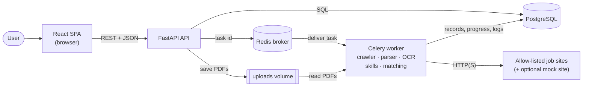

# 1. Introduction and Architecture

> **Status: Planned.** On 18 November 2026 the repository contains documentation only. There is no backend, frontend, test or Docker code yet. Everything in this LLD describes the **intended** implementation, derived from the High-Level Design. Section 1.2 explains the status labels.

## 1.1 Purpose of This LLD

The High-Level Design (HLD) says **which parts** the system has and **why**. This Low-Level Design (LLD) says **how each part works inside**:

- the modules and files the code is split into;
- the tables, columns and keys in the database;
- the API endpoints with their inputs and outputs;
- the step-by-step logic of background jobs, crawling, resume parsing, skill extraction and matching;
- how errors are handled and how everything is tested.

It is written for two readers: the developer who implements the platform, and an interviewer who wants the internals explained in plain language.

**Sources.** Every design statement comes from one of these documents:

| Source | Used for |
|---|---|
| `Intern_Assignment_Flexible_Brief.pdf` ("the brief") | Requirements, record fields, the scoring formula, deliverables |
| `docs/HLD_Job_Candidate_Matching_Platform_Full.md` (v1.2) | All design details. References such as "HLD §8.5" point to this file. |
| `docs/HLD_Job_Candidate_Matching_Platform.md` (v1.2) | Concise summary of the same design |
| `docs/ARCHITECTURE_DECISIONS.md` (v1.1) | Reasons behind decisions (ADR-001 to ADR-027) |

## 1.2 Implementation Status and Labels

Because no application code exists, the whole LLD is **Planned**. It adds **no** features, endpoints, tables or columns beyond the HLD. Where the HLD leaves a small detail open (a parameter name, a response shape, a timeout), the LLD makes the simplest consistent choice. Each such choice is labelled **LLD decision** and listed in Section 1.6.

| Label | Meaning |
|---|---|
| **Planned** | Specified in the HLD, not yet implemented. This applies to everything unless another label is shown. |
| **Optional** | Part of the design but not required, for example the mock job site. |
| **Could** | One of the brief's "Could" extras. Not part of the baseline build. |
| **Open** | A question the HLD itself leaves open for review (for example its open question O2). |
| **LLD decision** | A design choice made in this LLD because the brief and HLD leave the detail open. All of them are listed in Section 1.6; all were approved on 18 November 2026. |
| **Proposed name** | A name introduced by this LLD only to make the design concrete. |

## 1.3 Platform Overview

The platform does four things:

1. **Collects jobs.** A crawler visits allow-listed job websites breadth-first, and site-specific extractors turn each page into job records.
2. **Reads resumes.** Users upload PDF resumes. A parser extracts the candidate's name, contact details, title, skills, experience, education and summary, using OCR for scanned resumes.
3. **Matches both sides.** Every candidate is scored against every job on a 0–100 scale with the brief's formula. Each candidate sees their top 10 jobs and each job its top 10 candidates, with matched skills, missing skills and the reason for the score.
4. **Shows and exports results.** A web UI shows background-job progress and logs, searchable tables and match pages. Data can be exported as CSV or JSON.

Crawling, resume parsing and matching are slow, so they run as **background jobs** in a separate worker process. The user starts them from the UI and watches their progress.

## 1.4 Architecture at a Glance

The system is a **modular monolith with a background worker** (ADR-001). One Python codebase runs as two kinds of process: the **FastAPI API**, which answers the UI quickly, and the **Celery worker**, which does the slow work. The React single-page application (SPA) is a separate frontend that only talks to the API.

Five rules shape every part of the LLD:

| Rule | What it means in practice |
|---|---|
| PostgreSQL is the single source of truth | Status, progress, logs and results are written to and read from the database. The API never asks the worker directly (ADR-003). |
| Tasks carry only an ID | A Celery message holds only `background_job_id`. The worker loads everything else from the database (ADR-004). |
| Heavy work is asynchronous | Crawling, PDF parsing, OCR and matching never run inside an HTTP request. |
| One skill normalizer | Jobs, resumes and search filters use the same normalizer, so "JS" always means JavaScript. |
| Fail small | An error is contained to one page, one file or one record. It is logged and counted, and the job continues. |

## 1.5 Technology Stack

The stack is fixed by the HLD (HLD §7.5). The table shows what each technology does in this system and which process uses it.

| Technology | Purpose in this system | Used in |
|---|---|---|
| Python | Language of the whole backend | API, worker |
| FastAPI | HTTP routes, request validation, dependency injection, automatic OpenAPI docs at `/docs` | API |
| Pydantic | Validates and normalizes API requests, responses and every extracted job or candidate record | API, worker |
| SQLAlchemy | Maps tables to Python classes; builds parameterized SQL; manages sessions, transactions and upserts | API, worker |
| PostgreSQL | Stores all data; enforces keys, unique and check constraints; serves indexed queries | Database container |
| Celery | Runs `crawl`, `resume` and `match` tasks in worker processes, with time limits | Worker (and the API publishes tasks) |
| Redis | Message broker: holds task messages until a worker takes them | Redis container |
| httpx | Fetches pages and robots.txt; its mock transport makes crawler tests offline | Worker |
| BeautifulSoup | Parses HTML inside extractors; tolerates malformed pages | Worker |
| Playwright | Headless Chromium, only for pages that need JavaScript | Worker |
| PyMuPDF | Opens and checks PDFs; extracts text blocks with coordinates and font sizes; renders scanned pages to images | Worker |
| pdfplumber | Extracts tables, such as skills in a table; fallback word extraction | Worker |
| Tesseract (via pytesseract) | OCR for scanned, image-only pages | Worker |
| scikit-learn | TF-IDF text similarity, used only to break ties between equal scores | Worker |
| Custom scoring | The brief's explainable formula, written by hand | Worker |
| React + TypeScript | Component-based UI with typed API data | Frontend |
| Vite | Development server and production build for the frontend | Frontend |
| Tailwind CSS + shadcn/ui | Styling and ready-made components (tables, badges, progress bars, dialogs) | Frontend |
| Pytest | Unit and integration tests, all offline | Backend tests |
| Docker Compose | Starts every service with `docker compose up` | Deployment |

**Supporting libraries** (HLD §7.5): Alembic (database migrations), pydantic-settings (configuration from environment variables), email-validator (for Pydantic's `EmailStr`), the Python standard library (`urllib.robotparser`, `urllib.parse`, `ipaddress`, `csv`), React Router (page routing) and ReportLab (development only, for generating fake resume PDFs).

**Deployment** (HLD §16). `docker compose up` starts six services:

| Service | Role |
|---|---|
| `frontend` | Serves the built React app |
| `api` | FastAPI; applies database migrations on start |
| `worker` | Celery worker image that also contains Playwright Chromium and Tesseract |
| `db` | PostgreSQL |
| `redis` | Message broker |
| `mock-site` | **Optional.** A static and a JavaScript-rendered job page for a reproducible demo |

Only the frontend and API ports are published to the host. Two volumes keep data across restarts: `pgdata` for the database and `uploads` for resume PDFs. Configuration comes from environment variables documented in `.env.example`.

## 1.6 Design Decisions Made in This LLD

For each detail below, the brief and the HLD were checked first. They either did not specify it, or (LLD-4) specified it in two conflicting ways. Each decision is the simplest choice that fits the existing design. **All eleven were approved on 18 November 2026.**

LLD-4 and LLD-6 to LLD-10 were also copied into HLD v1.2, because each one settles a conflict, an open question or a visible behaviour in the HLD. The others are implementation details, so they stay in the LLD only.

| ID | Decision | Why | LLD section | In HLD v1.2 |
|---|---|---|---|---|
| LLD-1 | File names inside the planned folders | The HLD names folders and their responsibilities, not files | 2.2 | LLD only |
| LLD-2 | `GET /skills` uses the standard list response `{items, total, page, page_size}` and returns every skill on one page, sorted by name | HLD §12.1 gives every list response this shape; the taxonomy is a short list | 4.5 | LLD only |
| LLD-3 | `GET /health` returns `{"status", "database", "redis"}` with 200, or 503 in the standard error envelope; each check has a short timeout | Docker reads only the status code; a hanging database must fail the check, not hang it | 4.5 | LLD only |
| LLD-4 | Upload: 202 if at least one file is accepted (the others listed in `rejected_files`). If none is accepted: **422** with code `NO_VALID_FILES` and each file's reason (`FILE_TOO_LARGE` or `NOT_A_PDF`) in `details.rejected_files` | Follows HLD §9.2; the 413 and 415 rows in HLD v1.1 §12.1 contradicted it | 4.5 | §12.1, §14 |
| LLD-5 | Sorting with `sort` and `order`, with a small allow-list per list | The HLD requires an allow-list but names no parameters | 4.4 | LLD only |
| LLD-6 | `GET /jobs?max_required_years=N`: jobs whose minimum is at most N years, plus jobs with no minimum | Answers "which jobs suit someone with N years", and matches the scoring rule | 4.5 | §9.4 |
| LLD-7 | Heartbeat timeout `JOB_HEARTBEAT_TIMEOUT_SECONDS` = 600. The heartbeat is written at claim, after each item, and just before the match job's final write. | HLD open question O4 | 5.8 | §13.4, §13.7, §16.3, O4 |
| LLD-8 | A job queued longer than `JOB_QUEUED_TIMEOUT_SECONDS` (600) while no job has written a heartbeat is failed with a clear message. Lost tasks are not re-sent. | HLD open question O5 | 5.8 | §13.4 (diagram 08), §13.7, §14, §16.3, §16.4, O5 |
| LLD-9 | The UI polls every 2 seconds; `VITE_POLL_INTERVAL_MS` (default 2000) | HLD open question O4 | 8.5 | §8.1, O4 |
| LLD-10 | "Export match table" on the Candidates page, using the candidate filters | No page held this button, and "same as search" was unclear for matches | 8.2 | §8.1, §8.10, §12.6 |
| LLD-11 | "Present" in a date range means the parse date, which is passed into the calculation as a parameter | Not defined in the HLD; a parameter makes tests repeatable | 6.6 | LLD only |

## 1.7 Inconsistencies Found in the HLD

Two inconsistencies were found in HLD v1.1. Both were corrected in HLD v1.2 (approved 18 November 2026). Version 1.1 is kept in `docs/archive/v1.1/`.

| # | Where in the HLD | What was inconsistent | Correction in v1.2 |
|---|---|---|---|
| H1 | ER diagram "1 of 2" in §11.1 (`docs/diagrams/06-database-er-core`) vs the field list in §11.2 | The diagram showed `numeric score`; §11.2 says `DOUBLE PRECISION`, because ADR-017 never rounds scores before ranking | The diagram now shows `double score`; its source, PNG and SVG were regenerated |
| H2 | Explanation sentence in §10.8 vs the API example in §12.5 | §10.8's template includes each component's points; the §12.5 example left them out | The §12.5 example now uses the §10.8 template |
