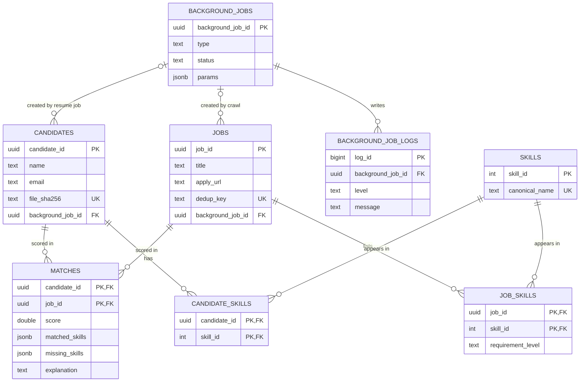

# 3. Database Design

> **Status: Planned.** Tables, columns, types and constraints are taken from HLD §11. Nothing here adds a column. The schema will be created with Alembic migrations, which the `api` service applies on start-up.

## 3.1 Overview

PostgreSQL holds eight tables in two groups:

- **Core data:** `jobs`, `candidates`, `skills`, `job_skills`, `candidate_skills`, `matches`.
- **Background processing:** `background_jobs`, `background_job_logs`.

Fields that the brief names keep the brief's names (for example `job_id`, `min_experience_years`, `parsed_with_ocr`). Each table maps to one SQLAlchemy model class in `app/models`.

## 3.2 ER Diagram

The diagram shows keys and a few main columns. Sections 3.3–3.5 list every column.



## 3.3 Core Tables

### `jobs`: one row per job posting

| Column | Type | Key / constraint | Notes |
|---|---|---|---|
| job_id | UUID | **PK** | Generated by the system. |
| title | text | NOT NULL | |
| company | text | | |
| location | text | | Its city part is used for location fit. |
| job_type | text | CHECK in (`full_time`, `part_time`, `contract`, `internship`, `temporary`, `unknown`) | |
| salary_min, salary_max | numeric | nullable; CHECK `salary_min ≤ salary_max` when both are set | Numbers, not text. |
| salary_currency, salary_period | text | nullable | |
| salary_text | text | nullable | Salary exactly as written on the site. |
| posted_date | date | nullable | ISO date. Null (with a logged warning) if the site shows none. |
| description | text | | Clean text with HTML removed. |
| min_experience_years | numeric | nullable; CHECK ≥ 0 | Present only if found in the posting. |
| apply_url | text | NOT NULL | Always an absolute URL. |
| source | text | NOT NULL | Extractor or site name, for example `fake_python_jobs`. |
| is_remote | boolean | | Used by location fit. |
| source_url | text | | The page the job was extracted from. |
| dedup_key | text | UNIQUE | See Section 3.6. |
| background_job_id | UUID | **FK** → `background_jobs`, nullable | The crawl that created or last updated the job. |
| created_at, updated_at | timestamptz | | |

`required_skills` and `nice_to_have_skills` are **not columns**. They come from `job_skills` and are returned by the API as arrays of canonical names.

### `candidates`: one row per parsed resume

| Column | Type | Key / constraint | Notes |
|---|---|---|---|
| candidate_id | UUID | **PK** | |
| name | text | | Placeholder from the file name, with a warning, if no name is found. |
| email | text | nullable; partial UNIQUE on `lower(email)` where not null | Validated with Pydantic `EmailStr`. |
| phone | text | nullable | Digits with an optional leading `+`. |
| city | text | nullable | |
| current_title | text | nullable | |
| years_experience | numeric | nullable; CHECK ≥ 0 | A number, not text. |
| education | JSONB | | List of entries (degree, institution, years where found). |
| summary | text | nullable | |
| source_file | text | NOT NULL | Original upload name, kept only as data. |
| parsed_with_ocr | boolean | NOT NULL | True if any page needed OCR. |
| file_sha256 | text | UNIQUE | Detects the same file uploaded twice. |
| stored_path | text | | Internal UUID path on the uploads volume. Never returned by the API. |
| resume_text | text | | Extracted text, used for TF-IDF and debugging. |
| parse_warnings | JSONB | | For example `["invalid email removed"]`. |
| background_job_id | UUID | **FK** → `background_jobs`, nullable | The latest resume job that parsed the candidate. A newer resume with the same email moves it to that job. |
| created_at, updated_at | timestamptz | | |

`skills` for a candidate come from `candidate_skills`.

### `skills`, `job_skills`, `candidate_skills`: the skill links

| Table | Column | Type | Key / constraint |
|---|---|---|---|
| `skills` | skill_id | integer | **PK** |
| | canonical_name | text | UNIQUE (for example `JavaScript`) |
| | category | text | For example `language`, `framework`, `database` |
| `job_skills` | job_id | UUID | **PK** (composite), **FK** → `jobs`, ON DELETE CASCADE |
| | skill_id | integer | **PK** (composite), **FK** → `skills` |
| | requirement_level | text | CHECK in (`required`, `nice_to_have`) |
| `candidate_skills` | candidate_id | UUID | **PK** (composite), **FK** → `candidates`, ON DELETE CASCADE |
| | skill_id | integer | **PK** (composite), **FK** → `skills` |

The `skills` table is synchronized from `app/skills/taxonomy.json` at start-up, so the database and the taxonomy file always agree.

### `matches`: one row per (candidate, job) pair

| Column | Type | Key / constraint | Notes |
|---|---|---|---|
| candidate_id | UUID | **PK** (composite), **FK** → `candidates`, ON DELETE CASCADE | |
| job_id | UUID | **PK** (composite), **FK** → `jobs`, ON DELETE CASCADE | |
| score | DOUBLE PRECISION | CHECK 0–100 | **Full precision, never rounded in storage.** Rounded to 2 decimals only for display (Part 7). |
| matched_skills | JSONB | | Array of `{skill, level}`. |
| missing_skills | JSONB | | Array of `{skill, level}`. |
| explanation | text | | Generated sentence. |
| score_breakdown | JSONB | | Counts, ratios and points per score component. |
| text_similarity | DOUBLE PRECISION | | TF-IDF cosine similarity, tie-breaker only. |
| computed_at | timestamptz | | Shown in the UI as "matches last computed". |

**Note on the `score` type.** `DOUBLE PRECISION` matches HLD §11.2 and, since HLD v1.2, the HLD's ER diagram as well (Section 1.7, H1). A rounded column such as `numeric(5,2)` would let rounding affect ranking.

Example `score_breakdown` (shape only):

```json
{
  "required":     { "matched": 3, "total": 4, "ratio": 0.75, "points": 52.5 },
  "nice_to_have": { "matched": 1, "total": 2, "ratio": 0.5, "points": 7.5 },
  "experience":   { "candidate_years": 2, "minimum": 3, "fit": 0.6667, "points": 6.6667 },
  "location":     { "candidate_city": "Pune", "job_location": "Pune, India", "fit": 1, "points": 5.0 }
}
```

## 3.4 Background-Processing Tables

### `background_jobs`: one row per crawl, resume or match run

| Column | Type | Key / constraint | Notes |
|---|---|---|---|
| background_job_id | UUID | **PK** | |
| type | text | NOT NULL; CHECK in (`crawl`, `resume`, `match`) | |
| status | text | NOT NULL; CHECK in (`queued`, `running`, `completed`, `failed`, `cancelled`) | Lifecycle from the brief (Part 5). |
| params | JSONB | | Crawl configuration, or for a resume job the stored files: `upload_id`, `stored_file` (`<upload_id>.pdf`) and `size_bytes` of each. Never the original file names. For a match run: its `weights` (Part 7, Section 7.4) and, when a crawl queued it, `after_crawl` (that crawl's ID, Section 7.1). |
| progress_current, progress_total | integer | CHECK `progress_current ≥ 0` | |
| items_succeeded, items_failed | integer | | Counters shown in the UI. |
| cancel_requested | boolean | | Set by the API; checked by the worker between items. |
| error_message | text | | Job-level failure reason. |
| celery_task_id | text | | Used to revoke a task that is still queued. |
| created_at, started_at, finished_at, heartbeat_at | timestamptz | | `heartbeat_at` reveals a worker that stopped. |

### `background_job_logs`: timestamped log lines

| Column | Type | Key / constraint | Notes |
|---|---|---|---|
| log_id | BIGSERIAL | **PK** | Always increasing, so the UI can ask for "logs after ID N". |
| background_job_id | UUID | **FK** → `background_jobs`, ON DELETE CASCADE | |
| created_at | timestamptz | default `now()` | The timestamp the brief requires. |
| level | text | | `DEBUG`, `INFO`, `WARNING` or `ERROR`. |
| message | text | | Human-readable. Never contains uploaded file names, resume content or personal data; a file is named by its upload ID. |
| context | JSONB | | For example `{"url": "...", "attempt": 2}` or `{"upload_id": "7d2c1a9e-…", "page": 2}`. |

## 3.5 Relationships and Keys

| Relationship | Type | Implemented by |
|---|---|---|
| Background job → log lines | One-to-many | `background_job_logs.background_job_id` |
| Background job → jobs it created | One-to-many, optional | `jobs.background_job_id` |
| Background job → candidates it created | One-to-many, optional | `candidates.background_job_id` |
| Jobs ↔ skills | Many-to-many, with `requirement_level` | `job_skills` |
| Candidates ↔ skills | Many-to-many | `candidate_skills` |
| Candidates ↔ jobs | Many-to-many, with score and explanation | `matches` |

- **UUID primary keys** for jobs, candidates and background jobs (ADR-021). They can be generated anywhere, cannot be guessed, and do not reveal how many records exist. This matters because resumes are personal data.
- **Integer keys** for `skills` (small lookup table) and `background_job_logs` (append-only and ordered).
- Deleting a job or candidate deletes its skill links and matches (`ON DELETE CASCADE`).

## 3.6 Duplicate Prevention

| Entity | Duplicate rule | How it is enforced |
|---|---|---|
| Job | `dedup_key` = the normalized `apply_url`; if there is none, SHA-256 of normalized `source + title + company + location` | `INSERT … ON CONFLICT (dedup_key) DO UPDATE`. Newer non-null values overwrite older ones, so a job seen on a listing page and later on its detail page becomes one complete record. |
| Candidate, same file | SHA-256 of the file bytes | UNIQUE `file_sha256`; a re-upload is logged as "duplicate file, skipped". |
| Candidate, same person with a new file | Same email, ignoring case | Upsert by email; the newer resume replaces the parsed fields. |
| Skill links | Composite primary keys | The same link cannot be inserted twice. |
| Matches | Composite primary key `(candidate_id, job_id)` | One row per pair; each match run replaces all rows. |

## 3.7 Indexes

| Index | Used by |
|---|---|
| `matches (candidate_id, score DESC)` | Top 10 jobs for a candidate |
| `matches (job_id, score DESC)` | Top 10 candidates for a job |
| `job_skills (skill_id)`, `candidate_skills (skill_id)` | Search by skill |
| Trigram GIN indexes (`pg_trgm`) on `jobs.title`, `jobs.company`, `candidates.name`, `candidates.current_title` | Case-insensitive text search |
| `jobs (posted_date)`, `jobs (location)`, `candidates (city)` | Filters and sorting |
| `background_jobs (status, created_at)` | Background-job list and polling |
| `background_job_logs (background_job_id, log_id)` | Fetching only new log lines |

## 3.8 How the Code Uses the Database

- **Sessions.** The API opens one SQLAlchemy session per request (through a FastAPI dependency) and closes it afterwards. Each worker task opens its own sessions and keeps transactions short.
- **Parameterized SQL only.** All queries go through SQLAlchemy with bound parameters. Sort fields come from an allow-list, so user input never becomes SQL text.
- **Validation layers.** Pydantic validates data before it is written. The database constraints above are the final safety net.
- **Atomic match replacement.** A match run deletes the old `matches` rows and inserts the new ones in **one transaction**, so readers never see a half-written result (Part 7).
