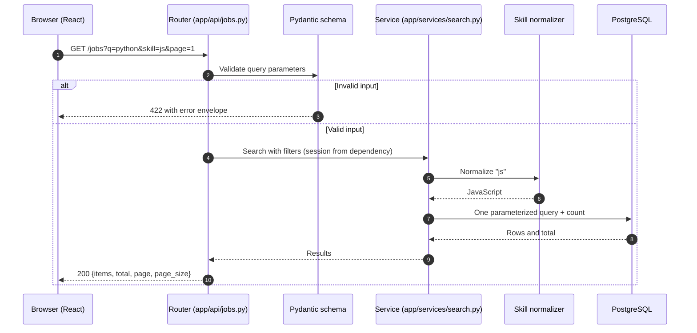

# 4. Backend and API Design

> **Status: Planned.** Endpoints, parameters and examples come from HLD §12; the internal layering comes from HLD §8.2. File names follow Part 2.

## 4.1 Backend Layers

The FastAPI backend is split into layers. Each layer has one job, so code is easy to test and to explain.

| Layer | Location | Responsibility | Rule |
|---|---|---|---|
| Routers | `app/api/` | Define the endpoints; read path, query and body; call a service; return a response schema | Thin: no business logic, no SQL |
| Schemas | `app/schemas/` | Pydantic models for requests, responses and extracted records | The contract with the frontend |
| Services | `app/services/` | Business rules that need the database: background-job control, search, match queries, export | Use a session passed in by the router |
| Domain modules | `app/crawler`, `extractors`, `resumes`, `skills`, `matching` | Pure logic shared with the worker | Never import FastAPI |
| Persistence | `app/models/`, `app/db/` | SQLAlchemy models, engine, session factory | The only layer that knows table structure |

## 4.2 Important Modules

| Module | What it does |
|---|---|
| `main.py` | Creates the FastAPI app. Registers the routers, the CORS middleware (only the configured frontend origin is allowed) and the exception handlers that turn every error into the standard error envelope (Section 4.4). FastAPI generates `/openapi.json` and `/docs` from the routers and schemas. |
| `config.py` | Reads settings from environment variables with pydantic-settings: database and Redis URLs, upload folder and 20 MB limit, crawler settings, OCR settings, scoring weights (HLD §16.3), and the stale-job timeouts (Section 5.8). |
| `db/` | Creates the SQLAlchemy engine and a session factory. A FastAPI dependency opens **one session per request** and always closes it. |
| `schemas/` | Request models validate input, for example a crawl request needs an http(s) `seed_url` and positive, bounded `max_depth` and `max_pages`. Response models shape output, for example a list response is always `{items, total, page, page_size}`. `JobRecord` and `CandidateRecord` validate extracted data before it is saved (Parts 5 and 6). |
| `models/` | One SQLAlchemy class per table in Part 3, with relationships for the skill links and matches. |
| `services/background_jobs.py` | Creates a background job, publishes its Celery task, lists jobs, reads logs and applies the cancel rules (Part 5). |
| `services/search.py` | Builds one filtered, paginated query for `/jobs` or `/candidates`. Skill filters go through the skill normalizer first. |
| `services/matches.py` | Reads the top 10 matches for a candidate or a job in the ranking order of Part 7. |
| `services/export.py` | Reuses the search filters and streams CSV or JSON (Section 4.6). |

## 4.3 How an API Request Is Processed

Example: the user searches jobs for "python" with the skill filter "js".



Step by step:

1. **Routing.** FastAPI matches the method and path to a router function. CORS middleware rejects calls from other origins.
2. **Validation.** FastAPI validates path, query and body against the Pydantic schema. Invalid input stops here with **422**.
3. **Dependencies.** FastAPI injects a database session (and settings) into the router function.
4. **Service call.** The router calls one service function. The service applies the business rules and runs SQLAlchemy queries with bound parameters.
5. **Response.** The router returns data, and FastAPI serializes it through the response schema to JSON.
6. **Errors.** Known errors (unknown ID, invalid state) are raised as application errors and converted to the error envelope with the right status code. Unexpected errors return a generic message; details go only to the server logs.
7. **Clean-up.** The session is closed when the request ends.

**Requests that start background work** follow the same path, but the service does not do the work itself. It saves a `queued` background job, publishes its ID to Redis and returns **202 Accepted** at once (Part 5).

## 4.4 API Conventions

| Topic | Convention |
|---|---|
| Format | JSON over HTTP; `multipart/form-data` for resume upload; CSV or JSON files for exports |
| Paths | No version prefix (ADR-027). `/jobs` means job postings; asynchronous work uses `/background-jobs` (ADR-002). |
| Long operations | Return **202 Accepted** with the background-job resource; the client polls it. |
| Pagination | `page` and `page_size` (bounded maximum). Every list returns `{items, total, page, page_size}`. |
| Sorting | `sort` (a field from the allow-list below) and `order` (`asc` or `desc`) |
| CORS | Only the configured frontend origin |
| Documentation | `/openapi.json` and interactive `/docs`, generated by FastAPI |

**Sorting** (**LLD decision** LLD-5). The HLD requires an allow-list of sort fields but does not name the parameters. The allow-list is kept small:

| List | Allowed `sort` values | Default order |
|---|---|---|
| `GET /jobs` | `posted_date`, `title` | `posted_date`, `desc` (newest first) |
| `GET /candidates` | `name`, `years_experience` | `name`, `asc` |
| `GET /background-jobs` | No sort parameter | Newest first (`created_at` descending) |
| `GET /jobs/{id}/matches`, `GET /candidates/{id}/matches` | No sort parameter | Ranking order (Section 7.10) |

- Any other `sort` or `order` value gives 422.
- Missing values (a job without a posted date, a candidate without years of experience) always come last.
- Rows with equal values are ordered by ID, so moving between pages never repeats or skips a row.
- Exports use the same sort as the list they export.

**Error envelope.** Every error has the same shape:

```json
{ "error": { "code": "NO_VALID_FILES", "message": "No file was accepted, so no job was created.",
  "details": { "rejected_files": [ { "file": "cv_07.pdf", "code": "NOT_A_PDF", "message": "File is not a PDF document." } ] } } }
```

The example is a resume upload in which no file was accepted, so the whole request fails with `NO_VALID_FILES`. A single rejected file is not an error response of its own. It is listed with its own code (`FILE_TOO_LARGE` or `NOT_A_PDF`): in `rejected_files` of a 202 response when other files were accepted, or in `details.rejected_files` as above (Section 4.5).

| Status | Used for |
|---|---|
| 200 / 202 | Success / accepted for background processing |
| 404 | Unknown ID |
| 409 | Conflict, for example cancelling a job that already finished |
| 422 | Request validation failure, or a resume upload in which no file is accepted (Section 4.5) |
| 503 | Database or broker unavailable |

The API does not use 413 or 415. An oversized or non-PDF upload is reported per file, inside the response (Section 4.5).

## 4.5 Endpoint Reference

| Method | Path | Purpose | Inputs | Success response |
|---|---|---|---|---|
| POST | `/background-jobs/crawl` | Start a crawl | Body: `seed_url`, `max_depth`, `max_pages`, `allowed_domains` (optional, defaults to the seed host), `extractor` (optional) | 202 background job |
| POST | `/background-jobs/resume` | Upload PDFs and start parsing | Multipart: one or more `files` | 202 background job with `accepted_files` and `rejected_files`; 422 if no file is accepted |
| POST | `/background-jobs/match` | Recompute all matches | None | 202 background job |
| GET | `/background-jobs` | List background jobs | Query: `type`, `status`, `page`, `page_size` | 200 list |
| GET | `/background-jobs/{id}` | One job's status, progress, counters and parameters | Path: `id` | 200 job, or 404 |
| POST | `/background-jobs/{id}/cancel` | Cancel a job | Path: `id` | 200 (queued job cancelled), 202 (running job asked to stop), 409 (already finished) |
| GET | `/background-jobs/{id}/logs` | Log lines, oldest first | Query: `after_id` (only newer lines), `level` | 200 `{items, next_after_id}` |
| GET | `/jobs` | Search jobs | Query: `q`, `skill`, `location`, `job_type`, `max_required_years`, `sort`, `order`, `page`, `page_size` | 200 list |
| GET | `/jobs/{id}` | One job | Path: `id` | 200 job, or 404 |
| GET | `/jobs/{id}/matches` | Top candidates for a job (required path) | Query: `limit` (default and maximum 10) | 200 ranked matches |
| GET | `/candidates` | Search candidates | Query: `q`, `skill`, `city`, `sort`, `order`, `page`, `page_size` | 200 list |
| GET | `/candidates/{id}` | One candidate | Path: `id` | 200 candidate, or 404 |
| GET | `/candidates/{id}/matches` | Top jobs for a candidate (required path) | Query: `limit` (default and maximum 10) | 200 ranked matches |
| GET | `/exports/jobs` | Download jobs | Query: `format` (`csv` or `json`) + the `/jobs` filters | 200 file |
| GET | `/exports/candidates` | Download candidates | Query: `format` + the `/candidates` filters | 200 file |
| GET | `/exports/matches` | Download the match table | Query: `format`, `top` (default 10 per candidate) + the `/candidates` filters | 200 file |
| GET | `/skills` | Canonical skills for filter drop-downs | None | 200 list, all skills on one page |
| GET | `/health` | Database and Redis reachability, for Docker health checks | None | 200 `{"status", "database", "redis"}`, or 503 error envelope |
| GET | `/openapi.json`, `/docs` | API description and interactive docs | None | Generated by FastAPI |

**Background-job resource.** Creation and list responses contain `background_job_id`, `type`, `status`, `progress` (`current`, `total`, `percent`) and `created_at`. List items add `items_succeeded`, `items_failed`, `started_at` and `finished_at`. The detail endpoint also returns the job's parameters and, for a failed job, its reason, because the detail page shows them (Part 8).

**Experience filter** (**LLD decision** LLD-6). `max_required_years=3` returns jobs whose `min_experience_years` is at most 3, plus jobs with no minimum. It answers "which jobs suit someone with 3 years of experience". Including jobs without a minimum matches the scoring rule, where such jobs give full experience points (Section 7.5). The HLD names only this one experience filter, so `/candidates` has none. HLD v1.2 §9.4 uses the same definition.

**Match export filters** (**LLD decision** LLD-10). Every export takes the search filters (HLD §8.10). The match table lists the top jobs *per candidate*, so `/exports/matches` takes the `/candidates` filters (`q`, `skill`, `city`). With no filters, it exports every candidate's top 10: the `samples/` deliverable. HLD v1.2 §8.10 and §12.6 state the same rule.

**Upload status codes** (**LLD decision** LLD-4). The upload endpoint checks each file separately. Each rejected file gets a reason code: `FILE_TOO_LARGE` or `NOT_A_PDF`. The status code then describes the request as a whole:

| Result of the upload | Status | Body |
|---|---|---|
| At least one file accepted | 202 | The new background job, with `accepted_files` and `rejected_files` |
| No file accepted, for any reason | 422 | Error envelope with code `NO_VALID_FILES`; `details.rejected_files` gives each file's reason |
| No files sent, or more files than the per-request limit | 422 | Validation error |

This follows HLD §9.2: bad files are rejected one by one, good files still start a job, and a request with no valid file returns 422 without creating a job. HLD v1.2 §12.1 and §14 say the same. Corrupt and encrypted PDFs pass this upload check and fail later, in the worker (Part 6).

## 4.6 Request and Response Examples

**Start a crawl**

```http
POST /background-jobs/crawl
Content-Type: application/json

{ "seed_url": "https://realpython.github.io/fake-jobs/", "max_depth": 2, "max_pages": 50,
  "allowed_domains": ["realpython.github.io"], "extractor": null }
```

```http
HTTP/1.1 202 Accepted

{ "background_job_id": "7f3c2a9e-1b44-4c55-9a51-0c9f3e7d2b10", "type": "crawl", "status": "queued",
  "progress": { "current": 0, "total": 50, "percent": 0 }, "created_at": "2026-11-10T10:15:02Z" }
```

**Upload resumes** (`multipart/form-data` with `files=@cv_01.pdf`, `files=@cv_02_two_column.pdf`, `files=@notes.txt`)

```http
HTTP/1.1 202 Accepted

{ "background_job_id": "b2d8e0c1-7a1f-4e0e-8a0b-5f0e2b6c9d33", "type": "resume", "status": "queued",
  "accepted_files": ["cv_01.pdf", "cv_02_two_column.pdf"],
  "rejected_files": [ { "file": "notes.txt", "code": "NOT_A_PDF", "message": "File is not a PDF document." } ] }
```

**Upload with no acceptable file** (`files=@notes.txt`, `files=@cv_09.pdf`, where cv_09.pdf is 25 MB)

```http
HTTP/1.1 422 Unprocessable Entity

{ "error": { "code": "NO_VALID_FILES", "message": "No file was accepted, so no job was created.",
  "details": { "rejected_files": [
    { "file": "notes.txt", "code": "NOT_A_PDF", "message": "File is not a PDF document." },
    { "file": "cv_09.pdf", "code": "FILE_TOO_LARGE", "message": "cv_09.pdf is larger than 20 MB." } ] } } }
```

**Cancel.** `POST /background-jobs/7f3c…/cancel` returns `202 {"status": "running", "cancel_requested": true}` for a running job, or `200 {"status": "cancelled"}` for a queued job.

**Read new log lines**: `GET /background-jobs/7f3c…/logs?after_id=120`

```json
{ "items": [
    { "log_id": 121, "created_at": "2026-11-10T10:15:41.204Z", "level": "INFO",
      "message": "Fetched https://realpython.github.io/fake-jobs/jobs/senior-python-developer-0.html (200)" },
    { "log_id": 122, "created_at": "2026-11-10T10:15:42.010Z", "level": "WARNING",
      "message": "Timeout on attempt 1/3, retrying in 2.0 s", "context": { "attempt": 1 } } ],
  "next_after_id": 122 }
```

**Search jobs**: `GET /jobs?q=python&skill=js&location=pune&page=1&page_size=25`

```json
{ "items": [ {
    "job_id": "a91c5d2e-0f7b-4f3a-9d1e-2b8c7a6e5f40", "title": "Backend Python Developer",
    "company": "Acme Analytics", "location": "Pune, India", "job_type": "full_time",
    "salary": { "min": 900000, "max": 1400000, "currency": "INR", "period": "year" },
    "posted_date": "2026-11-03",
    "required_skills": ["Python", "FastAPI", "PostgreSQL", "Docker"],
    "nice_to_have_skills": ["Redis", "Kubernetes"], "min_experience_years": 3,
    "apply_url": "https://jobs.example.com/backend-python-developer", "source": "mock_static" } ],
  "total": 1, "page": 1, "page_size": 25 }
```

`GET /candidates` returns the same envelope with the candidate fields from the brief (`candidate_id`, `name`, `email`, `phone`, `city`, `current_title`, `skills`, `years_experience`, `education`, `summary`, `source_file`, `parsed_with_ocr`).

**Top jobs for a candidate**: `GET /candidates/{id}/matches` (shortened: one item, skill lists trimmed; the full example is in Part 7)

```json
{ "candidate_id": "5b1e9c3a-2d4f-4a6b-8c7d-9e0f1a2b3c4d", "computed_at": "2026-11-10T11:02:44Z",
  "items": [ {
    "rank": 1, "job_id": "a91c5d2e-0f7b-4f3a-9d1e-2b8c7a6e5f40",
    "title": "Backend Python Developer", "company": "Acme Analytics", "score": 71.67,
    "matched_skills": [ { "skill": "Python", "level": "required" }, { "skill": "Redis", "level": "nice_to_have" } ],
    "missing_skills": [ { "skill": "Docker", "level": "required" }, { "skill": "Kubernetes", "level": "nice_to_have" } ],
    "text_similarity": 0.42,
    "explanation": "Score 71.67/100. Has 3 of 4 required skills (52.50 pts; missing Docker). ..." } ] }
```

The full response also has a `breakdown` per item (Part 7). `score` is a **2-decimal display value**; the order of `items` and each `rank` come from the full-precision score (Part 7). `GET /jobs/{id}/matches` has the same shape, with candidate details (`candidate_id`, `name`, `current_title`, `city`) instead of job details.

**Skills for the filter drop-down**: `GET /skills` (**LLD decision** LLD-2). The response has the standard list shape (HLD §12.1). Because the taxonomy is a short, curated list, every skill is returned on one page, sorted by name, and the endpoint takes no paging parameters. The API does not return aliases, because the server normalizes whatever the user types in a filter.

```json
{ "items": [
    { "skill": "JavaScript", "category": "language" },
    { "skill": "PostgreSQL", "category": "database" },
    { "skill": "React", "category": "framework" } ],
  "total": 3, "page": 1, "page_size": 3 }
```

**Health check**: `GET /health` (**LLD decision** LLD-3). Docker's health check reads only the status code; the body helps a person see what is wrong. The database check (`SELECT 1`) and the Redis check (`PING`) each have a short timeout, so a hanging service makes the check fail quickly instead of hanging it.

```http
HTTP/1.1 200 OK

{ "status": "ok", "database": "ok", "redis": "ok" }
```

```http
HTTP/1.1 503 Service Unavailable

{ "error": { "code": "SERVICE_UNAVAILABLE", "message": "Service temporarily unavailable.",
  "details": { "database": "ok", "redis": "down" } } }
```

**Exports**

| Request | Result |
|---|---|
| `GET /exports/jobs?format=csv&q=python` | `jobs_<timestamp>.csv`, filtered exactly like `/jobs` |
| `GET /exports/candidates?format=json` | `candidates_<timestamp>.json` (a JSON array) |
| `GET /exports/matches?format=csv&top=10` | One row per (candidate, rank, job, score, matched skills, missing skills, explanation), for every candidate: the `samples/` deliverable. Adding `/candidates` filters such as `&city=pune` limits it to those candidates. |

Exports are streamed row by row from a server-side cursor, so memory use stays flat. They are sent with a `Content-Disposition: attachment` header.

| Concern | CSV | JSON |
|---|---|---|
| Skill lists | Joined with `"; "` in one cell | Arrays |
| Matched/missing skills | `"Python (required); Redis (nice-to-have)"` | Arrays of `{skill, level}` |
| Dates | ISO 8601 | ISO 8601 strings |
| Safety | Cells starting with `=`, `+`, `-` or `@` get a leading `'` to prevent formula injection | Not needed |
