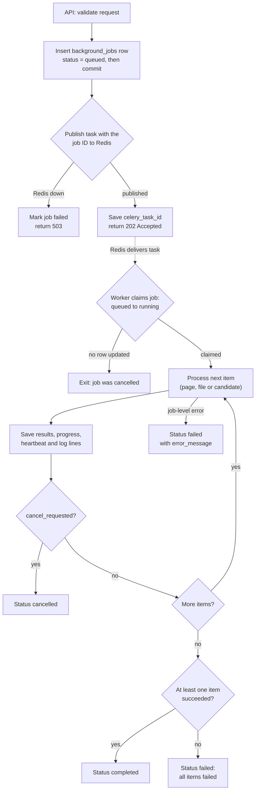
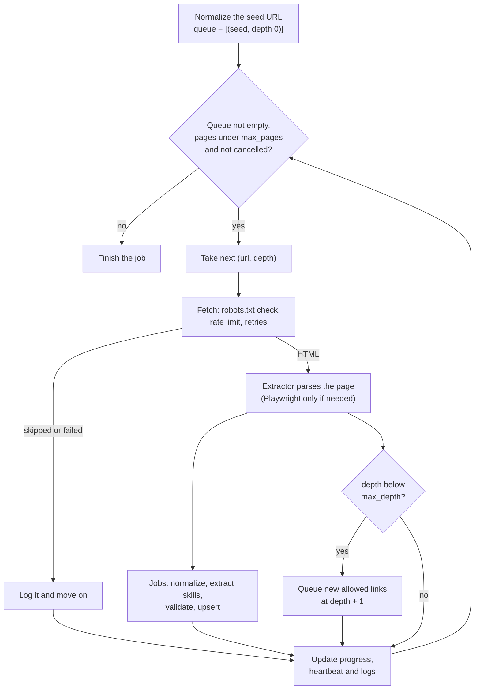

# 5. Background Jobs and Crawler

> **Status: Implemented** (Phases 1–8, completed 22 November 2026). This part was written as the design before the code; the code follows it, and later additions are marked with their dates.
>
> Sections 5.1–5.8 cover background job processing; Sections 5.9–5.17 cover the crawler.

## 5.1 Celery, Redis and the Worker

| Part | Role | Kitchen analogy |
|---|---|---|
| Celery client (inside the API) | Turns "run task `crawl` for job X" into a message and publishes it | Writing an order ticket |
| Redis (broker) | Holds messages in a queue until a worker takes one | The ticket rail |
| Celery worker | A separate process that takes messages and runs the matching Python function | The cook |
| PostgreSQL | Stores every job's status, progress, logs and results | The order book everyone can read |

There are three task types: `crawl`, `resume` and `match`. Each task receives **only** `background_job_id`. The worker loads the job's parameters from the database. This keeps messages small and keeps personal data out of Redis (ADR-004).

Worker settings: `prefetch_multiplier = 1`, so a long task does not reserve tasks that a free worker could run. Each task type also has a soft time limit, so a hung task is stopped.

## 5.2 Job Lifecycle

The brief requires the states **queued → running → completed / failed / cancelled**. They are stored in lower case.

| From | To | When |
|---|---|---|
| (new) | `queued` | The API creates the job |
| `queued` | `running` | A worker claims the job |
| `queued` | `cancelled` | The user cancels before the job starts |
| `queued` | `failed` | The task could not be published to Redis, or no worker picked it up (Section 5.8) |
| `running` | `completed` | Processing finished, and at least one item succeeded |
| `running` | `failed` | A job-level error, every item failed, the time limit was hit, or the worker was lost |
| `running` | `cancelled` | The worker sees the cancel flag |

`completed`, `failed` and `cancelled` are final; they never change again.

**Every state change is a conditional update** (ADR-006). For example, the worker claims a job like this:

```sql
UPDATE background_jobs SET status = 'running', started_at = now(), heartbeat_at = now()
WHERE background_job_id = :id AND status = 'queued'
```

If no row changes, someone cancelled the job while it waited in the queue, so the worker exits without doing any work. This removes the race between "cancel" and "start".

## 5.3 Workflow



## 5.4 Creating a Job (API Side)

Code: `services/background_jobs.py`.

1. Validate the request (crawl settings, or the uploaded files: Part 6).
2. Insert the `background_jobs` row with `status = 'queued'`, `type` and `params` (crawl settings; the stored files by upload ID and storage name, without original file names; or a match run's weights, Part 7, Section 7.4), then **commit**. Committing first guarantees that the worker can always find the row.
3. Publish the Celery task with the single argument `background_job_id`, and store the returned `celery_task_id`.
4. If publishing fails, set the job to `failed` ("could not be queued") and return 503.
5. Return **202 Accepted** with the job resource. The UI starts polling (Part 8).

## 5.5 Executing a Job (Worker Side)

Code: `worker/tasks.py` holds three thin task functions. Each one:

1. Loads the job row by ID and **claims** it (Section 5.2). If the claim fails, it exits.
2. Calls the domain module: the crawler (Sections 5.9–5.17), the resume parser (Part 6) or the matching engine (Part 7).
3. Processes **one item at a time**: one page, one file, or one candidate scored against all jobs. Each item runs inside its own `try/except`, so one bad item is logged and counted, and the loop continues.
4. After each item, in one short transaction: updates `progress_current`, the `items_succeeded` / `items_failed` counters and `heartbeat_at`, and writes log lines. It then reads `cancel_requested`.
5. Sets the final status and `finished_at` (Section 5.8).

After a crawl has its final status, the crawl task may queue a match run (automatic re-matching, Part 7, Section 7.1). It reads the final status again first, and nothing it does changes that status.

## 5.6 Progress and Logs

| Job type | `progress_total` | `progress_current` goes up after |
|---|---|---|
| `crawl` | `max_pages`; set to 100% at the end if the crawl runs out of pages early | each processed page |
| `resume` | number of accepted files | each processed file |
| `match` | number of candidates | each candidate scored against all jobs |

- **Logs** are rows in `background_job_logs`, with a server timestamp, a level (`DEBUG`, `INFO`, `WARNING`, `ERROR`), a message and optional JSON context.
- All task code writes logs through one helper, `log(job_id, level, message, **context)`, in `worker/progress.py`, so the format is always the same.
- Logs contain URLs, upload IDs, page numbers and error reasons, but **never uploaded file names, resume content or personal data**. A resume file is named by the first 8 characters of its upload ID.
- Typical lines: `Fetched … (200)`, `Extracted 12 jobs`, `Skipped … disallowed by robots.txt`, `Resume upload 7d2c1a9e: page 1: OCR completed (543 characters).`, `Resume upload 7d2c1a9e: parsed (created a new candidate, OCR on page 1).`, `Resume upload 3f81b0c2 failed: the file is password-protected.`

## 5.7 Cancellation

| Status when the user cancels | What happens | Response |
|---|---|---|
| `queued` | The API sets `cancelled` with a conditional update and asks Celery to revoke the queued task (best effort). If the task still arrives, the worker's claim fails and it exits. | 200 |
| `running` | The API sets `cancel_requested = true`. The worker checks the flag between items, stops cleanly, logs "Cancelled by user after N items" and sets `cancelled`. Saved records are kept. | 202 |
| `completed`, `failed`, `cancelled` | Nothing changes. | 409 |

Cancellation is **cooperative**: the worker stops itself between items, instead of being killed mid-write. A cancelled match job leaves the previous match results untouched, because results are only replaced at the very end (Part 7).

## 5.8 Completion and Failure Rules

| Situation | Final status |
|---|---|
| All items processed, at least one succeeded | `completed`, with succeeded and failed counts shown |
| All items failed (for example every PDF is corrupt) | `failed` with "all N items failed" |
| Job-level error (seed URL disallowed by robots.txt, uploads volume unreadable, unexpected error outside the item loop) | `failed`, `error_message` set, ERROR log line |
| Soft time limit exceeded | `failed` with "time limit exceeded"; partial results are kept |
| Worker lost (container killed, out of memory) | The job stays `running`, but its `heartbeat_at` stops changing. The stale-job check below sets it to `failed` ("worker stopped unexpectedly"). |
| Job never picked up (Redis lost the message, or no worker is available) | The stale-job check below sets it to `failed` ("No worker picked up this job within 10 minutes. The worker may be stopped, or the task was lost. Start it again."). |

Resuming a stopped crawl is a **Could** feature; it is deferred (not part of this version) and is not attempted.

**Stale-job check.** Two conditional updates run together on worker start-up and whenever the API lists background jobs (HLD §13.7). Both are safe to run at any time and from several places, because they change only rows that still match their conditions.

*1. Lost worker* (**LLD decision** LLD-7). A `running` job whose heartbeat is older than `JOB_HEARTBEAT_TIMEOUT_SECONDS` (default 600, that is 10 minutes) is failed:

```sql
UPDATE background_jobs
SET status = 'failed', finished_at = now(), error_message = 'Worker stopped unexpectedly.'
WHERE status = 'running' AND heartbeat_at < now() - :heartbeat_timeout
```

The heartbeat is written when the job is claimed, after every item, and, for a match job, just before its final "replace all matches" transaction (Section 7.9). That transaction is the one long step that does not end an item. So the timeout only needs to be longer than the slowest **single** step: one page with all its retries and browser rendering, one resume with OCR, or the final match write. Ten minutes leaves a wide margin, and a dead worker is still noticed within minutes. The value is a configuration setting, not a performance target.

*2. Job never picked up* (**LLD decision** LLD-8). HLD v1.1 said that jobs stuck in `queued` because Redis lost their messages are marked `failed`, but gave no rule; HLD v1.2 §13.7 and §16.4 now contain this one. A queued job is failed when it has waited longer than `JOB_QUEUED_TIMEOUT_SECONDS` (default 600) **and the worker has shown no sign of life for that whole time**, meaning no job has written a heartbeat during that period:

```sql
UPDATE background_jobs
SET status = 'failed', finished_at = now(),
    error_message = 'No worker picked up this job within 10 minutes. '
                    'The worker may be stopped, or the task was lost. Start it again.'
WHERE status = 'queued'
  AND created_at < now() - :queued_timeout
  AND NOT EXISTS (SELECT 1 FROM background_jobs
                  WHERE heartbeat_at > now() - :queued_timeout)
```

- **Why the idle condition:** with one worker, a job can legitimately wait in `queued` behind a long crawl. That crawl keeps writing heartbeats, so the waiting job is left alone. An idle worker takes a queued job within seconds, so a job that waits for minutes with no heartbeat anywhere has lost its message, or no worker is running.
- **Why heartbeats rather than finish times:** jobs failed by this check never wrote a heartbeat, so they do not count as activity. Otherwise, failing one lost job would delay the check for the next one.
- **If the message arrives later anyway:** the worker's claim (Section 5.2) finds the job no longer `queued`, so it exits without doing anything. A job is never processed twice.
- **The message text** shows the configured timeout in minutes ("10 minutes" with the default).
- **Rejected alternatives:** reading Redis's queue to compare messages with jobs (fiddly, and tied to Celery's internal message format), and automatically re-sending lost tasks (not part of the approved design; the user starts the job again).

## 5.9 Crawl Inputs and Validation

The API validates the crawl request before creating the job:

| Field | Rule |
|---|---|
| `seed_url` | Well-formed `http` or `https` URL, and must pass the allow-list and SSRF checks (Section 5.12) |
| `max_depth`, `max_pages` | Positive integers within configured maximums (for example `CRAWLER_MAX_PAGES_LIMIT`) |
| `allowed_domains` | Optional. Defaults to the seed URL's host. |
| `extractor` | Optional. Forces a specific extractor plug-in. |

If the **seed** URL is disallowed by robots.txt, the worker fails the job at once with a clear reason.

## 5.10 BFS Crawl Loop

Breadth-first search (BFS) visits pages level by level: the seed (depth 0), then pages linked from it (depth 1), and so on. On job boards the listing pages are usually closest to the seed, so BFS reaches the most useful pages before `max_pages` runs out. Code: `crawler/frontier.py`.

```text
frontier = queue[(normalize(seed_url), 0)]          # FIFO queue of (url, depth)
visited  = {normalize(seed_url)}                    # URLs already queued or fetched
pages_processed = 0

while frontier not empty and pages_processed < max_pages and not cancel_requested:
    url, depth = frontier.pop_left()
    page = fetch(url)                     # robots.txt + rate limit + retries inside
    pages_processed += 1                  # failed pages count too
    if page failed: log warning; continue # one bad page never crashes the job
    result = extractor_for(url).parse(url, page.html)   # jobs + links
    save(result.jobs)                     # pipeline in Section 5.17
    if depth < max_depth:
        for link in result.links:
            n = normalize(absolute(link, base=url))
            if n not in visited and allowed(n):
                visited.add(n); frontier.append((n, depth + 1))
```

**Page limit.** When the loop stops because `pages_processed` reached `max_pages` while URLs are still queued, the crawl still ends `completed`, and its summary line is followed by a WARNING: "Stopped at the page limit (max_pages N): M discovered pages were not visited …". Jobs seen only on a listing page then have no description, so no skills, until a later crawl reaches their own page; the upsert by `dedup_key` (Section 5.17) then completes them in place. No warning is logged when every discovered page was visited or the crawl was cancelled. (Added on 24 November 2026, after a Fake Python Jobs crawl with `max_pages` 50 reached only 49 of its 100 job pages and looked complete.)



## 5.11 URL Normalization

Code: `crawler/urls.py`. Every URL is normalized before it is compared or queued, so the same page is fetched only once:

1. Resolve relative links against the page URL, so every URL is absolute.
2. Lower-case the scheme and host; remove default ports (`:80`, `:443`).
3. Remove the fragment (`#section`).
4. Remove tracking parameters (`utm_*`, `gclid`, `fbclid`) and sort the remaining query parameters.
5. Turn an empty path into `/`. Keep other trailing slashes, because some servers treat them as different pages.
6. Accept only `http` and `https`; skip `mailto:`, `javascript:`, `tel:` and similar links.

Example: `HTTPS://Jobs.Example.com:443/list?utm_source=x&b=2&a=1#top` becomes `https://jobs.example.com/list?a=1&b=2`.

## 5.12 Domain Restrictions and SSRF Guard

- **Allow-list.** A URL is followed only if its host equals an allowed domain or is a subdomain of one.
- **SSRF guard** (`crawler/ssrf.py`). Before fetching, the host is resolved, and loopback, private, link-local, multicast and reserved addresses are refused. This stops the crawler from being used to reach internal services. One explicit exception, set by an environment variable (for example `CRAWLER_PRIVATE_HOST_ALLOWLIST=mock-site`), lets the crawler reach the Docker-internal mock site.
- **Redirects** are followed manually, up to a small limit. Every hop is checked again against the allow-list, robots.txt and the SSRF guard.

## 5.13 robots.txt

Code: `crawler/robots.py`. For each new host, `/robots.txt` is fetched once per crawl and cached. Each URL is checked against the rules for the crawler's User-Agent before it is fetched; disallowed URLs are skipped and logged.

| robots.txt response | Treatment |
|---|---|
| 200 | Use the rules. A `Crawl-delay` longer than the configured delay replaces it. |
| 404 or other 4xx | No rules: everything is allowed |
| 5xx or unreachable | The whole domain is treated as disallowed for this crawl, and this is logged (the conservative choice) |

## 5.14 Rate Limiting

Code: `crawler/rate_limiter.py`. The limiter keeps a **minimum interval between two requests to the same host** (`CRAWLER_DEFAULT_DELAY_SECONDS`; the default value is a configuration setting, not a performance target). Pages within one crawl are fetched one after another. A 429 response also slows that domain down for the rest of the crawl.

The limiter belongs to one crawl, so two simultaneous crawls of the same site could together exceed the rate. A shared Redis-based limiter is the documented upgrade path; it is not part of the baseline.

## 5.15 Retries and Timeouts

Code: `crawler/fetcher.py`, using httpx with timeouts.

| Condition | Action |
|---|---|
| Timeout or connection error | Retry with exponential backoff and jitter, up to `CRAWLER_MAX_RETRIES` attempts |
| HTTP 429 | Retry after `Retry-After` (capped) if present, otherwise back off |
| HTTP 5xx | Retry with exponential backoff |
| Other 4xx | No retry: log and skip |
| Content that is neither HTML nor JSON | No retry: skip (JSON reaches only extractors that read it, Section 5.16) |
| Retries used up | Mark the page failed, log a warning, continue the crawl |

Exponential backoff means each wait is longer than the last, for example about 1 s, 2 s, then 4 s, each with a small random jitter so retries do not happen in lock-step.

## 5.16 Extractor Plug-ins

Adding a website means adding **one file**, `extractors/<site>.py` (brief requirement). The HLD's illustrative contract:

```python
class BaseExtractor(Protocol):
    name: str                      # e.g. "fake_python_jobs"; stored as job.source
    domains: tuple[str, ...]       # hosts this extractor handles
    render_mode: Literal["static", "browser"] = "static"

    def matches(self, url: str) -> bool: ...
    def needs_browser(self, url: str, static_html: str) -> bool: ...  # default False
    def parse(self, url: str, html: str) -> ExtractionResult: ...     # jobs + links
```

- **Discovery** (`extractors/registry.py`). At worker start-up the registry imports every module in `extractors/` and registers each class that follows the contract. No registry code changes when a site is added.
- **Selection.** First, the extractor named in the crawl request, if any. Otherwise, the first registered extractor whose `matches(url)` is true. Otherwise, the **generic fallback** (`extractors/generic.py`), which reads schema.org `JobPosting` JSON-LD if the page has it, and otherwise only collects links.
- **Static first.** By default, httpx fetches the HTML and BeautifulSoup parses it. Playwright (headless Chromium) is used only if `render_mode = "browser"` or `needs_browser(url, static_html)` returns true, for example when the job list is empty in the static HTML. Playwright waits for the page to render, then the same `parse` method runs on the rendered HTML.
- **Same rules in the browser.** Playwright request interception blocks non-allow-listed and private hosts, and skips images, fonts and media for speed. robots.txt and the rate limiter still apply.
- Extractors **never touch the database**. They return an `ExtractionResult` of raw jobs and links.
- **JSON job boards** (22 November 2026). An extractor declares `formats`: `("html",)` by default, or `("json",)` for a public job-board API. The fetcher accepts `application/json` as well as HTML; a JSON response given to an HTML extractor is skipped and logged. `greenhouse` (`boards-api.greenhouse.io`) reads Greenhouse's Job Board API and `lever` (`api.lever.co`) Lever's Postings API, each in one request; their seed URLs come from `seed_template` with the board token or company name. `DATA_SOURCES.md` lists the fields each source gives; missing ones stay unknown.
- **Real and demo sources** (22 November 2026). `demo = True` marks an extractor whose site's jobs are invented (`mock_static`, `mock_dynamic`, `fake_python_jobs`). A job is a real listing only if its `source` is a real-source extractor. The crawler drops jobs that a non-demo extractor finds on a demo extractor's host (with a WARNING), and a crawl request that forces a non-demo extractor onto a demo host is refused (422), so a demo job is never stored as a real one. `GET /sources` lists every extractor with its `label`, `kind` and seed hints.

## 5.17 From Extracted Data to Stored Jobs

Each raw job goes through the same pipeline before it is saved:

| Step | What happens |
|---|---|
| 1. `RawJob` | Loose fields as the extractor found them |
| 2. Normalize | Strip HTML and extra whitespace from the description; make `apply_url` absolute; turn `posted_date` into an ISO date (relative dates such as "3 days ago" are resolved against the fetch time); parse salary into numbers (keeping the original as `salary_text`); map `job_type` to its allowed values; detect remote jobs (`is_remote`) |
| 3. Extract skills | Find canonical skills in the description and split them into required and nice-to-have (Part 6) |
| 4. Validate | The Pydantic `JobRecord` schema checks every field. An invalid record is logged and skipped; the page still counts as processed. |
| 5. Save | Upsert into `jobs` by `dedup_key` (`INSERT … ON CONFLICT DO UPDATE`), set `background_job_id`, `source_url` and `industry` (Section 5.18), and save the skill links in `job_skills` with their `requirement_level` |

Because of the upsert, a job found again later (for example on its detail page after the listing page) updates the same row instead of creating a duplicate (Part 3, Section 3.6).

**Change detection** (for automatic re-matching, Part 7, Section 7.1). Before each upsert, the stored row is read with `SELECT … FOR UPDATE`, together with its skill links; the upsert returns the values stored after it. A job counts as changed for matching when it is new, or when anything matching reads differs: the required or nice-to-have skills (or a skill's level), `min_experience_years`, `location`, `is_remote` or `description` (the text for the TF-IDF tie-breaker). A job fetched again unchanged, an empty value that keeps the stored one, or a change only to columns matching never reads (title, company, salary, dates, job type) does not count. Because of the row lock, a concurrent crawl saving the same job compares against the latest committed values.

## 5.18 Industry Classification

Every job gets one industry (22 November 2026; ADR-028): Software & IT, AI & Data Science, Finance & Banking, Marketing, Sales & Business, Human Resources, Design, Operations & Supply Chain, Healthcare, Education, Engineering, Legal, or Other / Unclassified. Code: `app/industries` (`classifier.py`, rules in `industries.json`). It is a label for browsing and filtering, separate from skill extraction, and never part of a match score.

| Evidence | Points | At most, per industry |
|---|---|---|
| A term of the title (e.g. "nurse", "financial", "mechanical engineer") | 3 | 6 |
| A skill whose taxonomy category belongs to the industry (Python: Software & IT; Payroll: Human Resources); Excel, Agile, Scrum and Jira point nowhere, Figma to Design | 1 | 4 |
| A term of the description (e.g. "patients", "litigation", "supply chain") | 1 | 3 |

Terms match like skills: lower case, whole words, longest first, no overlaps ("data engineer" is one term; "tax" is not found in "taxi"). A title written "Role, specialty" ("Engineer, automotive") is also read in the usual order. Each term counts once. The industry with the most points wins if it has at least 3 and strictly more than the next; otherwise the job is `other` (Other / Unclassified), so weak or tied evidence is never forced into an industry.

**When.** `save_records` classifies each job from the values it will store (the new title; the new description or, if the record has none, the stored one; the new skills or the stored ones) and writes `industry` in the same upsert. `GET /jobs/{id}` recomputes the classification for its `industry_reasons`, e.g. `Title: "nurse" (+3)`, `Skills: BLS, Patient Care (+2)`; if the rules changed since the job was saved, it says so. The rules file is checked when it loads: the 13 codes in order, each term in one industry only, and skill exceptions that name real skills.

**Existing jobs.** Migration `5d2e8c41a7b9` adds the column (default `other`) and classifies the jobs already stored with the same rules, writing only that column. A later change of rules reaches a job when it is crawled again, or at once with `python -m app.services.reclassify --apply` (a dry run without `--apply`; it writes only `jobs.industry`).
