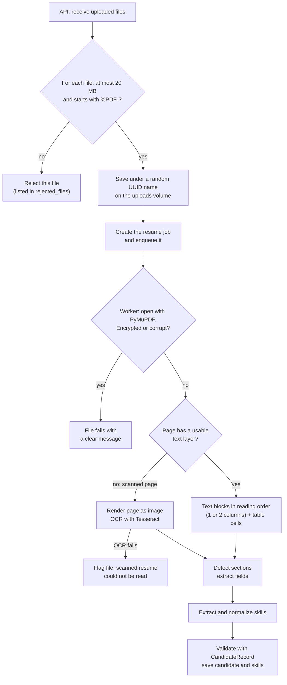

# 6. Resume Parsing and Skill Extraction

> **Status: Planned.** Resume parsing follows HLD §8.7 and §9.2; skill extraction follows HLD §8.8. Code lives in `app/resumes` and `app/skills` (Part 2). Resume parsing runs inside the `resume` background job (Part 5).

## 6.1 Overview



Each file is one **item** of the background job. A failed file is logged and counted, and the next file is processed (Part 5).

## 6.2 Upload Validation (API)

Code: `resumes/validation.py`, called by the resume upload endpoint.

| Check | How | If it fails |
|---|---|---|
| Size ≤ 20 MB (20 × 1024 × 1024 bytes) | Counted **while streaming**, so an oversized file is never fully read into memory | File rejected with code `FILE_TOO_LARGE`: "cv_09.pdf is larger than 20 MB." |
| Real PDF | The first bytes must be the `%PDF-` signature. The file name extension and declared content type are checked but **not trusted**. | File rejected with code `NOT_A_PDF` |
| Number of files | A limit on files per request | Whole request rejected with 422 |

A rejected file does not stop the others. The whole request returns 202 if at least one file is accepted, otherwise 422 with every file's reason (Section 4.5).

Valid files are stored under a **random UUID name** in the uploads volume. The original file name is kept only as data (`source_file`) and is never used as a path, which prevents path traversal. No endpoint ever serves the raw PDF. The job's `params` hold the list of stored files.

## 6.3 Opening and Checking the PDF (Worker)

For each stored file, the worker:

1. Opens it with **PyMuPDF**. If it cannot be opened, the file is **corrupt**: "cv_07.pdf failed: the file is damaged or not a valid PDF."
2. Checks `is_encrypted` / `needs_pass`. If set, the file is **encrypted**: "cv_08.pdf failed: the file is password-protected." There is no attempt to open it.
3. Applies a configurable page-count limit, which reduces the impact of malicious "PDF bomb" files.

## 6.4 Text Extraction and Two-Column Layouts

Code: `resumes/text_extraction.py`.

1. **Text blocks.** For each page, PyMuPDF returns text blocks with their bounding boxes (x and y coordinates).
2. **Column detection.** If the blocks form two horizontal groups separated by a consistent vertical gap, the page is two-column. The reading order is then the left column top to bottom, followed by the right column top to bottom. Otherwise blocks are read top to bottom, then left to right. Without this step, lines from the two columns would be mixed together.
3. **Tables.** pdfplumber extracts tables on each page. Cell text is added to the text used for skill extraction, so "skills in a table" layouts are captured.
4. **Fallback.** If PyMuPDF's text looks garbled (for example very few words for the number of characters), pdfplumber's word extraction is used for that page instead.

The final text is stored in `candidates.resume_text`, which the matching engine uses for TF-IDF (Part 7).

## 6.5 Scanned PDFs and OCR

Code: `resumes/ocr.py`. OCR is a **Should** requirement; flagging is the permitted fallback.

- A page counts as **scanned** if it has almost no extractable text but contains images (the threshold is configurable).
- A scanned page is rendered to an image with PyMuPDF at a resolution suitable for OCR (for example 300 DPI) and passed to Tesseract.
- If any page needed OCR, the candidate is saved with `parsed_with_ocr = true`.
- If Tesseract is missing, times out or returns no usable text, the file is **flagged** with a warning ("scanned resume: OCR produced no text"). No candidate is created from empty text.
- `OCR_ENABLED` and `OCR_LANGUAGE` configure this step.

## 6.6 Field Extraction

Code: `resumes/fields.py`. Fields are found with simple rules:

| Field | How it is found |
|---|---|
| Sections | Headings such as Summary/Profile, Experience/Employment, Education and Skills: matched case-insensitively, on short lines, often in a larger or bold font |
| `name` | The largest-font text near the top of page 1. For OCR text: the first line that is not contact information. If none is found, a placeholder from the file name is used and a warning is recorded. |
| `email` | Regular expression, then validated by Pydantic `EmailStr`. Invalid becomes null with a warning. |
| `phone` | Regular expression for common formats, normalized to digits with an optional leading `+` |
| `city` | Contact or header line matched against a small, configurable city list |
| `current_title` | The line directly under the name, otherwise the first role in the experience section |
| `years_experience` | An explicit statement such as "6+ years of experience" is preferred. Otherwise the date ranges in the experience section are merged so that overlaps are not counted twice. |
| `education` | Entries from the Education section, stored as a list |
| `summary` | The Summary or Profile section, otherwise the first paragraph |
| `skills` | The skill extractor (Section 6.8), run over the Skills section, the table cells and the full text |
| `source_file` | The original upload name |

**Years of experience example.** The ranges "Jan 2018 – Dec 2020" and "Jan 2020 – Dec 2022" overlap during 2020. Merged, they cover Jan 2018 to Dec 2022, so the result is **5 years**, not the 6 years a simple sum would give. "Present" in a range means the date the resume is parsed (**LLD decision** LLD-11). The calculation receives "today" as a parameter: the parse date in normal use, and a fixed date in tests, so test results never change from day to day.

## 6.7 Validation, De-duplication and Saving

1. The fields are validated with the Pydantic **`CandidateRecord`** schema (email format, numbers as numbers, lists as lists).
2. An invalid **optional** field becomes null, and a note is added to `parse_warnings`, so a resume with a malformed phone number is still saved. The candidate page shows these warnings (Part 8).
3. **Duplicates** (Part 3, Section 3.6):
   - the same file (same SHA-256 of the bytes) is logged as "duplicate file, skipped";
   - the same person with a new file (same email, ignoring case) updates the existing candidate's parsed fields.
4. The candidate is saved with `source_file`, `stored_path`, `resume_text`, `parsed_with_ocr` and `background_job_id`, and their skills are saved in `candidate_skills`.
5. A log line records the result, for example "Parsed cv_03.pdf (OCR)". Log lines never contain resume content.

## 6.8 Skill Extraction and Normalization

Skill extraction is shared by job descriptions (Part 5), resumes and search filters. Code: `app/skills`.

**Taxonomy.** `taxonomy.json` is a curated, version-controlled list of canonical skills with their aliases and a category (ADR-015):

```json
{
  "JavaScript": { "aliases": ["js", "javascript", "java script", "ecmascript"], "category": "language" },
  "React":      { "aliases": ["react", "reactjs", "react.js"],                 "category": "framework" },
  "PostgreSQL": { "aliases": ["postgres", "postgresql", "psql"],               "category": "database" }
}
```

At start-up the `skills` table is synchronized from this file. ESCO could later be imported into the same structure.

**Extraction steps** (`skills/extractor.py` and `skills/normalizer.py`):

1. **Normalize the text.** Lower-case it and standardize punctuation, but keep tokens with symbols intact: `c++`, `c#`, `.net`, `node.js`.
2. **Alias index.** All aliases are compiled into one lookup keyed by token sequences, so a single pass over the text finds multi-word aliases.
3. **Longest match first.** "machine learning engineer" gives `Machine Learning`, not `Machine` and `Learning`. Matches respect word boundaries, so "java" is not found inside "javascript".
4. **Ambiguous words.** Short or common words ("go", "r", "c", "rest", "spring", "swift") count as skills only in a clear skill context: a Skills section or table, a comma-separated skills list, or a case-sensitive form such as "Go" or "Golang". Known false phrases ("R&D", "go-to-market", "C-level", "the rest of") are rejected.
5. **De-duplicate** into a set of canonical names.

**Required versus nice-to-have (jobs only):**

1. Structured fields from the extractor, if the site has them, are used first.
2. Otherwise the description is split by headings. "Requirements", "Must have", "Qualifications" and "What you need" mark **required** skills. "Nice to have", "Bonus", "Preferred" and "Plus" mark **nice-to-have** skills.
3. An inline qualifier overrides the heading for its own bullet or sentence. "Docker is a plus" makes Docker nice-to-have even under a Requirements heading.
4. If there are no headings, every skill is **required**. If a skill appears in both groups, required wins.

Example: under "Requirements: Python, FastAPI, PostgreSQL. Docker is a plus." and "Nice to have: Redis, Kubernetes", the job gets required {Python, FastAPI, PostgreSQL} and nice-to-have {Docker, Redis, Kubernetes}.

**Search.** A skill filter typed by the user goes through the same normalizer, so a search for "js" finds `JavaScript`.

## 6.9 Extraction Quality Checks

Every score is built from extracted skills, so extraction mistakes matter more than any scoring detail (HLD §8.8):

1. **Labelled examples.** The job and resume test fixtures are labelled by hand with their expected skills (and, for jobs, the requirement level). Tests report **precision** (the share of extracted skills that are correct) and **recall** (the share of labelled skills that were found). The README records the measured values; no target is set in advance.
2. **Unmatched-term report.** Each crawl and resume job logs the most frequent skill-like terms that matched no alias, as terms and counts only. Reviewing this list is how the taxonomy grows; aliases are added by hand, never automatically.
3. **Hand-check feedback.** Every extraction error found during the README's 5-candidate hand check becomes a new labelled test case.
