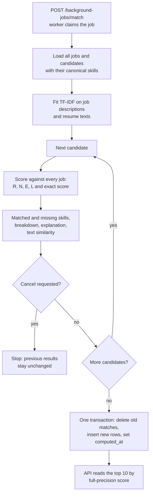

# 7. Matching Engine

> **Status: Planned.** The algorithm follows HLD §10, the workflow HLD §9.3 and the decisions ADR-016 to ADR-019. Code lives in `app/matching` (Part 2) and runs inside the `match` background job (Part 5).

## 7.1 When Matching Runs

Matching runs as a **`match` background job**. The user starts it with the "Recompute matches" button, which calls `POST /background-jobs/match`. It scores every candidate against every job and stores the results, so match pages and exports only read stored rows (ADR-019).

The job page and candidate page show `computed_at` ("matches last computed"), so stale results are visible. Automatic re-matching when new jobs arrive is a **Could** feature and is not part of the baseline.

## 7.2 Inputs

| From | Data used |
|---|---|
| `jobs` + `job_skills` | Required and nice-to-have canonical skills, `min_experience_years`, `location` (city part), `is_remote`, `description` |
| `candidates` + `candidate_skills` | Canonical skills, `years_experience`, `city`, `resume_text` |
| Configuration | Weights `MATCH_WEIGHTS` = 70, 15, 10, 5 |

Skills are already canonical, because they were normalized when the jobs and resumes were saved (Part 6). Comparing them is therefore simple set arithmetic.

## 7.3 Matching Workflow



`matching/engine.py` loads the data, scores one candidate against all jobs and saves the results; the `match` task in `worker/tasks.py` runs the loop with progress, heartbeat and cancellation. Together they run these steps:

```text
load jobs and candidates
fit TF-IDF on all job descriptions and resume texts          # matching/tfidf.py
rows = []
for each candidate:                                          # one progress item
    for each job:
        score, breakdown = score_pair(job, candidate)         # matching/scoring.py
        matched, missing, explanation = explain(breakdown)    # matching/explanation.py
        similarity = cosine(tfidf[job], tfidf[candidate])
        rows.append(candidate, job, score, breakdown, matched, missing, explanation, similarity)
    update progress and heartbeat; stop if cancel_requested
write heartbeat                                              # just before the long final step
in ONE transaction: delete all rows in matches; insert rows; set computed_at
```

(`score_pair` and `explain` are pseudocode names for the steps in Sections 7.4–7.7.)

## 7.4 The Scoring Formula

The brief's baseline formula is used **unchanged** (ADR-016):

```text
score = 70 × (required skills the candidate has / total required skills)
      + 15 × (nice-to-have skills the candidate has / total nice-to-have)
      + 10 × experience fit   (1 if years ≥ minimum, scaled down below it)
      +  5 × location fit     (same city or remote = 1)
```

Each factor is between 0 and 1, and the weights add up to 100, so the score is always between 0 and 100. The score is clamped to [0, 100] as a guard.

| Component | Rule | Example |
|---|---|---|
| **R**: required ratio | matched required skills ÷ all required skills | has 3 of 4 → 0.75 → 52.5 points |
| **N**: nice-to-have ratio | matched nice-to-have skills ÷ all nice-to-have skills | has 1 of 2 → 0.5 → 7.5 points |
| **E**: experience fit | `min(1, years / minimum)`: linear below the minimum | 2 years against a 3-year minimum → 0.667 → 6.67 points |
| **L**: location fit | 1 if the job is remote, or the candidate's city equals the job's city; otherwise 0 | Pune vs "Pune, India" → 1 → 5 points |

City comparison ignores case and surrounding spaces, and uses only the city part of the job location ("Pune, Maharashtra, India" → "pune"). Both sides go through the shared city normalizer (`app/locations`, Part 6): a city in `cities.json` gives its canonical name, so "Bangalore, Karnataka" and "Bengaluru" are the same city. A city that is not in the list is compared by the text before the first comma ("Stewartbury, AA" → "stewartbury"). A job is remote when its `is_remote` flag is set; the crawler sets it from the location or title when the job is saved. **Assumption** (HLD §10.4): "hybrid" jobs count as city-based, not remote.

Candidate skills that the job does not mention neither add nor remove points.

## 7.5 Edge Cases

The brief does not define these cases, so the HLD fixes them (ADR-017):

| Case | Rule | Reason |
|---|---|---|
| Job has required skills but no nice-to-have skills | N = 1 (full 15 points) | The candidate misses none of them. Otherwise a perfect candidate could score at most 85. |
| Job has nice-to-have skills but no required skills | R = 0, and the explanation says "no required skills could be identified for this job"; N is the usual ratio | An empty list almost always means extraction failed. Giving 70 points would push such jobs to the top of every list. |
| Job has no skills at all (no required and no nice-to-have skills) | R = 0 **and** N = 0, and the explanation says "no required or nice-to-have skills could be identified for this job". The job is still scored and stored like every other job; it scores at most 15 (experience and location). | **Decided** (HLD open question O2, 19 November 2026). With N = 1 such a job got 15 free points, and 25–30 with experience and location, which beat real partial matches such as 1 of 4 required skills in another city (27.5). After the recrawl, 90 of the 108 jobs had no skills. |
| Job has no minimum experience (null or 0) | E = 1 | A missing requirement is not held against the candidate. |
| Job has a minimum, candidate's years unknown | E = 0, and the explanation says "experience not found in resume" | Does not reward missing data. |
| Candidate has no skills | R = 0; N = 0 unless the job has required skills but no nice-to-have skills | Follows from the formula and the rows above. |
| Candidate or job city unknown, job not remote | L = 0 | The fit cannot be confirmed. |
| Duplicate skills | Counted once (sets) | |

**The N = 1 rule gives points even without a skill match.** A job that lists required skills but no nice-to-have skills gives every candidate the full nice-to-have points (15), including a candidate who has none of its required skills. Such a candidate scores 0 + 15 + E + L, for example 25 with no minimum experience in another city. A job that does list nice-to-have skills the candidate lacks gives 0 + 0 + E + L. In the README's 5-candidate hand check, this put two jobs where the data analyst has 0 of 2 and 0 of 5 required skills at 25.00, at ranks 9 and 10. A job in his own city that lists nice-to-have skills, and that he does not match either, scored 15.00. The rule is **kept** (confirmed 19 November 2026):

- without it, a perfect candidate for such a job could score at most 85;
- the required ratio, worth 70 points, still decides the ranking, so the effect only reorders weak matches at the bottom of a list;
- the explanation states it ("The job lists no nice-to-have skills (15.00 pts).").

Each component's rule is stored with it in `score_breakdown` (`rule`: `ratio`, `none_listed`, `no_required_identified` or `no_skills_identified` for skills; `ratio`, `no_minimum` or `years_unknown` for experience; `remote`, `same_city`, `different_city`, `candidate_city_unknown` or `job_city_unknown` for location), so the explanation and the UI can say why a component got its value.

## 7.6 Score Precision: Rank on Full Precision, Round Only for Display

This rule makes the ranking correct (ADR-017, HLD §10.5):

1. **Compute exactly.** `scoring.py` computes the score with Python's `fractions.Fraction`. Experience values are read from `numeric` columns as decimals, so they convert exactly.
2. **Store unrounded.** The exact value is converted once to a double and stored in `matches.score` (`DOUBLE PRECISION`). Equal fractions always convert to the same double, so equal scores are stored as identical values. Different scores keep their order.
3. **Rank on the stored value.** Sorting, the top-10 cut and `rank` always use the full-precision `score` (Section 7.10).
4. **Round only for display.** API responses, the UI, the explanation text and exports show the score with 2 decimals.

Why this matters:

- **Rounding before ranking** would make two different scores equal, for example 80.004 and 80.001 both shown as 80.00. The tie-breaker, not the score, would then decide their order.
- **Plain floating-point arithmetic** gives mathematically equal scores slightly different values. Example: the worked example in Section 7.11 and a second job where the same candidate has 2 of 3 required skills (no nice-to-have list, no minimum, different city) both score exactly 71⅔. Plain floats give 71.66666666666667 and 71.66666666666666, so floating-point error would decide the order instead of the tie-breaker. With exact computation, both are stored identically.

## 7.7 Matched Skills, Missing Skills and the Explanation

- **Matched skills** = the job's required and nice-to-have skills that the candidate has, each tagged with its level: `{"skill": "Python", "level": "required"}`.
- **Missing skills** = the job's required and nice-to-have skills that the candidate lacks, also tagged with their level.
- Both lists put required skills first, then nice-to-have skills, each in alphabetical order.
- **`score_breakdown`** stores the counts, ratios and points of all four components (Part 3 shows the shape), unrounded, plus the `rule` that applied to each component (Section 7.5) and, for location, the `job_city` that was compared.
- **`explanation`** is generated from the breakdown with a fixed template (`explanation.py`), so it always agrees with the score:

> "Score 71.67/100. Has 3 of 4 required skills (52.50 pts; missing Docker). Has 1 of 2 nice-to-have skills (7.50 pts; missing Kubernetes). 2 years of experience against a 3-year minimum (6.67 pts). Same city, Pune (5.00 pts)."

This template, with the points for each component, comes from HLD §10.8. Since HLD v1.2, the API example in HLD §12.5 uses the same sentence (Section 1.7, H2).

The UI shows matched skills as green badges and missing skills as red badges (Part 8).

## 7.8 TF-IDF Tie-Breaker

`tfidf.py` uses scikit-learn's `TfidfVectorizer`, fitted on all job descriptions and resume texts. The cosine similarity between a job's description and a candidate's resume text is stored as `text_similarity`.

It is **not part of the 0–100 score** (ADR-018). It is used only to order pairs with exactly equal scores, and the UI shows it separately ("text similarity 0.42, used to order equal scores"). Ties are common, because the ratios take only a few distinct values.

English stop words are removed. A missing or empty text has similarity 0 to everything, and if no text has a usable word at all, every similarity is 0. scikit-learn is installed only in the worker image.

## 7.9 Saving Results

Just before this step, the engine writes one more heartbeat, so the stale-job check never mistakes the final write for a lost worker (Section 5.8). All rows are written in **one transaction** that deletes the previous `matches` rows and inserts the new ones, with `computed_at` set. Readers therefore see either the old complete result set or the new one, never a half-written mix. If the job is cancelled or fails before this step, the previous results stay unchanged.

The transaction first takes `LOCK TABLE matches IN EXCLUSIVE MODE`. Plain reads continue, but two match runs that finish at the same time save one after the other, so the second one deletes the first one's rows instead of colliding with them.

A run with no candidates or no jobs fails at once ("No candidates to match: upload resumes first." or "No jobs to match: run a crawl first.") and changes nothing. A candidate whose scoring fails is logged and counted as failed, and the others are still saved; if every candidate fails, the job fails and nothing is saved.

## 7.10 Retrieving the Top Matches

`services/matches.py` serves both required routes from stored rows:

```sql
-- GET /candidates/{id}/matches  (top 10 jobs for a candidate)
SELECT ...
FROM matches m JOIN jobs j ON j.job_id = m.job_id
WHERE m.candidate_id = :candidate_id
ORDER BY m.score DESC,               -- full precision, never rounded
         m.text_similarity DESC NULLS LAST,  -- tie-breaker 1
         <required ratio> DESC,      -- tie-breaker 2, from the score_breakdown counts
         m.job_id                    -- tie-breaker 3, makes the order deterministic
LIMIT :limit                         -- default and maximum 10
```

`GET /jobs/{id}/matches` is the same query filtered by `job_id`, joined to `candidates` and ordered by `candidate_id` last. The indexes `matches (candidate_id, score DESC)` and `matches (job_id, score DESC)` make both queries fast.

An unknown ID gives 404. A candidate or job that no match run has included yet (it was added after the last run) gets `"items": []` and `"computed_at": null`.

The API numbers the rows in this order as `rank` (1–10), then rounds `score`, the breakdown points and `text_similarity` to 2 decimals, and the breakdown ratios and fits to 3, for the response. Rounding happens **after** ranking, so it can never change the order. Values are rounded half up on their decimal form (2.675 → 2.68), and the explanation uses the same rounding, so its score always equals the response's `score`.

## 7.11 Worked Example

**Job:** "Backend Python Developer", Pune, on-site. Required {Python, FastAPI, PostgreSQL, Docker}; nice-to-have {Redis, Kubernetes}; minimum 3 years.

**Candidate:** Pune, 2 years. Skills after normalization {Python, FastAPI, PostgreSQL, Redis, Git}; "Postgres" on the resume became PostgreSQL.

| Component | Calculation | Points |
|---|---|---|
| Required | 70 × 3/4 | 52.50 |
| Nice-to-have | 15 × 1/2 | 7.50 |
| Experience | 10 × min(1, 2/3) | 6.67 |
| Location | 5 × 1 (same city) | 5.00 |
| **Score** | exactly 215/3; stored as 71.66666666666667 | **shown as 71.67** |

Matched: Python, FastAPI, PostgreSQL (required); Redis (nice-to-have). Missing: Docker (required); Kubernetes (nice-to-have). Git does not affect this job's score.

The matching API item for this pair:

```json
{
  "rank": 1,
  "job_id": "a91c5d2e-0f7b-4f3a-9d1e-2b8c7a6e5f40",
  "title": "Backend Python Developer",
  "company": "Acme Analytics",
  "score": 71.67,
  "matched_skills": [
    { "skill": "FastAPI", "level": "required" }, { "skill": "PostgreSQL", "level": "required" },
    { "skill": "Python", "level": "required" }, { "skill": "Redis", "level": "nice_to_have" }
  ],
  "missing_skills": [ { "skill": "Docker", "level": "required" }, { "skill": "Kubernetes", "level": "nice_to_have" } ],
  "breakdown": {
    "required":     { "matched": 3, "total": 4, "ratio": 0.75, "points": 52.5, "rule": "ratio" },
    "nice_to_have": { "matched": 1, "total": 2, "ratio": 0.5, "points": 7.5, "rule": "ratio" },
    "experience":   { "candidate_years": 2.0, "minimum": 3.0, "fit": 0.667, "points": 6.67, "rule": "ratio" },
    "location":     { "candidate_city": "Pune", "job_location": "Pune, India", "job_city": "Pune", "fit": 1.0,
                      "points": 5.0, "rule": "same_city" }
  },
  "text_similarity": 0.42,
  "explanation": "Score 71.67/100. Has 3 of 4 required skills (52.50 pts; missing Docker). Has 1 of 2 nice-to-have skills (7.50 pts; missing Kubernetes). 2 years of experience against a 3-year minimum (6.67 pts). Same city, Pune (5.00 pts)."
}
```

## 7.12 Performance and Scale Path

The baseline scores pairs one at a time with exact arithmetic and stores every pair. The work grows with *candidates × jobs*. On synthetic data on one laptop (HLD §10.10; indicative only, **not** performance targets), this took 0.63 s for 100,000 pairs and 17.3 s for 2.5 million pairs. It runs in a background job, so API response times are not affected.

If data grows far beyond assignment size, HLD §10.10 documents the scale path. **None of it is part of the baseline:**

1. vectorized sparse-matrix scoring, with its rankings first checked against the exact version;
2. storing only each candidate's and each job's top 10;
3. incremental recompute for new jobs (the **Could** feature).
