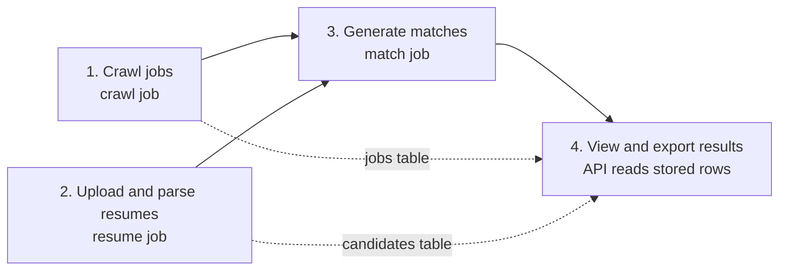

# 10. End-to-End Workflows

> **Status: Planned.** This part connects the earlier parts into four complete flows. Each step names the module that does the work and where it is explained in detail, so the details are not repeated here.

## 10.1 The Big Picture

A typical session runs the four flows in this order:

Flows 1–3 are background jobs: the API answers at once with **202 Accepted**, a Celery worker does the work, and the UI polls for progress (Part 5). Flow 4 is ordinary request and response (Part 4).

## 10.2 Flow 1: Crawling Jobs

| # | Who | What happens | Details |
|---|---|---|---|
| 1 | User, Background jobs page | Fills in the "New crawl" form: seed URL, `max_depth`, `max_pages`, allowed domains | Section 8.7 |
| 2 | React (`src/api/`) | Sends `POST /background-jobs/crawl` with JSON | Section 4.5 |
| 3 | `api/background_jobs.py` + Pydantic | Validates the URL, limits, allow-list and SSRF rules; 422 if invalid | Sections 5.9, 9.2 |
| 4 | `services/background_jobs.py` | Inserts a `queued` `crawl` row, commits, publishes the job ID to Redis, returns 202 | Section 5.4 |
| 5 | Celery worker (`worker/tasks.py`) | Claims the job (`queued` → `running`) | Section 5.2 |
| 6 | `crawler/frontier.py` | Runs BFS from the seed; every URL is normalized, allow-listed, checked against robots.txt and fetched with rate limiting and retries | Sections 5.10–5.15 |
| 7 | `extractors/registry.py` + plug-in | Selects the extractor and parses the static HTML (or the Playwright-rendered page) into raw jobs and links | Section 5.16 |
| 8 | Crawler pipeline + `skills/` | Normalizes each raw job, extracts required and nice-to-have skills, validates it with `JobRecord` | Sections 5.17, 6.8 |
| 9 | Crawler + SQLAlchemy | Upserts into `jobs` by `dedup_key` and saves `job_skills` | Sections 3.6, 5.17 |
| 10 | `worker/progress.py` | After each page: progress, heartbeat, log lines; checks the cancel flag | Section 5.6 |
| 11 | React polling | Shows the progress bar and new log lines until the job is `completed`, `failed` or `cancelled` | Section 8.5 |

## 10.3 Flow 2: Uploading and Parsing Resumes

| # | Who | What happens | Details |
|---|---|---|---|
| 1 | User | Opens "Upload resumes" and picks one or more PDFs | Section 8.7 |
| 2 | React | Sends `POST /background-jobs/resume` as `multipart/form-data` | Section 4.5 |
| 3 | `api/background_jobs.py` + `resumes/validation.py` | Streams each file, checking the 20 MB limit and the `%PDF-` signature; rejects bad files individually | Section 6.2 |
| 4 | API | Saves valid files under UUID names on the uploads volume, creates a `queued` `resume` job listing them, enqueues it, returns 202 with accepted and rejected files (422 with every file's reason, and no job, if no file is accepted) | Sections 5.4, 6.2 |
| 5 | Worker | Claims the job and processes the files one by one | Section 5.5 |
| 6 | `resumes/validation.py` | Opens each file with PyMuPDF; encrypted or corrupt files fail with a clear message | Section 6.3 |
| 7 | `resumes/text_extraction.py`, `resumes/ocr.py` | Extracts text in reading order (two-column aware) plus table cells; OCRs scanned pages, or flags the file | Sections 6.4, 6.5 |
| 8 | `resumes/fields.py` + `skills/` | Finds sections and fields; extracts and normalizes skills | Sections 6.6, 6.8 |
| 9 | Pydantic `CandidateRecord` + SQLAlchemy | Validates, then saves the candidate and `candidate_skills`, skipping duplicate files and updating a known email | Section 6.7 |
| 10 | Worker + React | Logs one line per file and updates progress; the UI shows them | Sections 5.6, 8.5 |

## 10.4 Flow 3: Generating Matches

| # | Who | What happens | Details |
|---|---|---|---|
| 1 | User | Clicks "Recompute matches" | Section 8.7 |
| 2 | React → API | `POST /background-jobs/match`; the API creates a `queued` `match` job and returns 202 | Section 5.4 |
| 3 | `matching/engine.py` | Loads all jobs and candidates with canonical skills; fits TF-IDF | Section 7.3 |
| 4 | `matching/scoring.py` | For each candidate and every job, computes R, N, E and L and the exact score with the formula and the edge-case rules | Sections 7.4, 7.5 |
| 5 | `matching/explanation.py`, `matching/tfidf.py` | Builds matched and missing skills, the breakdown, the explanation and the text similarity | Sections 7.7, 7.8 |
| 6 | Engine | Updates progress after each candidate; stops if cancelled, leaving the old results unchanged | Sections 5.7, 7.3 |
| 7 | Engine + SQLAlchemy | Replaces all rows in `matches` in one transaction, with full-precision scores, and sets `computed_at` | Sections 7.6, 7.9 |

## 10.5 Flow 4: Viewing and Exporting Results

| # | Who | What happens | Details |
|---|---|---|---|
| 1 | User, Jobs or Candidates page | Types a search term and filters, for example skill "js" | Section 8.7 |
| 2 | React → `GET /jobs` or `GET /candidates` | `services/search.py` normalizes the skill ("js" → JavaScript) and runs one paginated query; the API returns `{items, total, page, page_size}` | Section 4.3 |
| 3 | User | Opens a candidate (or a job) | Section 8.2 |
| 4 | React → `GET /candidates/{id}/matches` | `services/matches.py` reads the top 10 ordered by full-precision score, then text similarity, required ratio and ID | Section 7.10 |
| 5 | API | Assigns `rank` 1–10, then rounds the scores to 2 decimals for the response | Section 7.10 |
| 6 | React | Shows each match with its score, matched (tinted, with a check) and missing (dashed, with a minus) skill badges by level, and the explanation, in the API's order | Section 8.6 |
| 7 | User | Clicks Export CSV or JSON on a table, or "Export match table" on the Candidates page | Section 8.4 |
| 8 | `services/export.py` | Reuses the search filters and streams the file as a download (CSV cells protected against formula injection) | Section 4.6 |
