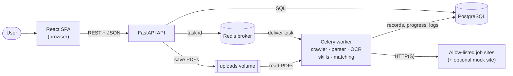
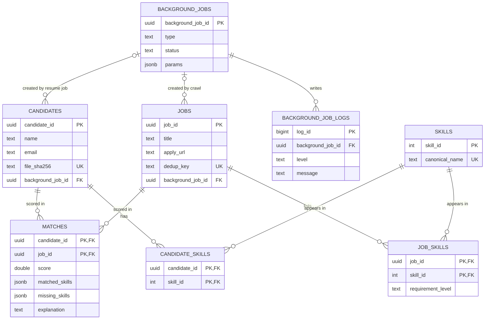
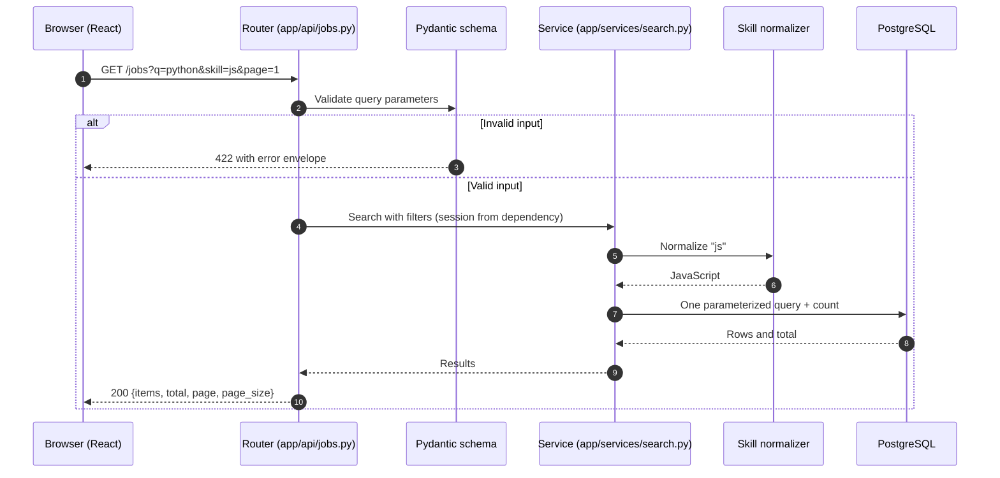
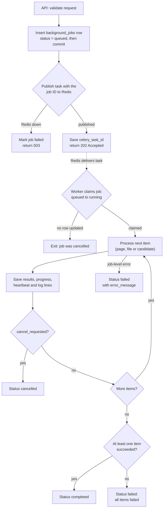
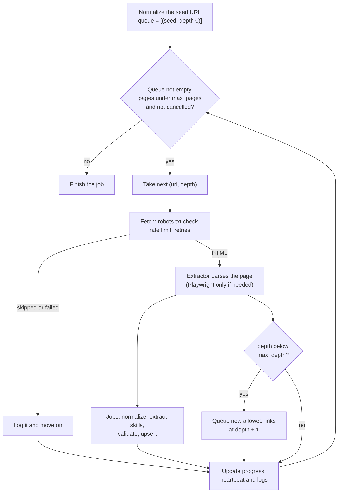
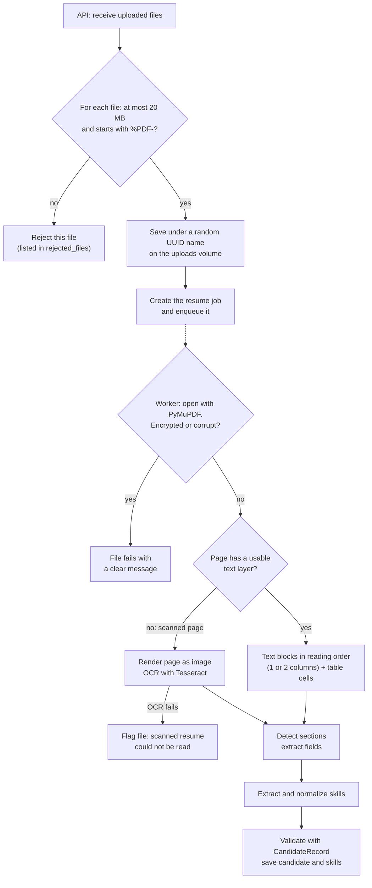
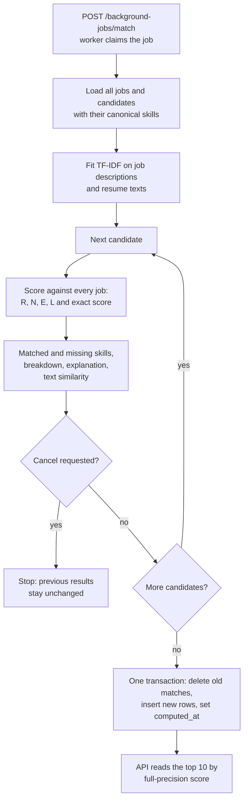
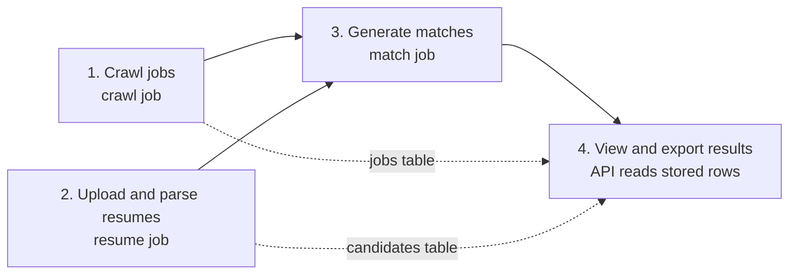

# Low-Level Design (LLD): Job–Candidate Matching Platform

**Version 1.1 · 18 November 2026 · Status: Planned design; all LLD decisions approved.** The repository contains no application code yet, so every part describes the intended implementation.

This file combines the ten parts in `docs/LLD/` in order. The text is identical to the individual files; only the heading levels are one step lower. `README.md` explains how to read the LLD.

## Contents

1. [Introduction and Architecture](#1-introduction-and-architecture)
2. [Project Structure](#2-project-structure)
3. [Database Design](#3-database-design)
4. [Backend and API Design](#4-backend-and-api-design)
5. [Background Jobs and Crawler](#5-background-jobs-and-crawler)
6. [Resume Parsing and Skill Extraction](#6-resume-parsing-and-skill-extraction)
7. [Matching Engine](#7-matching-engine)
8. [Frontend Design](#8-frontend-design)
9. [Error Handling and Testing](#9-error-handling-and-testing)
10. [End-to-End Workflows](#10-end-to-end-workflows)

---

## 1. Introduction and Architecture

> **Status: Planned.** On 18 November 2026 the repository contains documentation only. There is no backend, frontend, test or Docker code yet. Everything in this LLD describes the **intended** implementation, derived from the High-Level Design. Section 1.2 explains the status labels.

### 1.1 Purpose of This LLD

The High-Level Design (HLD) says **which parts** the system has and **why**. This Low-Level Design (LLD) says **how each part works inside**:

- the modules and files the code is split into;
- the tables, columns and keys in the database;
- the API endpoints with their inputs and outputs;
- the step-by-step logic of background jobs, crawling, resume parsing, skill extraction and matching;
- how errors are handled and how everything is tested.

It is written for two readers: the developer who implements the platform, and an interviewer who wants the internals explained in plain language.

**Sources.** Every design statement comes from one of these documents:

| Source | Used for |
|---|---|
| `Intern_Assignment_Flexible_Brief.pdf` ("the brief") | Requirements, record fields, the scoring formula, deliverables |
| `docs/HLD_Job_Candidate_Matching_Platform_Full.md` (v1.2) | All design details. References such as "HLD §8.5" point to this file. |
| `docs/HLD_Job_Candidate_Matching_Platform.md` (v1.2) | Concise summary of the same design |
| `docs/ARCHITECTURE_DECISIONS.md` (v1.1) | Reasons behind decisions (ADR-001 to ADR-027) |

### 1.2 Implementation Status and Labels

Because no application code exists, the whole LLD is **Planned**. It adds **no** features, endpoints, tables or columns beyond the HLD. Where the HLD leaves a small detail open (a parameter name, a response shape, a timeout), the LLD makes the simplest consistent choice. Each such choice is labelled **LLD decision** and listed in Section 1.6.

| Label | Meaning |
|---|---|
| **Planned** | Specified in the HLD, not yet implemented. This applies to everything unless another label is shown. |
| **Optional** | Part of the design but not required, for example the mock job site. |
| **Could** | One of the brief's "Could" extras. Not part of the baseline build. |
| **Open** | A question the HLD itself leaves open for review (for example its open question O2). |
| **LLD decision** | A design choice made in this LLD because the brief and HLD leave the detail open. All of them are listed in Section 1.6; all were approved on 18 November 2026. |
| **Proposed name** | A name introduced by this LLD only to make the design concrete. |

### 1.3 Platform Overview

The platform does four things:

1. **Collects jobs.** A crawler visits allow-listed job websites breadth-first, and site-specific extractors turn each page into job records.
2. **Reads resumes.** Users upload PDF resumes. A parser extracts the candidate's name, contact details, title, skills, experience, education and summary, using OCR for scanned resumes.
3. **Matches both sides.** Every candidate is scored against every job on a 0–100 scale with the brief's formula. Each candidate sees their top 10 jobs and each job its top 10 candidates, with matched skills, missing skills and the reason for the score.
4. **Shows and exports results.** A web UI shows background-job progress and logs, searchable tables and match pages. Data can be exported as CSV or JSON.

Crawling, resume parsing and matching are slow, so they run as **background jobs** in a separate worker process. The user starts them from the UI and watches their progress.

### 1.4 Architecture at a Glance

The system is a **modular monolith with a background worker** (ADR-001). One Python codebase runs as two kinds of process: the **FastAPI API**, which answers the UI quickly, and the **Celery worker**, which does the slow work. The React single-page application (SPA) is a separate frontend that only talks to the API.



Five rules shape every part of the LLD:

| Rule | What it means in practice |
|---|---|
| PostgreSQL is the single source of truth | Status, progress, logs and results are written to and read from the database. The API never asks the worker directly (ADR-003). |
| Tasks carry only an ID | A Celery message holds only `background_job_id`. The worker loads everything else from the database (ADR-004). |
| Heavy work is asynchronous | Crawling, PDF parsing, OCR and matching never run inside an HTTP request. |
| One skill normalizer | Jobs, resumes and search filters use the same normalizer, so "JS" always means JavaScript. |
| Fail small | An error is contained to one page, one file or one record. It is logged and counted, and the job continues. |

### 1.5 Technology Stack

The stack is fixed by the HLD (HLD §7.5). The table shows what each technology does in this system and which process uses it.

| Technology | Purpose in this system | Used in |
|---|---|---|
| Python | Language of the whole backend | API, worker |
| FastAPI | HTTP routes, request validation, dependency injection, automatic OpenAPI docs at `/docs` | API |
| Pydantic | Validates and normalizes API requests, responses and every extracted job or candidate record | API, worker |
| SQLAlchemy | Maps tables to Python classes; builds parameterized SQL; manages sessions, transactions and upserts | API, worker |
| PostgreSQL | Stores all data; enforces keys, unique and check constraints; serves indexed queries | Database container |
| Celery | Runs `crawl`, `resume` and `match` tasks in worker processes, with time limits | Worker (and the API publishes tasks) |
| Redis | Message broker: holds task messages until a worker takes them | Redis container |
| httpx | Fetches pages and robots.txt; its mock transport makes crawler tests offline | Worker |
| BeautifulSoup | Parses HTML inside extractors; tolerates malformed pages | Worker |
| Playwright | Headless Chromium, only for pages that need JavaScript | Worker |
| PyMuPDF | Opens and checks PDFs; extracts text blocks with coordinates and font sizes; renders scanned pages to images | Worker |
| pdfplumber | Extracts tables, such as skills in a table; fallback word extraction | Worker |
| Tesseract (via pytesseract) | OCR for scanned, image-only pages | Worker |
| scikit-learn | TF-IDF text similarity, used only to break ties between equal scores | Worker |
| Custom scoring | The brief's explainable formula, written by hand | Worker |
| React + TypeScript | Component-based UI with typed API data | Frontend |
| Vite | Development server and production build for the frontend | Frontend |
| Tailwind CSS + shadcn/ui | Styling and ready-made components (tables, badges, progress bars, dialogs) | Frontend |
| Pytest | Unit and integration tests, all offline | Backend tests |
| Docker Compose | Starts every service with `docker compose up` | Deployment |

**Supporting libraries** (HLD §7.5): Alembic (database migrations), pydantic-settings (configuration from environment variables), email-validator (for Pydantic's `EmailStr`), the Python standard library (`urllib.robotparser`, `urllib.parse`, `ipaddress`, `csv`), React Router (page routing) and ReportLab (development only, for generating fake resume PDFs).

**Deployment** (HLD §16). `docker compose up` starts six services:

| Service | Role |
|---|---|
| `frontend` | Serves the built React app |
| `api` | FastAPI; applies database migrations on start |
| `worker` | Celery worker image that also contains Playwright Chromium and Tesseract |
| `db` | PostgreSQL |
| `redis` | Message broker |
| `mock-site` | **Optional.** A static and a JavaScript-rendered job page for a reproducible demo |

Only the frontend and API ports are published to the host. Two volumes keep data across restarts: `pgdata` for the database and `uploads` for resume PDFs. Configuration comes from environment variables documented in `.env.example`.

### 1.6 Design Decisions Made in This LLD

For each detail below, the brief and the HLD were checked first. They either did not specify it, or (LLD-4) specified it in two conflicting ways. Each decision is the simplest choice that fits the existing design. **All eleven were approved on 18 November 2026.**

LLD-4 and LLD-6 to LLD-10 were also copied into HLD v1.2, because each one settles a conflict, an open question or a visible behaviour in the HLD. The others are implementation details, so they stay in the LLD only.

| ID | Decision | Why | LLD section | In HLD v1.2 |
|---|---|---|---|---|
| LLD-1 | File names inside the planned folders | The HLD names folders and their responsibilities, not files | 2.2 | LLD only |
| LLD-2 | `GET /skills` uses the standard list response `{items, total, page, page_size}` and returns every skill on one page, sorted by name | HLD §12.1 gives every list response this shape; the taxonomy is a short list | 4.5 | LLD only |
| LLD-3 | `GET /health` returns `{"status", "database", "redis"}` with 200, or 503 in the standard error envelope; each check has a short timeout | Docker reads only the status code; a hanging database must fail the check, not hang it | 4.5 | LLD only |
| LLD-4 | Upload: 202 if at least one file is accepted (the others listed in `rejected_files`). If none is accepted: **422** with code `NO_VALID_FILES` and each file's reason (`FILE_TOO_LARGE` or `NOT_A_PDF`) in `details.rejected_files` | Follows HLD §9.2; the 413 and 415 rows in HLD v1.1 §12.1 contradicted it | 4.5 | §12.1, §14 |
| LLD-5 | Sorting with `sort` and `order`, with a small allow-list per list | The HLD requires an allow-list but names no parameters | 4.4 | LLD only |
| LLD-6 | `GET /jobs?max_required_years=N`: jobs whose minimum is at most N years, plus jobs with no minimum | Answers "which jobs suit someone with N years", and matches the scoring rule | 4.5 | §9.4 |
| LLD-7 | Heartbeat timeout `JOB_HEARTBEAT_TIMEOUT_SECONDS` = 600. The heartbeat is written at claim, after each item, and just before the match job's final write. | HLD open question O4 | 5.8 | §13.4, §13.7, §16.3, O4 |
| LLD-8 | A job queued longer than `JOB_QUEUED_TIMEOUT_SECONDS` (600) while no job has written a heartbeat is failed with a clear message. Lost tasks are not re-sent. | HLD open question O5 | 5.8 | §13.4 (diagram 08), §13.7, §14, §16.3, §16.4, O5 |
| LLD-9 | The UI polls every 2 seconds; `VITE_POLL_INTERVAL_MS` (default 2000) | HLD open question O4 | 8.5 | §8.1, O4 |
| LLD-10 | "Export match table" on the Candidates page, using the candidate filters | No page held this button, and "same as search" was unclear for matches | 8.2 | §8.1, §8.10, §12.6 |
| LLD-11 | "Present" in a date range means the parse date, which is passed into the calculation as a parameter | Not defined in the HLD; a parameter makes tests repeatable | 6.6 | LLD only |

### 1.7 Inconsistencies Found in the HLD

Two inconsistencies were found in HLD v1.1. Both were corrected in HLD v1.2 (approved 18 November 2026). Version 1.1 is kept in `docs/archive/v1.1/`.

| # | Where in the HLD | What was inconsistent | Correction in v1.2 |
|---|---|---|---|
| H1 | ER diagram "1 of 2" in §11.1 (`docs/diagrams/06-database-er-core`) vs the field list in §11.2 | The diagram showed `numeric score`; §11.2 says `DOUBLE PRECISION`, because ADR-017 never rounds scores before ranking | The diagram now shows `double score`; its source, PNG and SVG were regenerated |
| H2 | Explanation sentence in §10.8 vs the API example in §12.5 | §10.8's template includes each component's points; the §12.5 example left them out | The §12.5 example now uses the §10.8 template |

---

## 2. Project Structure

> **Status: Planned.** Section 2.1 shows what exists today. Section 2.2 shows the planned layout from HLD §17.

### 2.1 What Exists Today

On 18 November 2026 the repository contains documentation only:

```text
FITSCAN/
├── LEARNING_NOTES.md                         # architecture learning notes
└── docs/
    ├── HLD_Job_Candidate_Matching_Platform.md        # concise HLD (v1.2)
    ├── HLD_Job_Candidate_Matching_Platform_Full.md   # detailed HLD (v1.2)
    ├── HLD_Job_Candidate_Matching_Platform.docx      # Word export of the detailed HLD (v1.2)
    ├── ARCHITECTURE_DECISIONS.md                     # ADR-001 to ADR-027
    ├── diagrams/                                     # Mermaid sources + PNG/SVG renders
    ├── pdf/                                          # PDF exports of the documents
    ├── archive/                                      # earlier versions: HLD v1.1 (+ old diagrams 06 and 08), v1.0 exports
    └── LLD/                                          # this Low-Level Design
```

### 2.2 Planned Layout

The folders and what each one contains come from HLD §17. **File names inside the folders are proposed names** introduced by this LLD (**LLD decision** LLD-1), so that later parts can say exactly where each piece of logic lives. Each file name follows a responsibility that HLD §17 lists for that folder.

```text
<repo-root>/
├── docker-compose.yml            # all services
├── .env.example                  # documented configuration, no secrets
├── README.md · DATA_SOURCES.md · AI_USAGE.md   # deliverables required by the brief
├── backend/
│   ├── Dockerfile                # two targets: api, worker (adds Playwright + Tesseract)
│   ├── pyproject.toml
│   ├── alembic/                  # database migrations
│   ├── app/
│   │   ├── main.py               # creates the FastAPI app: routers, CORS, error handlers
│   │   ├── config.py             # settings read from environment variables
│   │   ├── api/                  # routers (one file per resource)
│   │   │   ├── background_jobs.py · jobs.py · candidates.py
│   │   │   ├── exports.py · skills.py · health.py
│   │   │   └── upload_limit.py      # total size limit of an upload request, while it streams in
│   │   ├── schemas/              # Pydantic request/response models and record schemas
│   │   │                         # (e.g. job.py: JobRecord, candidate.py: CandidateRecord)
│   │   ├── models/               # SQLAlchemy models, one class per table
│   │   ├── db/                   # engine and session management
│   │   ├── services/             # business rules that use the database
│   │   │   ├── background_jobs.py   # create, list, cancel background jobs
│   │   │   ├── search.py            # filtered, paginated job/candidate queries
│   │   │   ├── matches.py           # top-10 match queries
│   │   │   ├── export.py            # CSV/JSON streaming
│   │   │   └── upload_retention.py  # manual clean-up of uploads no longer needed (Part 6)
│   │   ├── worker/               # the only code that knows about Celery
│   │   │   ├── celery_app.py        # Celery application and settings
│   │   │   ├── tasks.py             # crawl, resume and match task entry points
│   │   │   └── progress.py          # progress, heartbeat and log helpers
│   │   ├── crawler/
│   │   │   ├── frontier.py          # BFS loop: queue, visited set, limits, per-page pipeline
│   │   │   ├── fetcher.py           # httpx fetching with retries and redirects
│   │   │   ├── robots.py            # robots.txt cache and checks
│   │   │   ├── rate_limiter.py      # per-domain minimum interval
│   │   │   ├── urls.py              # URL normalization and allow-list checks
│   │   │   └── ssrf.py              # private-address guard
│   │   ├── extractors/
│   │   │   ├── base.py              # plug-in contract, ExtractionResult, RawJob
│   │   │   ├── registry.py          # auto-discovery and selection
│   │   │   ├── generic.py           # fallback: schema.org JobPosting JSON-LD
│   │   │   └── <site>.py            # one file per supported website
│   │   ├── resumes/
│   │   │   ├── validation.py        # signature, size, encryption, corruption checks
│   │   │   ├── text_extraction.py   # text blocks, column order, tables
│   │   │   ├── ocr.py               # scanned-page detection and Tesseract OCR
│   │   │   ├── fields.py            # sections and candidate fields
│   │   │   └── pipeline.py          # from a stored PDF to a saved candidate; duplicate rules
│   │   ├── locations/
│   │   │   ├── cities.json          # known cities and their other spellings
│   │   │   └── normalizer.py        # text → canonical city (candidates and job locations)
│   │   ├── skills/
│   │   │   ├── taxonomy.json        # canonical skills and their aliases
│   │   │   ├── normalizer.py        # alias → canonical name
│   │   │   └── extractor.py         # finds skills in text; required vs nice-to-have
│   │   └── matching/
│   │       ├── scoring.py           # the formula and edge-case rules (exact arithmetic)
│   │       ├── explanation.py       # breakdown and explanation sentence
│   │       ├── ranking.py           # ordering and tie-breakers
│   │       ├── tfidf.py             # TF-IDF text similarity (tie-breaker only)
│   │       └── engine.py            # loads data, scores all pairs, saves results
│   └── tests/
│       ├── fixtures/html/        # saved static and rendered pages
│       ├── resume_pdfs.py        # synthetic resume PDFs, generated while the tests run (Part 9)
│       ├── unit/
│       └── integration/
├── frontend/
│   ├── Dockerfile · package.json · vite.config.ts · tsconfig.json · components.json
│   └── src/
│       ├── api/                  # typed API client
│       ├── components/ui/        # shadcn/ui components
│       ├── components/           # shared app components: skill badges, progress, log viewer
│       ├── pages/                # the six pages (Part 8)
│       ├── hooks/                # polling and data-loading hooks
│       └── types/                # TypeScript types mirroring the API schemas
├── mock-site/                    # Optional: static + JavaScript-rendered job pages
├── scripts/                      # development tools, e.g. fake resume generation
└── samples/                      # exported jobs, candidates and match table (deliverable)
```

### 2.3 Module Responsibilities

| Folder | Responsibility | Runs in | Details |
|---|---|---|---|
| `app/api` | Receive HTTP requests, validate input, call a service, return a schema. No business logic. | API | Part 4 |
| `app/schemas` | Pydantic models: the contract between frontend and backend, plus `JobRecord` and `CandidateRecord` for extracted data. | API, worker | Parts 4–6 |
| `app/models`, `app/db` | SQLAlchemy models, engine and one session per request or task. The only layer that knows table structure. | API, worker | Part 3 |
| `app/services` | Background-job control, search, match queries and export: rules that need the database. | API | Part 4 |
| `app/worker` | Celery app and thin task wrappers that call the domain modules; progress and log helpers. | Worker | Part 5 |
| `app/crawler` | Polite, bounded BFS crawl and the per-page job pipeline. | Worker | Part 5 |
| `app/extractors` | Site-specific parsing of HTML into raw jobs and links. Never touches the database. | Worker | Part 5 |
| `app/resumes` | PDF checks, text and layout extraction, OCR and field extraction. | Worker (quick checks also in API) | Part 6 |
| `app/locations` | The city list and normalizer, shared by candidates and job locations, so "Bangalore" and "Bengaluru" are one city. Standard library only. | API, worker | Parts 6–7 |
| `app/skills` | The taxonomy, the normalizer and the skill extractor, shared by jobs, resumes and search. | API, worker | Part 6 |
| `app/matching` | Scoring, explanations, TF-IDF tie-breaker, ranking, and the match run. | Worker (ranking order also used by API queries) | Part 7 |
| `frontend/src` | React pages, components, typed API client and polling hooks. | Browser | Part 8 |
| `backend/tests` | Offline unit and integration tests with saved fixtures. | Test run | Part 9 |

### 2.4 Dependency Rules

These rules keep the code easy to test and explain (HLD §8.2):

1. **Routers → services → models.** A router never writes SQL itself; it calls a service.
2. **Domain modules have no web framework code.** `crawler`, `extractors`, `resumes`, `skills` and `matching` never import FastAPI, so the worker can reuse them directly.
3. **Only `worker/` imports Celery.** Tasks are thin wrappers around the domain modules.
4. **Extractors are pure parsers.** They take a URL and HTML and return data; the crawler saves it.
5. **The frontend talks to the backend only over HTTP.** It has no access to the database, Redis or the worker.

---

## 3. Database Design

> **Status: Planned.** Tables, columns, types and constraints are taken from HLD §11. Nothing here adds a column. The schema will be created with Alembic migrations, which the `api` service applies on start-up.

### 3.1 Overview

PostgreSQL holds eight tables in two groups:

- **Core data:** `jobs`, `candidates`, `skills`, `job_skills`, `candidate_skills`, `matches`.
- **Background processing:** `background_jobs`, `background_job_logs`.

Fields that the brief names keep the brief's names (for example `job_id`, `min_experience_years`, `parsed_with_ocr`). Each table maps to one SQLAlchemy model class in `app/models`.

### 3.2 ER Diagram

The diagram shows keys and a few main columns. Sections 3.3–3.5 list every column.



### 3.3 Core Tables

#### `jobs`: one row per job posting

| Column | Type | Key / constraint | Notes |
|---|---|---|---|
| job_id | UUID | **PK** | Generated by the system. |
| title | text | NOT NULL | |
| company | text | | |
| location | text | | Its city part is used for location fit. |
| job_type | text | CHECK in (`full_time`, `part_time`, `contract`, `internship`, `temporary`, `unknown`) | |
| salary_min, salary_max | numeric | nullable; CHECK `salary_min ≤ salary_max` when both are set | Numbers, not text. |
| salary_currency, salary_period | text | nullable | |
| salary_text | text | nullable | Salary exactly as written on the site. |
| posted_date | date | nullable | ISO date. Null (with a logged warning) if the site shows none. |
| description | text | | Clean text with HTML removed. |
| min_experience_years | numeric | nullable; CHECK ≥ 0 | Present only if found in the posting. |
| apply_url | text | NOT NULL | Always an absolute URL. |
| source | text | NOT NULL | Extractor or site name, for example `fake_python_jobs`. |
| is_remote | boolean | | Used by location fit. |
| source_url | text | | The page the job was extracted from. |
| industry | text | NOT NULL, default `other`; CHECK in (`software_it`, `ai_data`, `finance_banking`, `marketing`, `sales_business`, `human_resources`, `design`, `operations_supply_chain`, `healthcare`, `education`, `engineering`, `legal`, `other`) | Set by the crawler when the job is saved (Part 5, Section 5.18); added 22 November 2026 by migration `5d2e8c41a7b9`, which also classifies the jobs that already exist (only this column is written). |
| dedup_key | text | UNIQUE | See Section 3.6. |
| background_job_id | UUID | **FK** → `background_jobs`, nullable | The crawl that created or last updated the job. |
| created_at, updated_at | timestamptz | | |

`required_skills` and `nice_to_have_skills` are **not columns**. They come from `job_skills` and are returned by the API as arrays of canonical names.

#### `candidates`: one row per parsed resume

| Column | Type | Key / constraint | Notes |
|---|---|---|---|
| candidate_id | UUID | **PK** | |
| name | text | | Placeholder from the file name, with a warning, if no name is found. |
| email | text | nullable; partial UNIQUE on `lower(email)` where not null | Validated with Pydantic `EmailStr`. |
| phone | text | nullable | Digits with an optional leading `+`. |
| city | text | nullable | |
| current_title | text | nullable | |
| years_experience | numeric | nullable; CHECK ≥ 0 | A number, not text. |
| education | JSONB | | List of entries (degree, institution, years where found). |
| summary | text | nullable | |
| source_file | text | NOT NULL | Original upload name, kept only as data. |
| parsed_with_ocr | boolean | NOT NULL | True if any page needed OCR. |
| file_sha256 | text | UNIQUE | Detects the same file uploaded twice. |
| stored_path | text | | Internal UUID path on the uploads volume. Never returned by the API. |
| resume_text | text | | Extracted text, used for TF-IDF and debugging. |
| parse_warnings | JSONB | | For example `["invalid email removed"]`. |
| background_job_id | UUID | **FK** → `background_jobs`, nullable | The latest resume job that parsed the candidate. A newer resume with the same email moves it to that job. |
| created_at, updated_at | timestamptz | | |

`skills` for a candidate come from `candidate_skills`.

#### `skills`, `job_skills`, `candidate_skills`: the skill links

| Table | Column | Type | Key / constraint |
|---|---|---|---|
| `skills` | skill_id | integer | **PK** |
| | canonical_name | text | UNIQUE (for example `JavaScript`) |
| | category | text | For example `language`, `framework`, `database` |
| `job_skills` | job_id | UUID | **PK** (composite), **FK** → `jobs`, ON DELETE CASCADE |
| | skill_id | integer | **PK** (composite), **FK** → `skills` |
| | requirement_level | text | CHECK in (`required`, `nice_to_have`) |
| `candidate_skills` | candidate_id | UUID | **PK** (composite), **FK** → `candidates`, ON DELETE CASCADE |
| | skill_id | integer | **PK** (composite), **FK** → `skills` |

The `skills` table is synchronized from `app/skills/taxonomy.json` at start-up, so the database and the taxonomy file always agree.

#### `matches`: one row per (candidate, job) pair

| Column | Type | Key / constraint | Notes |
|---|---|---|---|
| candidate_id | UUID | **PK** (composite), **FK** → `candidates`, ON DELETE CASCADE | |
| job_id | UUID | **PK** (composite), **FK** → `jobs`, ON DELETE CASCADE | |
| score | DOUBLE PRECISION | CHECK 0–100 | **Full precision, never rounded in storage.** Rounded to 2 decimals only for display (Part 7). |
| matched_skills | JSONB | | Array of `{skill, level}`. |
| missing_skills | JSONB | | Array of `{skill, level}`. |
| explanation | text | | Generated sentence. |
| score_breakdown | JSONB | | Counts, ratios and points per score component. |
| text_similarity | DOUBLE PRECISION | | TF-IDF cosine similarity, tie-breaker only. |
| computed_at | timestamptz | | Shown in the UI as "matches last computed". |

**Note on the `score` type.** `DOUBLE PRECISION` matches HLD §11.2 and, since HLD v1.2, the HLD's ER diagram as well (Section 1.7, H1). A rounded column such as `numeric(5,2)` would let rounding affect ranking.

Example `score_breakdown` (shape only):

```json
{
  "required":     { "matched": 3, "total": 4, "ratio": 0.75, "points": 52.5 },
  "nice_to_have": { "matched": 1, "total": 2, "ratio": 0.5, "points": 7.5 },
  "experience":   { "candidate_years": 2, "minimum": 3, "fit": 0.6667, "points": 6.6667 },
  "location":     { "candidate_city": "Pune", "job_location": "Pune, India", "fit": 1, "points": 5.0 }
}
```

### 3.4 Background-Processing Tables

#### `background_jobs`: one row per crawl, resume or match run

| Column | Type | Key / constraint | Notes |
|---|---|---|---|
| background_job_id | UUID | **PK** | |
| type | text | NOT NULL; CHECK in (`crawl`, `resume`, `match`) | |
| status | text | NOT NULL; CHECK in (`queued`, `running`, `completed`, `failed`, `cancelled`) | Lifecycle from the brief (Part 5). |
| params | JSONB | | Crawl configuration, or for a resume job the stored files: `upload_id`, `stored_file` (`<upload_id>.pdf`) and `size_bytes` of each. Never the original file names. For a match run: its `weights` (Part 7, Section 7.4) and, when a crawl queued it, `after_crawl` (that crawl's ID, Section 7.1). |
| progress_current, progress_total | integer | CHECK `progress_current ≥ 0` | |
| items_succeeded, items_failed | integer | | Counters shown in the UI. |
| cancel_requested | boolean | | Set by the API; checked by the worker between items. |
| error_message | text | | Job-level failure reason. |
| celery_task_id | text | | Used to revoke a task that is still queued. |
| created_at, started_at, finished_at, heartbeat_at | timestamptz | | `heartbeat_at` reveals a worker that stopped. |

#### `background_job_logs`: timestamped log lines

| Column | Type | Key / constraint | Notes |
|---|---|---|---|
| log_id | BIGSERIAL | **PK** | Always increasing, so the UI can ask for "logs after ID N". |
| background_job_id | UUID | **FK** → `background_jobs`, ON DELETE CASCADE | |
| created_at | timestamptz | default `now()` | The timestamp the brief requires. |
| level | text | | `DEBUG`, `INFO`, `WARNING` or `ERROR`. |
| message | text | | Human-readable. Never contains uploaded file names, resume content or personal data; a file is named by its upload ID. |
| context | JSONB | | For example `{"url": "...", "attempt": 2}` or `{"upload_id": "7d2c1a9e-…", "page": 2}`. |

### 3.5 Relationships and Keys

| Relationship | Type | Implemented by |
|---|---|---|
| Background job → log lines | One-to-many | `background_job_logs.background_job_id` |
| Background job → jobs it created | One-to-many, optional | `jobs.background_job_id` |
| Background job → candidates it created | One-to-many, optional | `candidates.background_job_id` |
| Jobs ↔ skills | Many-to-many, with `requirement_level` | `job_skills` |
| Candidates ↔ skills | Many-to-many | `candidate_skills` |
| Candidates ↔ jobs | Many-to-many, with score and explanation | `matches` |

- **UUID primary keys** for jobs, candidates and background jobs (ADR-021). They can be generated anywhere, cannot be guessed, and do not reveal how many records exist. This matters because resumes are personal data.
- **Integer keys** for `skills` (small lookup table) and `background_job_logs` (append-only and ordered).
- Deleting a job or candidate deletes its skill links and matches (`ON DELETE CASCADE`).

### 3.6 Duplicate Prevention

| Entity | Duplicate rule | How it is enforced |
|---|---|---|
| Job | `dedup_key` = the normalized `apply_url`; if there is none, SHA-256 of normalized `source + title + company + location` | `INSERT … ON CONFLICT (dedup_key) DO UPDATE`. Newer non-null values overwrite older ones, so a job seen on a listing page and later on its detail page becomes one complete record. |
| Candidate, same file | SHA-256 of the file bytes | UNIQUE `file_sha256`; a re-upload is logged as "duplicate file, skipped". |
| Candidate, same person with a new file | Same email, ignoring case | Upsert by email; the newer resume replaces the parsed fields. |
| Skill links | Composite primary keys | The same link cannot be inserted twice. |
| Matches | Composite primary key `(candidate_id, job_id)` | One row per pair; each match run replaces all rows. |

### 3.7 Indexes

| Index | Used by |
|---|---|
| `matches (candidate_id, score DESC)` | Top 10 jobs for a candidate |
| `matches (job_id, score DESC)` | Top 10 candidates for a job |
| `job_skills (skill_id)`, `candidate_skills (skill_id)` | Search by skill |
| Trigram GIN indexes (`pg_trgm`) on `jobs.title`, `jobs.company`, `candidates.name`, `candidates.current_title` | Case-insensitive text search |
| `jobs (posted_date)`, `jobs (location)`, `jobs (industry)`, `candidates (city)` | Filters and sorting |
| `background_jobs (status, created_at)` | Background-job list and polling |
| `background_job_logs (background_job_id, log_id)` | Fetching only new log lines |

### 3.8 How the Code Uses the Database

- **Sessions.** The API opens one SQLAlchemy session per request (through a FastAPI dependency) and closes it afterwards. Each worker task opens its own sessions and keeps transactions short.
- **Parameterized SQL only.** All queries go through SQLAlchemy with bound parameters. Sort fields come from an allow-list, so user input never becomes SQL text.
- **Validation layers.** Pydantic validates data before it is written. The database constraints above are the final safety net.
- **Atomic match replacement.** A match run deletes the old `matches` rows and inserts the new ones in **one transaction**, so readers never see a half-written result (Part 7).

---

## 4. Backend and API Design

> **Status: Planned.** Endpoints, parameters and examples come from HLD §12; the internal layering comes from HLD §8.2. File names follow Part 2.

### 4.1 Backend Layers

The FastAPI backend is split into layers. Each layer has one job, so code is easy to test and to explain.

| Layer | Location | Responsibility | Rule |
|---|---|---|---|
| Routers | `app/api/` | Define the endpoints; read path, query and body; call a service; return a response schema | Thin: no business logic, no SQL |
| Schemas | `app/schemas/` | Pydantic models for requests, responses and extracted records | The contract with the frontend |
| Services | `app/services/` | Business rules that need the database: background-job control, search, match queries, export | Use a session passed in by the router |
| Domain modules | `app/crawler`, `extractors`, `resumes`, `skills`, `matching` | Pure logic shared with the worker | Never import FastAPI |
| Persistence | `app/models/`, `app/db/` | SQLAlchemy models, engine, session factory | The only layer that knows table structure |

### 4.2 Important Modules

| Module | What it does |
|---|---|
| `main.py` | Creates the FastAPI app. Registers the routers, the CORS middleware (only the configured frontend origin is allowed) and the exception handlers that turn every error into the standard error envelope (Section 4.4). FastAPI generates `/openapi.json` and `/docs` from the routers and schemas. |
| `config.py` | Reads settings from environment variables with pydantic-settings: database and Redis URLs, upload folder and 20 MB limit, crawler settings, OCR settings, scoring weights (HLD §16.3), and the stale-job timeouts (Section 5.8). |
| `db/` | Creates the SQLAlchemy engine and a session factory. A FastAPI dependency opens **one session per request** and always closes it. |
| `schemas/` | Request models validate input, for example a crawl request needs an http(s) `seed_url` and positive, bounded `max_depth` and `max_pages`. Response models shape output, for example a list response is always `{items, total, page, page_size}`. `JobRecord` and `CandidateRecord` validate extracted data before it is saved (Parts 5 and 6). |
| `models/` | One SQLAlchemy class per table in Part 3, with relationships for the skill links and matches. |
| `services/background_jobs.py` | Creates a background job, publishes its Celery task, lists jobs, reads logs and applies the cancel rules (Part 5). |
| `services/search.py` | Builds one filtered, paginated query for `/jobs` or `/candidates`. Skill filters go through the skill normalizer first. |
| `services/matches.py` | Reads the top 10 matches for a candidate or a job in the ranking order of Part 7. |
| `services/export.py` | Reuses the search filters and streams CSV or JSON (Section 4.6). |

### 4.3 How an API Request Is Processed

Example: the user searches jobs for "python" with the skill filter "js".



Step by step:

1. **Routing.** FastAPI matches the method and path to a router function. CORS middleware rejects calls from other origins.
2. **Validation.** FastAPI validates path, query and body against the Pydantic schema. Invalid input stops here with **422**.
3. **Dependencies.** FastAPI injects a database session (and settings) into the router function.
4. **Service call.** The router calls one service function. The service applies the business rules and runs SQLAlchemy queries with bound parameters.
5. **Response.** The router returns data, and FastAPI serializes it through the response schema to JSON.
6. **Errors.** Known errors (unknown ID, invalid state) are raised as application errors and converted to the error envelope with the right status code. Unexpected errors return a generic message; details go only to the server logs.
7. **Clean-up.** The session is closed when the request ends.

**Requests that start background work** follow the same path, but the service does not do the work itself. It saves a `queued` background job, publishes its ID to Redis and returns **202 Accepted** at once (Part 5).

### 4.4 API Conventions

| Topic | Convention |
|---|---|
| Format | JSON over HTTP; `multipart/form-data` for resume upload; CSV or JSON files for exports |
| Paths | No version prefix (ADR-027). `/jobs` means job postings; asynchronous work uses `/background-jobs` (ADR-002). |
| Long operations | Return **202 Accepted** with the background-job resource; the client polls it. |
| Pagination | `page` (from 1) and `page_size` (default 20, at most 100). Every list returns `{items, total, page, page_size}`; `total` counts every matching row. A page after the last one returns `"items": []` with the real `total`. |
| Sorting | `sort` (a field from the allow-list below) and `order` (`asc` or `desc`) |
| Query parameters | Each list and export validates its query with one Pydantic model. A value of the wrong type or out of range, and any parameter the endpoint does not define, gives 422 naming the parameter (`query.company`: "Extra inputs are not permitted"). A blank text filter (`q=`) counts as not set. |
| CORS | Only the configured frontend origin |
| Documentation | `/openapi.json` and interactive `/docs`, generated by FastAPI |

**Sorting** (**LLD decision** LLD-5). The HLD requires an allow-list of sort fields but does not name the parameters. The allow-list is kept small:

| List | Allowed `sort` values | Default order |
|---|---|---|
| `GET /jobs` | `posted_date`, `title` | `posted_date`, `desc` (newest first) |
| `GET /candidates` | `name`, `years_experience` | `name`, `asc` |
| `GET /background-jobs` | No sort parameter | Newest first (`created_at` descending) |
| `GET /jobs/{id}/matches`, `GET /candidates/{id}/matches` | No sort parameter | Ranking order (Section 7.10) |

- Any other `sort` or `order` value gives 422.
- Without `order`, each field has its natural direction: newest first for `posted_date`, most years first for `years_experience`, A to Z for `title` and `name`. Titles and names are compared ignoring case.
- Missing values (a job without a posted date, a candidate without years of experience) always come last.
- Rows with equal values are ordered by ID, so moving between pages never repeats or skips a row.
- Exports use the same sort as the list they export.

**Error envelope.** Every error has the same shape:

```json
{ "error": { "code": "NO_VALID_FILES", "message": "No file was accepted, so no job was created.",
  "details": { "rejected_files": [ { "file": "cv_07.pdf", "code": "NOT_A_PDF", "message": "File is not a PDF document." } ] } } }
```

The example is a resume upload in which no file was accepted, so the whole request fails with `NO_VALID_FILES`. A single rejected file is not an error response of its own. It is listed with its own code (`FILE_TOO_LARGE` or `NOT_A_PDF`): in `rejected_files` of a 202 response when other files were accepted, or in `details.rejected_files` as above (Section 4.5).

| Status | Used for |
|---|---|
| 200 / 202 | Success / accepted for background processing |
| 404 | Unknown ID |
| 409 | Conflict, for example cancelling a job that already finished |
| 422 | Request validation failure, or a resume upload in which no file is accepted (Section 4.5) |
| 503 | Database or broker unavailable |

The API does not use 413 or 415. An oversized or non-PDF upload is reported per file, inside the response (Section 4.5).

### 4.5 Endpoint Reference

| Method | Path | Purpose | Inputs | Success response |
|---|---|---|---|---|
| POST | `/background-jobs/crawl` | Start a crawl | Body: `seed_url`, `max_depth`, `max_pages`, `allowed_domains` (optional, defaults to the seed host), `extractor` (optional) | 202 background job |
| POST | `/background-jobs/resume` | Upload PDFs and start parsing | Multipart: one or more `files` | 202 background job with `accepted_files` (`index`, `upload_id`, `size_bytes`) and `rejected_files` (`index`, `code`, `message`); 422 if no file is accepted or the request is too large |
| POST | `/background-jobs/match` | Recompute all matches | Optional body: `weights` (`required`, `nice`, `experience`, `location`: whole numbers 0–100 that add up to exactly 100); without it, the active weights (Section 7.4) | 202 background job (`params.weights` records the weights used); 422 if the weights are invalid |
| GET | `/background-jobs` | List background jobs | Query: `type`, `status`, `page`, `page_size` | 200 list |
| GET | `/background-jobs/{id}` | One job's status, progress, counters and parameters | Path: `id` | 200 job, or 404 |
| POST | `/background-jobs/{id}/cancel` | Cancel a job | Path: `id` | 200 (queued job cancelled), 202 (running job asked to stop), 409 (already finished) |
| GET | `/background-jobs/{id}/logs` | Log lines, oldest first | Query: `after_id` (only newer lines), `level` | 200 `{items, next_after_id}` |
| GET | `/jobs` | Search jobs | Query: `q`, `skill`, `location`, `job_type`, `max_required_years`, `listing`, `industry`, `source`, `sort`, `order`, `page`, `page_size` | 200 list |
| GET | `/jobs/{id}` | One job | Path: `id` | 200 job, or 404 |
| GET | `/jobs/{id}/matches` | Top candidates for a job (required path) | Query: `limit` (default and maximum 10) | 200 ranked matches |
| GET | `/candidates` | Search candidates | Query: `q`, `skill`, `city`, `sort`, `order`, `page`, `page_size` | 200 list |
| GET | `/candidates/{id}` | One candidate | Path: `id` | 200 candidate, or 404 |
| GET | `/candidates/{id}/matches` | Top jobs for a candidate (required path) | Query: `limit` (default and maximum 10) | 200 ranked matches |
| GET | `/exports/jobs` | Download jobs | Query: `format` (`csv` or `json`) + the `/jobs` filters and sort (`q`, `skill`, `location`, `job_type`, `max_required_years`, `listing`, `industry`, `source`, `sort`, `order`); no paging | 200 file |
| GET | `/exports/candidates` | Download candidates | Query: `format` + the `/candidates` filters and sort (`q`, `skill`, `city`, `sort`, `order`); no paging | 200 file |
| GET | `/exports/matches` | Download the match table | Query: `format`, `top` (1–10, default 10 per candidate) + the `/candidates` filters and sort (`q`, `skill`, `city`, `sort`, `order`) | 200 file |
| GET | `/skills` | Canonical skills for filter drop-downs | None | 200 list, all skills on one page |
| GET | `/sources` | The job sources the crawler supports, one per extractor: `name`, `label`, `description`, `kind` (`real` or `demo`), `hosts`, `formats`, `needs_browser`, `seed_template`, `seed_key_label`, `example_seed`; real sources first | None | 200 `{items}` |
| GET | `/matching/weights` | Default, active and current-results scoring weights (Section 7.4) | None | 200 `{default, active, results}` |
| GET | `/health` | Database and Redis reachability, for Docker health checks | None | 200 `{"status", "database", "redis"}`, or 503 error envelope |
| GET | `/openapi.json`, `/docs` | API description and interactive docs | None | Generated by FastAPI |

**Background-job resource.** Creation and list responses contain `background_job_id`, `type`, `status`, `progress` (`current`, `total`, `percent`) and `created_at`. List items add `items_succeeded`, `items_failed`, `started_at` and `finished_at`. The detail endpoint also returns the job's parameters and, for a failed job, its reason, because the detail page shows them (Part 8).

**Experience filter** (**LLD decision** LLD-6). `max_required_years=3` returns jobs whose `min_experience_years` is at most 3, plus jobs with no minimum. It answers "which jobs suit someone with 3 years of experience". Including jobs without a minimum matches the scoring rule, where such jobs give full experience points (Section 7.5). The HLD names only this one experience filter, so `/candidates` has none. HLD v1.2 §9.4 uses the same definition.

**Match export filters** (**LLD decision** LLD-10). Every export takes the search filters (HLD §8.10). The match table lists the top jobs *per candidate*, so `/exports/matches` takes the `/candidates` filters (`q`, `skill`, `city`). It also takes the `/candidates` sort (`sort` = `name` or `years_experience`, `order` = `asc` or `desc`), so its candidates come in the same order as the candidates table (Section 4.7). With no filters, it exports every candidate's top 10: the `samples/` deliverable. HLD v1.2 §8.10 and §12.6 state the same rule.

**Upload status codes** (**LLD decision** LLD-4). The upload endpoint checks each file separately. Each rejected file gets a reason code: `FILE_TOO_LARGE` or `NOT_A_PDF`. The status code then describes the request as a whole:

| Result of the upload | Status | Body |
|---|---|---|
| At least one file accepted | 202 | The new background job, with `accepted_files` and `rejected_files` |
| No file accepted, for any reason | 422 | Error envelope with code `NO_VALID_FILES`; `details.rejected_files` gives each file's reason |
| No files sent, or more files than the per-request limit (`MAX_UPLOAD_FILES`, 20) | 422 | Validation error |
| All files together larger than `MAX_UPLOAD_REQUEST_MB` (50 MB, which must be more than `MAX_UPLOAD_MB`) | 422 | Validation error (`VALIDATION_ERROR`, field `body`). The request is stopped while it streams in: a declared `Content-Length` over the limit is refused before anything is read, a chunked body is cut off at the limit. Nothing is stored, no job is created, and the response closes the connection (`Connection: close`). |

This follows HLD §9.2: bad files are rejected one by one, good files still start a job, and a request with no valid file returns 422 without creating a job. HLD v1.2 §12.1 and §14 say the same. Corrupt and encrypted PDFs pass this upload check and fail later, in the worker (Part 6).

**Files are identified by position, never by name.** Each entry of `accepted_files` is `{"index", "upload_id", "size_bytes"}` and each entry of `rejected_files` is `{"index", "code", "message"}`, where `index` is the file's 0-based position in the request's `files`. The client maps the position to its own file list. No response echoes an original file name, and the messages do not contain it ("File is larger than 20 MB."). The `upload_id` is the file's identifier in the job's parameters and log lines.

### 4.6 Request and Response Examples

**Start a crawl**

```http
POST /background-jobs/crawl
Content-Type: application/json

{ "seed_url": "https://realpython.github.io/fake-jobs/", "max_depth": 2, "max_pages": 50,
  "allowed_domains": ["realpython.github.io"], "extractor": null }
```

```http
HTTP/1.1 202 Accepted

{ "background_job_id": "7f3c2a9e-1b44-4c55-9a51-0c9f3e7d2b10", "type": "crawl", "status": "queued",
  "progress": { "current": 0, "total": 50, "percent": 0 }, "created_at": "2026-11-10T10:15:02Z" }
```

**Upload resumes** (`multipart/form-data` with `files=@cv_01.pdf`, `files=@cv_02_two_column.pdf`, `files=@notes.txt`)

```http
HTTP/1.1 202 Accepted

{ "background_job_id": "b2d8e0c1-7a1f-4e0e-8a0b-5f0e2b6c9d33", "type": "resume", "status": "queued",
  "accepted_files": ["cv_01.pdf", "cv_02_two_column.pdf"],
  "rejected_files": [ { "file": "notes.txt", "code": "NOT_A_PDF", "message": "File is not a PDF document." } ] }
```

**Upload with no acceptable file** (`files=@notes.txt`, `files=@cv_09.pdf`, where cv_09.pdf is 25 MB)

```http
HTTP/1.1 422 Unprocessable Entity

{ "error": { "code": "NO_VALID_FILES", "message": "No file was accepted, so no job was created.",
  "details": { "rejected_files": [
    { "file": "notes.txt", "code": "NOT_A_PDF", "message": "File is not a PDF document." },
    { "file": "cv_09.pdf", "code": "FILE_TOO_LARGE", "message": "cv_09.pdf is larger than 20 MB." } ] } } }
```

**Cancel.** `POST /background-jobs/7f3c…/cancel` returns `202 {"status": "running", "cancel_requested": true}` for a running job, or `200 {"status": "cancelled"}` for a queued job.

**Read new log lines**: `GET /background-jobs/7f3c…/logs?after_id=120`

```json
{ "items": [
    { "log_id": 121, "created_at": "2026-11-10T10:15:41.204Z", "level": "INFO",
      "message": "Fetched https://realpython.github.io/fake-jobs/jobs/senior-python-developer-0.html (200)" },
    { "log_id": 122, "created_at": "2026-11-10T10:15:42.010Z", "level": "WARNING",
      "message": "Timeout on attempt 1/3, retrying in 2.0 s", "context": { "attempt": 1 } } ],
  "next_after_id": 122 }
```

**Search jobs**: `GET /jobs?q=python&skill=docker&location=pune&page=1&page_size=25`

```json
{ "items": [ {
    "job_id": "a91c5d2e-0f7b-4f3a-9d1e-2b8c7a6e5f40", "title": "Backend Python Developer",
    "company": "Acme Analytics", "location": "Pune, India", "job_type": "full_time",
    "salary": { "min": 900000, "max": 1400000, "currency": "INR", "period": "year" },
    "posted_date": "2026-11-03",
    "required_skills": ["Docker", "FastAPI", "PostgreSQL", "Python"],
    "nice_to_have_skills": ["Kubernetes", "Redis"], "min_experience_years": 3,
    "apply_url": "https://jobs.example.com/backend-python-developer", "source": "mock_static" } ],
  "total": 1, "page": 1, "page_size": 25 }
```

Skill lists are alphabetical. `salary` is `null` when the posting gives no salary numbers, currency or period. Numbers are JSON numbers (`3`, `1.5`).

Every job item also has `listing` (`real` or `demo`, from its `source`; Part 5, Section 5.16) and `industry` (Section 5.18).

**One job**: `GET /jobs/{id}` returns the same fields plus `is_remote`, `description`, `salary_text`, `source_url`, `created_at`, `updated_at` and `industry_reasons` (the evidence for the industry, e.g. `Title: "nurse" (+3)`; for `other`, why none was chosen). Its top candidates come from `GET /jobs/{id}/matches`.

**Search candidates**: `GET /candidates?q=engineer&skill=python&city=pune` returns the same envelope with the candidate fields from the brief:

```json
{ "items": [ {
    "candidate_id": "5b1e9c3a-2d4f-4a6b-8c7d-9e0f1a2b3c4d", "name": "Asha Verma",
    "email": "asha.verma@example.com", "phone": "+919876543210", "city": "Pune",
    "current_title": "Senior Backend Engineer", "skills": ["Docker", "FastAPI", "PostgreSQL", "Python", "Redis"],
    "years_experience": 6,
    "education": [ { "degree": "B.Tech in Computer Engineering", "institution": "Savitribai Phule Pune University",
                     "years": "2013 - 2017" } ],
    "summary": "Backend engineer with 6+ years of experience building reliable APIs.",
    "source_file": "asha_verma_cv.pdf", "parsed_with_ocr": false } ],
  "total": 1, "page": 1, "page_size": 20 }
```

**One candidate**: `GET /candidates/{id}` returns the same fields plus `parse_warnings` (for example `["invalid phone removed"]`), `created_at` and `updated_at`. Its top jobs come from `GET /candidates/{id}/matches`.

No candidate response or export contains `stored_path`, `resume_text`, `file_sha256` or `background_job_id` (Section 4.7).

**Top jobs for a candidate**: `GET /candidates/{id}/matches` (shortened: one item, skill lists trimmed; the full example is in Part 7)

```json
{ "candidate_id": "5b1e9c3a-2d4f-4a6b-8c7d-9e0f1a2b3c4d", "computed_at": "2026-11-10T11:02:44Z",
  "items": [ {
    "rank": 1, "job_id": "a91c5d2e-0f7b-4f3a-9d1e-2b8c7a6e5f40",
    "title": "Backend Python Developer", "company": "Acme Analytics", "score": 71.67,
    "matched_skills": [ { "skill": "Python", "level": "required" }, { "skill": "Redis", "level": "nice_to_have" } ],
    "missing_skills": [ { "skill": "Docker", "level": "required" }, { "skill": "Kubernetes", "level": "nice_to_have" } ],
    "text_similarity": 0.42,
    "explanation": "Score 71.67/100. Has 3 of 4 required skills (52.50 pts; missing Docker). ..." } ] }
```

The full response also has a `breakdown` per item (Part 7). `score` is a **2-decimal display value**; the order of `items` and each `rank` come from the full-precision score (Part 7). `GET /jobs/{id}/matches` has the same shape, with candidate details (`candidate_id`, `name`, `current_title`, `city`) instead of job details.

**Skills for the filter drop-down**: `GET /skills` (**LLD decision** LLD-2). The response has the standard list shape (HLD §12.1). Because the taxonomy is a short, curated list, every skill is returned on one page, sorted by name, and the endpoint takes no paging parameters. The API does not return aliases, because the server normalizes whatever the user types in a filter.

```json
{ "items": [
    { "skill": "JavaScript", "category": "language" },
    { "skill": "PostgreSQL", "category": "database" },
    { "skill": "React", "category": "framework" } ],
  "total": 3, "page": 1, "page_size": 3 }
```

**Health check**: `GET /health` (**LLD decision** LLD-3). Docker's health check reads only the status code; the body helps a person see what is wrong. The database check (`SELECT 1`) and the Redis check (`PING`) each have a short timeout, so a hanging service makes the check fail quickly instead of hanging it.

```http
HTTP/1.1 200 OK

{ "status": "ok", "database": "ok", "redis": "ok" }
```

```http
HTTP/1.1 503 Service Unavailable

{ "error": { "code": "SERVICE_UNAVAILABLE", "message": "Service temporarily unavailable.",
  "details": { "database": "ok", "redis": "down" } } }
```

**Exports**

| Request | Result |
|---|---|
| `GET /exports/jobs?format=csv&q=python` | `jobs_<timestamp>.csv`, filtered exactly like `/jobs` |
| `GET /exports/candidates?format=json` | `candidates_<timestamp>.json` (a JSON array) |
| `GET /exports/matches?format=csv&top=10` | One row per (candidate, rank, job, score, matched skills, missing skills, explanation), for every candidate: the `samples/` deliverable. Adding `/candidates` filters such as `&city=pune` limits it to those candidates. |

Exports are streamed row by row from a server-side cursor, so memory use stays flat. They are sent with a `Content-Disposition: attachment` header.

| Concern | CSV | JSON |
|---|---|---|
| Skill lists | Joined with `"; "` in one cell | Arrays |
| Matched/missing skills | `"Python (required); Redis (nice-to-have)"` | Arrays of `{skill, level}` |
| Dates | ISO 8601 | ISO 8601 strings |
| Safety | Text cells starting with `=`, `+`, `-` or `@`, or with a tab or carriage return, get a leading `'` to prevent formula injection. Numbers are never changed. | Not needed |

| Export | CSV columns | JSON items |
|---|---|---|
| `/exports/jobs` | `job_id, title, company, location, job_type, is_remote, salary_min, salary_max, salary_currency, salary_period, salary_text, posted_date, min_experience_years, required_skills, nice_to_have_skills, apply_url, source, listing, source_url, industry, description, created_at, updated_at` | The `GET /jobs/{id}` object of each job, without `industry_reasons` |
| `/exports/candidates` | `candidate_id, name, email, phone, city, current_title, years_experience, skills, education, summary, source_file, parsed_with_ocr` (education as `"B.Tech, Pune University (2013 - 2017); …"`) | The `GET /candidates` item of each candidate |
| `/exports/matches` | `candidate_id, candidate_name, rank, job_id, job_title, company, score, matched_skills, missing_skills, required_points, nice_to_have_points, experience_points, location_points, text_similarity, explanation, computed_at` | `{candidate_id, candidate_name, rank, job_id, job_title, company, score, matched_skills, missing_skills, breakdown, text_similarity, explanation, computed_at}` |

```http
GET /exports/matches?format=csv&top=10&city=pune

HTTP/1.1 200 OK
Content-Type: text/csv; charset=utf-8
Content-Disposition: attachment; filename="matches_2026-11-19T13-05-12Z.csv"
Cache-Control: no-store

candidate_id,candidate_name,rank,job_id,job_title,company,score,matched_skills,missing_skills,required_points,…
5b1e9c3a-…,Asha Verma,1,a91c5d2e-…,Backend Python Developer,Acme Analytics,71.67,FastAPI (required); PostgreSQL (required); Python (required); Redis (nice-to-have),Docker (required); Kubernetes (nice-to-have),52.5,…
```

### 4.7 Search, Detail and Export Rules

Code: `services/search.py` (filters, sorting, detail reads, `/skills`) and `services/export.py` (CSV and JSON). One filter builder per entity serves the search, the detail read and the export, so an export holds exactly the rows the table shows (HLD §9.4).

| Filter | `/jobs` | `/candidates` |
|---|---|---|
| `q` | Case-insensitive substring of the title **or** the company (the columns with trigram indexes). `%`, `_` and `\` are matched literally. | Same, over the name or the current title |
| `skill` | The term goes through the skill normalizer first (`js` → JavaScript, `reactjs` → React). A job matches if it has the skill as required **or** nice-to-have. A term that is not a skill of the taxonomy matches nothing (an empty page, not an error). | Same, over the candidate's skills |
| `location` / `city` | `location`: substring of the job's location. A known city also matches its other spellings (`bangalore` finds "Bengaluru, India"). | `city`: the candidate's city; a known city matches all its spellings, any other city is compared ignoring case |
| `job_type` | One of `full_time`, `part_time`, `contract`, `internship`, `temporary`, `unknown` | No |
| `max_required_years` | Jobs whose `min_experience_years` is at most N, plus jobs with no minimum (LLD-6). A number from 0 to 50. | No (LLD-6) |
| `listing` | `real` (the source is a real-source extractor) or `demo` (a demo site's source, or one no extractor claims) | No |
| `industry` | One industry code (`software_it`, …, `other`) | No |
| `source` | One source name from `GET /sources`; any other value is a 422 | No |

- **Combining.** Filters combine with AND. There is one `skill` per request. The design has no separate company, required-only or nice-to-have-only skill, remote, or candidate-experience filter; `q` covers the company, and `location=remote` finds jobs whose location says so.
- **Queries.** A search page costs two queries (the count and the page), a detail read one: the skill lists of each row are collected inside the same query (a correlated `array_agg`), never with a query per row.
- **Detail reads.** `GET /jobs/{id}` and `GET /candidates/{id}` return 404 with code `NOT_FOUND` for an unknown ID and 422 for a malformed one. They do not embed matches; the detail pages call the `/matches` routes (Part 8).
- **`GET /skills`.** Every row of the `skills` table (synchronized from the taxonomy), sorted by name ignoring case, with `page` 1 and `page_size` equal to `total`.
- **Match integration.** Searches, detail reads and exports only read stored rows. They never start a match run or change a match; scores are rounded only in the response, after ranking (Part 7).
- **Privacy.** Candidate responses and exports have exactly the fields of the approved contract (HLD §12.4), including `email`, `phone` and `source_file`. `stored_path`, `resume_text`, `file_sha256` and `background_job_id` are never selected by the queries, so they cannot appear. The match table names each candidate but has no contact details. Every export is sent with `Cache-Control: no-store`.

**Exports.** Each export takes its list's filters and sort, but no paging. Any other parameter, including `page` and `page_size`, gives 422.

| Parameter | `/exports/jobs` | `/exports/candidates` | `/exports/matches` |
|---|---|---|---|
| `format` | **Required**: `csv` or `json` | **Required**: `csv` or `json` | **Required**: `csv` or `json` |
| Filters | `q`, `skill`, `location`, `job_type`, `max_required_years`, `listing`, `industry`, `source` (as `/jobs`) | `q`, `skill`, `city` (as `/candidates`) | `q`, `skill`, `city`: they choose the candidates (LLD-10) |
| `sort` | `posted_date` (default) or `title` | `name` (default) or `years_experience` | `name` (default) or `years_experience`: the order of the candidates |
| `order` | `asc` or `desc`; default `desc` for `posted_date`, `asc` for `title` | `asc` or `desc`; default `asc` for `name`, `desc` for `years_experience` | Same as `/exports/candidates` |
| `top` | No | No | 1 to 10, default 10: jobs per candidate |

In the match table, rows follow the candidates in that order, and each candidate's jobs follow their rank (1 to `top`). Missing values (no name, unknown years) come last, and equal values are ordered by candidate ID, as in Section 4.4.

- **Ranking.** Each chosen candidate's top `top` stored matches are ranked in SQL with the same order as `GET /candidates/{id}/matches` (Part 7, Section 7.10). Rows follow the candidates' order, then the rank.
- **Streaming.** The query runs before the response starts, so a database error is still an error response. Rows then come from a server-side cursor in batches of 500.
- **Empty export.** A CSV with only its header line, or `[]`.
- **Filenames.** `<entity>_<UTC time>.<csv|json>`, for example `jobs_2026-11-10T10-15-00Z.csv`.
- **Size.** There is no row limit beyond `top`; the stream keeps memory use flat.

---

## 5. Background Jobs and Crawler

> **Status: Planned.** Background processing follows HLD §13, the crawler HLD §8.5, and the extractors HLD §8.6. Code lives in `app/worker`, `app/crawler` and `app/extractors` (Part 2).
>
> Sections 5.1–5.8 cover background job processing; Sections 5.9–5.17 cover the crawler.

### 5.1 Celery, Redis and the Worker

| Part | Role | Kitchen analogy |
|---|---|---|
| Celery client (inside the API) | Turns "run task `crawl` for job X" into a message and publishes it | Writing an order ticket |
| Redis (broker) | Holds messages in a queue until a worker takes one | The ticket rail |
| Celery worker | A separate process that takes messages and runs the matching Python function | The cook |
| PostgreSQL | Stores every job's status, progress, logs and results | The order book everyone can read |

There are three task types: `crawl`, `resume` and `match`. Each task receives **only** `background_job_id`. The worker loads the job's parameters from the database. This keeps messages small and keeps personal data out of Redis (ADR-004).

Worker settings: `prefetch_multiplier = 1`, so a long task does not reserve tasks that a free worker could run. Each task type also has a soft time limit, so a hung task is stopped.

### 5.2 Job Lifecycle

The brief requires the states **queued → running → completed / failed / cancelled**. They are stored in lower case.

| From | To | When |
|---|---|---|
| (new) | `queued` | The API creates the job |
| `queued` | `running` | A worker claims the job |
| `queued` | `cancelled` | The user cancels before the job starts |
| `queued` | `failed` | The task could not be published to Redis, or no worker picked it up (Section 5.8) |
| `running` | `completed` | Processing finished, and at least one item succeeded |
| `running` | `failed` | A job-level error, every item failed, the time limit was hit, or the worker was lost |
| `running` | `cancelled` | The worker sees the cancel flag |

`completed`, `failed` and `cancelled` are final; they never change again.

**Every state change is a conditional update** (ADR-006). For example, the worker claims a job like this:

```sql
UPDATE background_jobs SET status = 'running', started_at = now(), heartbeat_at = now()
WHERE background_job_id = :id AND status = 'queued'
```

If no row changes, someone cancelled the job while it waited in the queue, so the worker exits without doing any work. This removes the race between "cancel" and "start".

### 5.3 Workflow



### 5.4 Creating a Job (API Side)

Code: `services/background_jobs.py`.

1. Validate the request (crawl settings, or the uploaded files: Part 6).
2. Insert the `background_jobs` row with `status = 'queued'`, `type` and `params` (crawl settings; the stored files by upload ID and storage name, without original file names; or a match run's weights, Part 7, Section 7.4), then **commit**. Committing first guarantees that the worker can always find the row.
3. Publish the Celery task with the single argument `background_job_id`, and store the returned `celery_task_id`.
4. If publishing fails, set the job to `failed` ("could not be queued") and return 503.
5. Return **202 Accepted** with the job resource. The UI starts polling (Part 8).

### 5.5 Executing a Job (Worker Side)

Code: `worker/tasks.py` holds three thin task functions. Each one:

1. Loads the job row by ID and **claims** it (Section 5.2). If the claim fails, it exits.
2. Calls the domain module: the crawler (Sections 5.9–5.17), the resume parser (Part 6) or the matching engine (Part 7).
3. Processes **one item at a time**: one page, one file, or one candidate scored against all jobs. Each item runs inside its own `try/except`, so one bad item is logged and counted, and the loop continues.
4. After each item, in one short transaction: updates `progress_current`, the `items_succeeded` / `items_failed` counters and `heartbeat_at`, and writes log lines. It then reads `cancel_requested`.
5. Sets the final status and `finished_at` (Section 5.8).

After a crawl has its final status, the crawl task may queue a match run (automatic re-matching, Part 7, Section 7.1). It reads the final status again first, and nothing it does changes that status.

### 5.6 Progress and Logs

| Job type | `progress_total` | `progress_current` goes up after |
|---|---|---|
| `crawl` | `max_pages`; set to 100% at the end if the crawl runs out of pages early | each processed page |
| `resume` | number of accepted files | each processed file |
| `match` | number of candidates | each candidate scored against all jobs |

- **Logs** are rows in `background_job_logs`, with a server timestamp, a level (`DEBUG`, `INFO`, `WARNING`, `ERROR`), a message and optional JSON context.
- All task code writes logs through one helper, `log(job_id, level, message, **context)`, in `worker/progress.py`, so the format is always the same.
- Logs contain URLs, upload IDs, page numbers and error reasons, but **never uploaded file names, resume content or personal data**. A resume file is named by the first 8 characters of its upload ID.
- Typical lines: `Fetched … (200)`, `Extracted 12 jobs`, `Skipped … disallowed by robots.txt`, `Resume upload 7d2c1a9e: page 1: OCR completed (543 characters).`, `Resume upload 7d2c1a9e: parsed (created a new candidate, OCR on page 1).`, `Resume upload 3f81b0c2 failed: the file is password-protected.`

### 5.7 Cancellation

| Status when the user cancels | What happens | Response |
|---|---|---|
| `queued` | The API sets `cancelled` with a conditional update and asks Celery to revoke the queued task (best effort). If the task still arrives, the worker's claim fails and it exits. | 200 |
| `running` | The API sets `cancel_requested = true`. The worker checks the flag between items, stops cleanly, logs "Cancelled by user after N items" and sets `cancelled`. Saved records are kept. | 202 |
| `completed`, `failed`, `cancelled` | Nothing changes. | 409 |

Cancellation is **cooperative**: the worker stops itself between items, instead of being killed mid-write. A cancelled match job leaves the previous match results untouched, because results are only replaced at the very end (Part 7).

### 5.8 Completion and Failure Rules

| Situation | Final status |
|---|---|
| All items processed, at least one succeeded | `completed`, with succeeded and failed counts shown |
| All items failed (for example every PDF is corrupt) | `failed` with "all N items failed" |
| Job-level error (seed URL disallowed by robots.txt, uploads volume unreadable, unexpected error outside the item loop) | `failed`, `error_message` set, ERROR log line |
| Soft time limit exceeded | `failed` with "time limit exceeded"; partial results are kept |
| Worker lost (container killed, out of memory) | The job stays `running`, but its `heartbeat_at` stops changing. The stale-job check below sets it to `failed` ("worker stopped unexpectedly"). |
| Job never picked up (Redis lost the message, or no worker is available) | The stale-job check below sets it to `failed` ("No worker picked up this job within 10 minutes. The worker may be stopped, or the task was lost. Start it again."). |

Resuming a stopped crawl is a **Could** feature; it is deferred (not part of this version) and is not attempted.

**Stale-job check.** Two conditional updates run together on worker start-up and whenever the API lists background jobs (HLD §13.7). Both are safe to run at any time and from several places, because they change only rows that still match their conditions.

*1. Lost worker* (**LLD decision** LLD-7). A `running` job whose heartbeat is older than `JOB_HEARTBEAT_TIMEOUT_SECONDS` (default 600, that is 10 minutes) is failed:

```sql
UPDATE background_jobs
SET status = 'failed', finished_at = now(), error_message = 'Worker stopped unexpectedly.'
WHERE status = 'running' AND heartbeat_at < now() - :heartbeat_timeout
```

The heartbeat is written when the job is claimed, after every item, and, for a match job, just before its final "replace all matches" transaction (Section 7.9). That transaction is the one long step that does not end an item. So the timeout only needs to be longer than the slowest **single** step: one page with all its retries and browser rendering, one resume with OCR, or the final match write. Ten minutes leaves a wide margin, and a dead worker is still noticed within minutes. The value is a configuration setting, not a performance target.

*2. Job never picked up* (**LLD decision** LLD-8). HLD v1.1 said that jobs stuck in `queued` because Redis lost their messages are marked `failed`, but gave no rule; HLD v1.2 §13.7 and §16.4 now contain this one. A queued job is failed when it has waited longer than `JOB_QUEUED_TIMEOUT_SECONDS` (default 600) **and the worker has shown no sign of life for that whole time**, meaning no job has written a heartbeat during that period:

```sql
UPDATE background_jobs
SET status = 'failed', finished_at = now(),
    error_message = 'No worker picked up this job within 10 minutes. '
                    'The worker may be stopped, or the task was lost. Start it again.'
WHERE status = 'queued'
  AND created_at < now() - :queued_timeout
  AND NOT EXISTS (SELECT 1 FROM background_jobs
                  WHERE heartbeat_at > now() - :queued_timeout)
```

- **Why the idle condition:** with one worker, a job can legitimately wait in `queued` behind a long crawl. That crawl keeps writing heartbeats, so the waiting job is left alone. An idle worker takes a queued job within seconds, so a job that waits for minutes with no heartbeat anywhere has lost its message, or no worker is running.
- **Why heartbeats rather than finish times:** jobs failed by this check never wrote a heartbeat, so they do not count as activity. Otherwise, failing one lost job would delay the check for the next one.
- **If the message arrives later anyway:** the worker's claim (Section 5.2) finds the job no longer `queued`, so it exits without doing anything. A job is never processed twice.
- **The message text** shows the configured timeout in minutes ("10 minutes" with the default).
- **Rejected alternatives:** reading Redis's queue to compare messages with jobs (fiddly, and tied to Celery's internal message format), and automatically re-sending lost tasks (not part of the approved design; the user starts the job again).

### 5.9 Crawl Inputs and Validation

The API validates the crawl request before creating the job:

| Field | Rule |
|---|---|
| `seed_url` | Well-formed `http` or `https` URL, and must pass the allow-list and SSRF checks (Section 5.12) |
| `max_depth`, `max_pages` | Positive integers within configured maximums (for example `CRAWLER_MAX_PAGES_LIMIT`) |
| `allowed_domains` | Optional. Defaults to the seed URL's host. |
| `extractor` | Optional. Forces a specific extractor plug-in. |

If the **seed** URL is disallowed by robots.txt, the worker fails the job at once with a clear reason.

### 5.10 BFS Crawl Loop

Breadth-first search (BFS) visits pages level by level: the seed (depth 0), then pages linked from it (depth 1), and so on. On job boards the listing pages are usually closest to the seed, so BFS reaches the most useful pages before `max_pages` runs out. Code: `crawler/frontier.py`.

```text
frontier = queue[(normalize(seed_url), 0)]          # FIFO queue of (url, depth)
visited  = {normalize(seed_url)}                    # URLs already queued or fetched
pages_processed = 0

while frontier not empty and pages_processed < max_pages and not cancel_requested:
    url, depth = frontier.pop_left()
    page = fetch(url)                     # robots.txt + rate limit + retries inside
    pages_processed += 1                  # failed pages count too
    if page failed: log warning; continue # one bad page never crashes the job
    result = extractor_for(url).parse(url, page.html)   # jobs + links
    save(result.jobs)                     # pipeline in Section 5.17
    if depth < max_depth:
        for link in result.links:
            n = normalize(absolute(link, base=url))
            if n not in visited and allowed(n):
                visited.add(n); frontier.append((n, depth + 1))
```



### 5.11 URL Normalization

Code: `crawler/urls.py`. Every URL is normalized before it is compared or queued, so the same page is fetched only once:

1. Resolve relative links against the page URL, so every URL is absolute.
2. Lower-case the scheme and host; remove default ports (`:80`, `:443`).
3. Remove the fragment (`#section`).
4. Remove tracking parameters (`utm_*`, `gclid`, `fbclid`) and sort the remaining query parameters.
5. Turn an empty path into `/`. Keep other trailing slashes, because some servers treat them as different pages.
6. Accept only `http` and `https`; skip `mailto:`, `javascript:`, `tel:` and similar links.

Example: `HTTPS://Jobs.Example.com:443/list?utm_source=x&b=2&a=1#top` becomes `https://jobs.example.com/list?a=1&b=2`.

### 5.12 Domain Restrictions and SSRF Guard

- **Allow-list.** A URL is followed only if its host equals an allowed domain or is a subdomain of one.
- **SSRF guard** (`crawler/ssrf.py`). Before fetching, the host is resolved, and loopback, private, link-local, multicast and reserved addresses are refused. This stops the crawler from being used to reach internal services. One explicit exception, set by an environment variable (for example `CRAWLER_PRIVATE_HOST_ALLOWLIST=mock-site`), lets the crawler reach the Docker-internal mock site.
- **Redirects** are followed manually, up to a small limit. Every hop is checked again against the allow-list, robots.txt and the SSRF guard.

### 5.13 robots.txt

Code: `crawler/robots.py`. For each new host, `/robots.txt` is fetched once per crawl and cached. Each URL is checked against the rules for the crawler's User-Agent before it is fetched; disallowed URLs are skipped and logged.

| robots.txt response | Treatment |
|---|---|
| 200 | Use the rules. A `Crawl-delay` longer than the configured delay replaces it. |
| 404 or other 4xx | No rules: everything is allowed |
| 5xx or unreachable | The whole domain is treated as disallowed for this crawl, and this is logged (the conservative choice) |

### 5.14 Rate Limiting

Code: `crawler/rate_limiter.py`. The limiter keeps a **minimum interval between two requests to the same host** (`CRAWLER_DEFAULT_DELAY_SECONDS`; the default value is a configuration setting, not a performance target). Pages within one crawl are fetched one after another. A 429 response also slows that domain down for the rest of the crawl.

The limiter belongs to one crawl, so two simultaneous crawls of the same site could together exceed the rate. A shared Redis-based limiter is the documented upgrade path; it is not part of the baseline.

### 5.15 Retries and Timeouts

Code: `crawler/fetcher.py`, using httpx with timeouts.

| Condition | Action |
|---|---|
| Timeout or connection error | Retry with exponential backoff and jitter, up to `CRAWLER_MAX_RETRIES` attempts |
| HTTP 429 | Retry after `Retry-After` (capped) if present, otherwise back off |
| HTTP 5xx | Retry with exponential backoff |
| Other 4xx | No retry: log and skip |
| Content that is neither HTML nor JSON | No retry: skip (JSON reaches only extractors that read it, Section 5.16) |
| Retries used up | Mark the page failed, log a warning, continue the crawl |

Exponential backoff means each wait is longer than the last, for example about 1 s, 2 s, then 4 s, each with a small random jitter so retries do not happen in lock-step.

### 5.16 Extractor Plug-ins

Adding a website means adding **one file**, `extractors/<site>.py` (brief requirement). The HLD's illustrative contract:

```python
class BaseExtractor(Protocol):
    name: str                      # e.g. "fake_python_jobs"; stored as job.source
    domains: tuple[str, ...]       # hosts this extractor handles
    render_mode: Literal["static", "browser"] = "static"

    def matches(self, url: str) -> bool: ...
    def needs_browser(self, url: str, static_html: str) -> bool: ...  # default False
    def parse(self, url: str, html: str) -> ExtractionResult: ...     # jobs + links
```

- **Discovery** (`extractors/registry.py`). At worker start-up the registry imports every module in `extractors/` and registers each class that follows the contract. No registry code changes when a site is added.
- **Selection.** First, the extractor named in the crawl request, if any. Otherwise, the first registered extractor whose `matches(url)` is true. Otherwise, the **generic fallback** (`extractors/generic.py`), which reads schema.org `JobPosting` JSON-LD if the page has it, and otherwise only collects links.
- **Static first.** By default, httpx fetches the HTML and BeautifulSoup parses it. Playwright (headless Chromium) is used only if `render_mode = "browser"` or `needs_browser(url, static_html)` returns true, for example when the job list is empty in the static HTML. Playwright waits for the page to render, then the same `parse` method runs on the rendered HTML.
- **Same rules in the browser.** Playwright request interception blocks non-allow-listed and private hosts, and skips images, fonts and media for speed. robots.txt and the rate limiter still apply.
- Extractors **never touch the database**. They return an `ExtractionResult` of raw jobs and links.
- **JSON job boards** (22 November 2026). An extractor declares `formats`: `("html",)` by default, or `("json",)` for a public job-board API. The fetcher accepts `application/json` as well as HTML; a JSON response given to an HTML extractor is skipped and logged. `greenhouse` (`boards-api.greenhouse.io`) reads Greenhouse's Job Board API and `lever` (`api.lever.co`) Lever's Postings API, each in one request; their seed URLs come from `seed_template` with the board token or company name. `DATA_SOURCES.md` lists the fields each source gives; missing ones stay unknown.
- **Real and demo sources** (22 November 2026). `demo = True` marks an extractor whose site's jobs are invented (`mock_static`, `mock_dynamic`, `fake_python_jobs`). A job is a real listing only if its `source` is a real-source extractor. The crawler drops jobs that a non-demo extractor finds on a demo extractor's host (with a WARNING), and a crawl request that forces a non-demo extractor onto a demo host is refused (422), so a demo job is never stored as a real one. `GET /sources` lists every extractor with its `label`, `kind` and seed hints.

### 5.17 From Extracted Data to Stored Jobs

Each raw job goes through the same pipeline before it is saved:

| Step | What happens |
|---|---|
| 1. `RawJob` | Loose fields as the extractor found them |
| 2. Normalize | Strip HTML and extra whitespace from the description; make `apply_url` absolute; turn `posted_date` into an ISO date (relative dates such as "3 days ago" are resolved against the fetch time); parse salary into numbers (keeping the original as `salary_text`); map `job_type` to its allowed values; detect remote jobs (`is_remote`) |
| 3. Extract skills | Find canonical skills in the description and split them into required and nice-to-have (Part 6) |
| 4. Validate | The Pydantic `JobRecord` schema checks every field. An invalid record is logged and skipped; the page still counts as processed. |
| 5. Save | Upsert into `jobs` by `dedup_key` (`INSERT … ON CONFLICT DO UPDATE`), set `background_job_id`, `source_url` and `industry` (Section 5.18), and save the skill links in `job_skills` with their `requirement_level` |

Because of the upsert, a job found again later (for example on its detail page after the listing page) updates the same row instead of creating a duplicate (Part 3, Section 3.6).

**Change detection** (for automatic re-matching, Part 7, Section 7.1). Before each upsert, the stored row is read with `SELECT … FOR UPDATE`, together with its skill links; the upsert returns the values stored after it. A job counts as changed for matching when it is new, or when anything matching reads differs: the required or nice-to-have skills (or a skill's level), `min_experience_years`, `location`, `is_remote` or `description` (the text for the TF-IDF tie-breaker). A job fetched again unchanged, an empty value that keeps the stored one, or a change only to columns matching never reads (title, company, salary, dates, job type) does not count. Because of the row lock, a concurrent crawl saving the same job compares against the latest committed values.

### 5.18 Industry Classification

Every job gets one industry (22 November 2026; ADR-028): Software & IT, AI & Data Science, Finance & Banking, Marketing, Sales & Business, Human Resources, Design, Operations & Supply Chain, Healthcare, Education, Engineering, Legal, or Other / Unclassified. Code: `app/industries` (`classifier.py`, rules in `industries.json`). It is a label for browsing and filtering, separate from skill extraction, and never part of a match score.

| Evidence | Points | At most, per industry |
|---|---|---|
| A term of the title (e.g. "nurse", "financial", "mechanical engineer") | 3 | 6 |
| A skill whose taxonomy category belongs to the industry (Python: Software & IT; Payroll: Human Resources); Excel, Agile, Scrum and Jira point nowhere, Figma to Design | 1 | 4 |
| A term of the description (e.g. "patients", "litigation", "supply chain") | 1 | 3 |

Terms match like skills: lower case, whole words, longest first, no overlaps ("data engineer" is one term; "tax" is not found in "taxi"). Each term counts once. The industry with the most points wins if it has at least 3 and strictly more than the next; otherwise the job is `other` (Other / Unclassified), so weak or tied evidence is never forced into an industry.

**When.** `save_records` classifies each job from the values it will store (the new title; the new description or, if the record has none, the stored one; the new skills or the stored ones) and writes `industry` in the same upsert. `GET /jobs/{id}` recomputes the classification for its `industry_reasons`, e.g. `Title: "nurse" (+3)`, `Skills: BLS, Patient Care (+2)`; if the rules changed since the job was saved, it says so. The rules file is checked when it loads: the 13 codes in order, each term in one industry only, and skill exceptions that name real skills.

**Existing jobs.** Migration `5d2e8c41a7b9` adds the column (default `other`) and classifies the jobs already stored with the same rules, writing only that column. A later change of rules reaches a job when it is crawled again.

---

## 6. Resume Parsing and Skill Extraction

> **Status: Planned.** Resume parsing follows HLD §8.7 and §9.2; skill extraction follows HLD §8.8. Code lives in `app/resumes` and `app/skills` (Part 2). Resume parsing runs inside the `resume` background job (Part 5).

### 6.1 Overview



Each file is one **item** of the background job. A failed file is logged and counted, and the next file is processed (Part 5).

### 6.2 Upload Validation (API)

Code: `resumes/validation.py`, called by the resume upload endpoint.

| Check | How | If it fails |
|---|---|---|
| Size ≤ 20 MB (20 × 1024 × 1024 bytes) | Counted **while streaming**, so an oversized file is never fully read into memory | File rejected with code `FILE_TOO_LARGE`: "File is larger than 20 MB." |
| Real PDF | The first bytes must be the `%PDF-` signature. The file name extension and declared content type are checked but **not trusted**. | File rejected with code `NOT_A_PDF` |
| Number of files | A limit on files per request | Whole request rejected with 422 |

A rejected file does not stop the others. The whole request returns 202 if at least one file is accepted, otherwise 422 with every file's reason (Section 4.5).

Valid files are stored under a **random UUID name**, `<upload_id>.pdf`, in the uploads volume. The original file name is never used as a path, which prevents path traversal. It waits for the worker in a small metadata file next to the PDF, `<upload_id>.json`, and after parsing it is kept only as data in `candidates.source_file`. No endpoint ever serves the uploads volume. The job's `params` hold, for each stored file, only its `upload_id`, `stored_file` and `size_bytes`, so `GET /background-jobs/{id}` never shows a file name. API responses identify files by their position in the request and their upload ID (Part 4, Section 4.5), and log lines by their upload ID.

### 6.3 Opening and Checking the PDF (Worker)

For each stored file, the worker:

1. Opens it with **PyMuPDF**. If it cannot be opened, the file is **corrupt**: "cv_07.pdf failed: the file is damaged or not a valid PDF."
2. Checks `is_encrypted` / `needs_pass`. If set, the file is **encrypted**: "cv_08.pdf failed: the file is password-protected." There is no attempt to open it.
3. Applies a configurable page-count limit, which reduces the impact of malicious "PDF bomb" files.

### 6.4 Text Extraction and Two-Column Layouts

Code: `resumes/text_extraction.py`.

1. **Text blocks.** For each page, PyMuPDF returns text blocks with their bounding boxes (x and y coordinates).
2. **Column detection.** If the blocks form two horizontal groups separated by a consistent vertical gap, the page is two-column. The reading order is then the left column top to bottom, followed by the right column top to bottom. Otherwise blocks are read top to bottom, then left to right. Without this step, lines from the two columns would be mixed together.
3. **Tables.** pdfplumber extracts tables on each page. Cell text is added to the text used for skill extraction, so "skills in a table" layouts are captured.
4. **Fallback.** If PyMuPDF's text looks garbled (for example very few words for the number of characters), pdfplumber's word extraction is used for that page instead.

The final text is stored in `candidates.resume_text`, which the matching engine uses for TF-IDF (Part 7).

### 6.5 Scanned PDFs and OCR

Code: `resumes/ocr.py`. OCR is a **Should** requirement; flagging is the permitted fallback.

- A page counts as **scanned** if it has almost no extractable text but contains images (the threshold is configurable).
- A scanned page is rendered to an image with PyMuPDF at a resolution suitable for OCR (for example 300 DPI) and passed to Tesseract.
- `parsed_with_ocr` is true when the text of at least one page came from OCR. A scanned page that could not be read adds a note to `parse_warnings` instead; if other pages have text, the candidate is still saved.
- If Tesseract is missing, times out or returns no usable text, the file is **flagged** with a warning ("scanned resume: OCR produced no text"). No candidate is created from empty text.
- `OCR_ENABLED` and `OCR_LANGUAGE` configure this step.

### 6.6 Field Extraction

Code: `resumes/fields.py`. Fields are found with simple rules:

| Field | How it is found |
|---|---|
| Sections | Headings such as Summary/Profile, Experience/Employment, Education and Skills: matched case-insensitively, on short lines, often in a larger or bold font |
| `name` | The largest-font text near the top of page 1. For OCR text: the first line that is not contact information. If none is found, a placeholder from the file name is used and a warning is recorded. |
| `email` | Regular expression, then validated by Pydantic `EmailStr`. Invalid becomes null with a warning. |
| `phone` | Regular expression for common formats, normalized to digits with an optional leading `+` |
| `city` | Contact or header line matched against a small, configurable city list |
| `current_title` | The line directly under the name, otherwise the first role in the experience section |
| `years_experience` | An explicit statement such as "6+ years of experience" is preferred. Otherwise the date ranges in the experience section are merged so that overlaps are not counted twice. |
| `education` | Entries from the Education section, stored as a list |
| `summary` | The Summary or Profile section, otherwise the first paragraph |
| `skills` | The skill extractor (Section 6.8), run over the Skills section, the table cells and the full text |
| `source_file` | The original upload name |

**Years of experience example.** The ranges "Jan 2018 – Dec 2020" and "Jan 2020 – Dec 2022" overlap during 2020. Merged, they cover Jan 2018 to Dec 2022, so the result is **5 years**, not the 6 years a simple sum would give. "Present" in a range means the date the resume is parsed (**LLD decision** LLD-11). The calculation receives "today" as a parameter: the parse date in normal use, and a fixed date in tests, so test results never change from day to day.

### 6.7 Validation, De-duplication and Saving

1. The fields are validated with the Pydantic **`CandidateRecord`** schema (email format, numbers as numbers, lists as lists).
2. An invalid **optional** field becomes null, and a note is added to `parse_warnings`, so a resume with a malformed phone number is still saved. The candidate page shows these warnings (Part 8).
3. **Duplicates** (Part 3, Section 3.6):
   - the same file (same SHA-256 of the bytes) is logged as "duplicate file, skipped";
   - the same person with a new file (same email, ignoring case) updates the existing candidate's parsed fields.
4. The candidate is saved with `source_file`, `stored_path`, `resume_text`, `parsed_with_ocr` and `background_job_id`, and their skills are saved in `candidate_skills`.
5. A log line records the result by upload ID, for example "Resume upload 7d2c1a9e: parsed (created a new candidate, OCR on page 1)." Log lines never contain file names, resume content or personal data.

### 6.8 Skill Extraction and Normalization

Skill extraction is shared by job descriptions (Part 5), resumes and search filters. Code: `app/skills`.

**Taxonomy.** `taxonomy.json` is a curated, version-controlled list of canonical skills with their aliases and a category (ADR-015):

```json
{
  "JavaScript": { "aliases": ["js", "javascript", "java script", "ecmascript"], "category": "language" },
  "React":      { "aliases": ["react", "reactjs", "react.js"],                 "category": "framework" },
  "PostgreSQL": { "aliases": ["postgres", "postgresql", "psql"],               "category": "database" }
}
```

At start-up the `skills` table is synchronized from this file. ESCO could later be imported into the same structure.

**Extraction steps** (`skills/extractor.py` and `skills/normalizer.py`):

1. **Normalize the text.** Lower-case it and standardize punctuation, but keep tokens with symbols intact: `c++`, `c#`, `.net`, `node.js`.
2. **Alias index.** All aliases are compiled into one lookup keyed by token sequences, so a single pass over the text finds multi-word aliases.
3. **Longest match first.** "machine learning engineer" gives `Machine Learning`, not `Machine` and `Learning`. Matches respect word boundaries, so "java" is not found inside "javascript".
4. **Ambiguous words.** Short or common words ("go", "r", "c", "rest", "spring", "swift") count as skills only in a clear skill context: a Skills section or table, a comma-separated skills list, or a case-sensitive form such as "Go" or "Golang". Known false phrases ("R&D", "go-to-market", "C-level", "the rest of") are rejected.
5. **De-duplicate** into a set of canonical names.

**Required versus nice-to-have (jobs only):**

1. Structured fields from the extractor, if the site has them, are used first.
2. Otherwise the description is split by headings. "Requirements", "Must have", "Qualifications" and "What you need" mark **required** skills. "Nice to have", "Bonus", "Preferred" and "Plus" mark **nice-to-have** skills.
3. An inline qualifier overrides the heading for its own bullet or sentence. "Docker is a plus" makes Docker nice-to-have even under a Requirements heading.
4. If there are no headings, every skill is **required**. If a skill appears in both groups, required wins.

Example: under "Requirements: Python, FastAPI, PostgreSQL. Docker is a plus." and "Nice to have: Redis, Kubernetes", the job gets required {Python, FastAPI, PostgreSQL} and nice-to-have {Docker, Redis, Kubernetes}.

**Search.** A skill filter typed by the user goes through the same normalizer, so a search for "js" finds `JavaScript`.

**Non-IT skills** (22 November 2026). The taxonomy also holds 67 skills of finance, marketing, sales, human resources, design, operations, healthcare, education, engineering and legal work, in categories of those names (for example Financial Modeling, GAAP, SEO, Salesforce, Payroll, UX Design, Supply Chain Management, Patient Care, BLS, Lesson Planning, AutoCAD, Litigation). Aliases are specific on purpose: no bare `cad` (Canadian dollars), `plc` (a company suffix) or `aml` (a diagnosis), and `sap` counts only as "SAP" or in a skill list, like `go` or `r`. The same skills serve job descriptions and resumes, so candidates outside IT can be matched too.

### 6.9 Extraction Quality Checks

Every score is built from extracted skills, so extraction mistakes matter more than any scoring detail (HLD §8.8):

1. **Labelled examples.** The job and resume test fixtures are labelled by hand with their expected skills (and, for jobs, the requirement level). Tests report **precision** (the share of extracted skills that are correct) and **recall** (the share of labelled skills that were found). The README records the measured values; no target is set in advance.
2. **Unmatched-term report.** Each crawl and resume job logs the most frequent skill-like terms that matched no alias, as terms and counts only. Reviewing this list is how the taxonomy grows; aliases are added by hand, never automatically.
3. **Hand-check feedback.** Every extraction error found during the README's 5-candidate hand check becomes a new labelled test case.

### 6.10 Upload Retention

Code: `services/upload_retention.py`. Uploaded PDFs are personal data, so files that are no longer needed are removed. The clean-up is a **manual command** run in the API container, the only one with write access to the uploads volume (the worker reads it read-only). It is a **dry run** unless `--delete` is given, and there is no scheduler:

```bash
docker compose exec api python -m app.services.upload_retention            # dry run: counts only
docker compose exec api python -m app.services.upload_retention --delete   # delete
```

The rules are decided per upload ID from PostgreSQL: the resume jobs' `params` and the candidates' `stored_path`.

| Upload | What happens |
|---|---|
| Its resume job is `queued` or `running` | Nothing, ever |
| Its PDF is a candidate's current `stored_path` | The PDF is kept while the candidate exists. Its metadata file (`.json`) is deleted once the job has finished, because the name is then in `source_file` |
| A finished job, and no candidate uses the PDF (failed, flagged scan, duplicate, cancelled, or replaced by a newer resume with the same email) | The PDF and the metadata file are deleted 7 days after the job finished |
| In no job at all (for example the API stopped between storing the files and creating the job) | Deleted 1 day after the files were written |
| `<upload_id>.part` or `<upload_id>.json.part` (an interrupted copy) | Deleted 1 hour after it was written |
| Any other file, folder or link | Never touched; counted as unexpected |

Safeguards:

- Only regular files named after a UUID, directly inside `UPLOAD_DIR`, are considered, and each path is checked again just before it is deleted.
- The database is only read. Files are listed before the database is read, so an upload stored meanwhile is not part of the run; a new upload is young enough to be kept by the rules anyway.
- A file that is already gone counts as done, so running the command twice does no harm.
- The output and the log contain counts per rule only: no upload IDs, file names or contents.

---

## 7. Matching Engine

> **Status: Planned.** The algorithm follows HLD §10, the workflow HLD §9.3 and the decisions ADR-016 to ADR-019. Code lives in `app/matching` (Part 2) and runs inside the `match` background job (Part 5).

### 7.1 When Matching Runs

Matching runs as a **`match` background job**. The user starts it with the "Recompute matches" button, which calls `POST /background-jobs/match`, or a crawl queues it automatically (below). It scores every candidate against every job and stores the results, so match pages and exports only read stored rows (ADR-019).

The job page and candidate page show `computed_at` ("matches last computed"), so stale results are visible.

**Automatic re-matching** (Could feature, implemented 22 November 2026). When a crawl has its final status, the crawl task (`rematch_after_crawl` in `worker/tasks.py`) checks whether the crawl saved a job that is new or whose match inputs changed (Part 5, Section 5.17). If so, and the crawl ended `completed` or `failed` (a failed crawl keeps the jobs it saved), it calls `request_auto_match` (`services/background_jobs.py`). A cancelled crawl never queues a run, and with `AUTO_REMATCH=false` nothing is queued. `request_auto_match` takes the same advisory lock as `POST /background-jobs/match` as the first statement of its transaction, so manual and automatic requests are decided one at a time, and then:

| Situation | Outcome |
|---|---|
| A match run was already queued for this crawl | Nothing more |
| A match run is `queued` | Nothing more: it loads every job when it starts, so it includes this crawl's jobs. A `running` run does not count, because it may have loaded the jobs before they were saved. |
| No candidates | Nothing to match |
| Otherwise | A new `queued` run with the active weights (Section 7.4); `params` = `{weights, after_crawl}` |

Every outcome is written to the crawl's log. If the broker is down, the new run is marked `failed` ("could not be queued") and the crawl's log says so; the crawl's status never changes. The automatic run then works like any other run, including the rule that an older run never overwrites a newer run's results (Section 7.9). Resume uploads do not queue a run.

### 7.2 Inputs

| From | Data used |
|---|---|
| `jobs` + `job_skills` | Required and nice-to-have canonical skills, `min_experience_years`, `location` (city part), `is_remote`, `description` |
| `candidates` + `candidate_skills` | Canonical skills, `years_experience`, `city`, `resume_text` |
| Configuration | Weights `MATCH_WEIGHTS` = 70, 15, 10, 5 |

Skills are already canonical, because they were normalized when the jobs and resumes were saved (Part 6). Comparing them is therefore simple set arithmetic.

### 7.3 Matching Workflow



`matching/engine.py` loads the data, scores one candidate against all jobs and saves the results; the `match` task in `worker/tasks.py` runs the loop with progress, heartbeat and cancellation. Together they run these steps:

```text
load jobs and candidates
fit TF-IDF on all job descriptions and resume texts          # matching/tfidf.py
rows = []
for each candidate:                                          # one progress item
    for each job:
        score, breakdown = score_pair(job, candidate)         # matching/scoring.py
        matched, missing, explanation = explain(breakdown)    # matching/explanation.py
        similarity = cosine(tfidf[job], tfidf[candidate])
        rows.append(candidate, job, score, breakdown, matched, missing, explanation, similarity)
    update progress and heartbeat; stop if cancel_requested
write heartbeat                                              # just before the long final step
in ONE transaction: delete all rows in matches; insert rows; set computed_at
```

(`score_pair` and `explain` are pseudocode names for the steps in Sections 7.4–7.7.)

### 7.4 The Scoring Formula

The brief's baseline formula is used **unchanged** (ADR-016):

```text
score = 70 × (required skills the candidate has / total required skills)
      + 15 × (nice-to-have skills the candidate has / total nice-to-have)
      + 10 × experience fit   (1 if years ≥ minimum, scaled down below it)
      +  5 × location fit     (same city or remote = 1)
```

Each factor is between 0 and 1, and the weights add up to 100, so the score is always between 0 and 100. The score is clamped to [0, 100] as a guard.

**Weights per run** (Could feature, implemented 22 November 2026). The default weights 70, 15, 10, 5 come from `MATCH_WEIGHTS`. A run can be started with its own weights (`POST /background-jobs/match` with `{"weights": {"required": …, "nice": …, "experience": …, "location": …}}`): four whole numbers from 0 to 100 that add up to exactly 100. A set that breaks this rule is refused with 422, never rescaled. The resolved weights are stored in the run's `params.weights` and the worker scores with them; only the weights change, never the formula or the edge-case rules (Section 7.5). A run started without weights uses the **active weights**: those of the most recently created match run that is queued, running or completed and recorded weights. A failed or cancelled run (superseded runs included, Section 7.9) never changes them; with no such run they are `MATCH_WEIGHTS`. `GET /matching/weights` returns the default and active weights and the weights of the run whose results are stored. Runs from before weights were recorded have `params = null`: their weights show as "not recorded", while their stored points and explanations still show what each match received. A job queued before runs recorded weights uses `MATCH_WEIGHTS`, as before.

| Component | Rule | Example |
|---|---|---|
| **R**: required ratio | matched required skills ÷ all required skills | has 3 of 4 → 0.75 → 52.5 points |
| **N**: nice-to-have ratio | matched nice-to-have skills ÷ all nice-to-have skills | has 1 of 2 → 0.5 → 7.5 points |
| **E**: experience fit | `min(1, years / minimum)`: linear below the minimum | 2 years against a 3-year minimum → 0.667 → 6.67 points |
| **L**: location fit | 1 if the job is remote, or the candidate's city equals the job's city; otherwise 0 | Pune vs "Pune, India" → 1 → 5 points |

City comparison ignores case and surrounding spaces, and uses only the city part of the job location ("Pune, Maharashtra, India" → "pune"). Both sides go through the shared city normalizer (`app/locations`, Part 6): a city in `cities.json` gives its canonical name, so "Bangalore, Karnataka" and "Bengaluru" are the same city. A city that is not in the list is compared by the text before the first comma ("Stewartbury, AA" → "stewartbury"). A job is remote when its `is_remote` flag is set; the crawler sets it from the location or title when the job is saved. **Assumption** (HLD §10.4): "hybrid" jobs count as city-based, not remote.

Candidate skills that the job does not mention neither add nor remove points.

### 7.5 Edge Cases

The brief does not define these cases, so the HLD fixes them (ADR-017):

| Case | Rule | Reason |
|---|---|---|
| Job has required skills but no nice-to-have skills | N = 1 (full 15 points) | The candidate misses none of them. Otherwise a perfect candidate could score at most 85. |
| Job has nice-to-have skills but no required skills | R = 0, and the explanation says "no required skills could be identified for this job"; N is the usual ratio | An empty list almost always means extraction failed. Giving 70 points would push such jobs to the top of every list. |
| Job has no skills at all (no required and no nice-to-have skills) | R = 0 **and** N = 0, and the explanation says "no required or nice-to-have skills could be identified for this job". The job is still scored and stored like every other job; it scores at most 15 (experience and location). | **Decided** (HLD open question O2, 19 November 2026). With N = 1 such a job got 15 free points, and 25–30 with experience and location, which beat real partial matches such as 1 of 4 required skills in another city (27.5). After the recrawl, 90 of the 108 jobs had no skills. |
| Job has no minimum experience (null or 0) | E = 1 | A missing requirement is not held against the candidate. |
| Job has a minimum, candidate's years unknown | E = 0, and the explanation says "experience not found in resume" | Does not reward missing data. |
| Candidate has no skills | R = 0; N = 0 unless the job has required skills but no nice-to-have skills | Follows from the formula and the rows above. |
| Candidate or job city unknown, job not remote | L = 0 | The fit cannot be confirmed. |
| Duplicate skills | Counted once (sets) | |

**The N = 1 rule gives points even without a skill match.** A job that lists required skills but no nice-to-have skills gives every candidate the full nice-to-have points (15), including a candidate who has none of its required skills. Such a candidate scores 0 + 15 + E + L, for example 25 with no minimum experience in another city. A job that does list nice-to-have skills the candidate lacks gives 0 + 0 + E + L. In the README's 5-candidate hand check, this put two jobs where the data analyst has 0 of 2 and 0 of 5 required skills at 25.00, at ranks 9 and 10. A job in his own city that lists nice-to-have skills, and that he does not match either, scored 15.00. The rule is **kept** (confirmed 19 November 2026):

- without it, a perfect candidate for such a job could score at most 85;
- the required ratio, worth 70 points, still decides the ranking, so the effect only reorders weak matches at the bottom of a list;
- the explanation states it ("The job lists no nice-to-have skills (15.00 pts).").

Each component's rule is stored with it in `score_breakdown` (`rule`: `ratio`, `none_listed`, `no_required_identified` or `no_skills_identified` for skills; `ratio`, `no_minimum` or `years_unknown` for experience; `remote`, `same_city`, `different_city`, `candidate_city_unknown` or `job_city_unknown` for location), so the explanation and the UI can say why a component got its value.

### 7.6 Score Precision: Rank on Full Precision, Round Only for Display

This rule makes the ranking correct (ADR-017, HLD §10.5):

1. **Compute exactly.** `scoring.py` computes the score with Python's `fractions.Fraction`. Experience values are read from `numeric` columns as decimals, so they convert exactly.
2. **Store unrounded.** The exact value is converted once to a double and stored in `matches.score` (`DOUBLE PRECISION`). Equal fractions always convert to the same double, so equal scores are stored as identical values. Different scores keep their order.
3. **Rank on the stored value.** Sorting, the top-10 cut and `rank` always use the full-precision `score` (Section 7.10).
4. **Round only for display.** API responses, the UI, the explanation text and exports show the score with 2 decimals.

Why this matters:

- **Rounding before ranking** would make two different scores equal, for example 80.004 and 80.001 both shown as 80.00. The tie-breaker, not the score, would then decide their order.
- **Plain floating-point arithmetic** gives mathematically equal scores slightly different values. Example: the worked example in Section 7.11 and a second job where the same candidate has 2 of 3 required skills (no nice-to-have list, no minimum, different city) both score exactly 71⅔. Plain floats give 71.66666666666667 and 71.66666666666666, so floating-point error would decide the order instead of the tie-breaker. With exact computation, both are stored identically.

### 7.7 Matched Skills, Missing Skills and the Explanation

- **Matched skills** = the job's required and nice-to-have skills that the candidate has, each tagged with its level: `{"skill": "Python", "level": "required"}`.
- **Missing skills** = the job's required and nice-to-have skills that the candidate lacks, also tagged with their level.
- Both lists put required skills first, then nice-to-have skills, each in alphabetical order.
- **`score_breakdown`** stores the counts, ratios and points of all four components (Part 3 shows the shape), unrounded, plus the `rule` that applied to each component (Section 7.5) and, for location, the `job_city` that was compared.
- **`explanation`** is generated from the breakdown with a fixed template (`explanation.py`), so it always agrees with the score:

> "Score 71.67/100. Has 3 of 4 required skills (52.50 pts; missing Docker). Has 1 of 2 nice-to-have skills (7.50 pts; missing Kubernetes). 2 years of experience against a 3-year minimum (6.67 pts). Same city, Pune (5.00 pts)."

This template, with the points for each component, comes from HLD §10.8. Since HLD v1.2, the API example in HLD §12.5 uses the same sentence (Section 1.7, H2).

The UI shows matched skills as tinted badges with a check and missing skills as dashed badges with a minus, each with its level (Part 8).

### 7.8 TF-IDF Tie-Breaker

`tfidf.py` uses scikit-learn's `TfidfVectorizer`, fitted on all job descriptions and resume texts. The cosine similarity between a job's description and a candidate's resume text is stored as `text_similarity`.

It is **not part of the 0–100 score** (ADR-018). It is used only to order pairs with exactly equal scores, and the UI shows it separately ("text similarity 0.42, used to order equal scores"). Ties are common, because the ratios take only a few distinct values.

English stop words are removed. A missing or empty text has similarity 0 to everything, and if no text has a usable word at all, every similarity is 0. scikit-learn is installed only in the worker image.

### 7.9 Saving Results

Just before this step, the engine writes one more heartbeat, so the stale-job check never mistakes the final write for a lost worker (Section 5.8). All rows are written in **one transaction** that deletes the previous `matches` rows, inserts the new ones with `computed_at` set, and marks the run `completed`. Readers therefore see either the old complete result set or the new one, never a half-written mix, and `completed` always means the results were saved. If the run is no longer `running` at that point (for example the stale-job check failed it), the transaction is rolled back and nothing is saved. If the job is cancelled or fails before this step, the previous results stay unchanged.

The transaction first takes `LOCK TABLE matches IN EXCLUSIVE MODE`. Plain reads continue, but saving runs take turns. Two runs can be in progress at once, and the one that started later (its `started_at` is set when the worker claims it, just before it loads the data) read newer data. So after taking the lock, a run checks for a completed match run that started after it (an exact tie on `started_at` is ordered by run ID). If there is one, the run saves nothing and ends `cancelled` with the reason "Superseded: a newer match run (#…) saved its results first; these results were not saved." An older run therefore never replaces a newer run's results, whichever of the two finishes first.

A run with no candidates or no jobs fails at once ("No candidates to match: upload resumes first." or "No jobs to match: run a crawl first.") and changes nothing. A candidate whose scoring fails is logged and counted as failed, and the others are still saved; if every candidate fails, the job fails and nothing is saved.

### 7.10 Retrieving the Top Matches

`services/matches.py` serves both required routes from stored rows:

```sql
-- GET /candidates/{id}/matches  (top 10 jobs for a candidate)
SELECT ...
FROM matches m JOIN jobs j ON j.job_id = m.job_id
WHERE m.candidate_id = :candidate_id
ORDER BY m.score DESC,               -- full precision, never rounded
         m.text_similarity DESC NULLS LAST,  -- tie-breaker 1
         <required ratio> DESC,      -- tie-breaker 2, from the score_breakdown counts
         m.job_id                    -- tie-breaker 3, makes the order deterministic
LIMIT :limit                         -- default and maximum 10
```

`GET /jobs/{id}/matches` is the same query filtered by `job_id`, joined to `candidates` and ordered by `candidate_id` last. The indexes `matches (candidate_id, score DESC)` and `matches (job_id, score DESC)` make both queries fast.

An unknown ID gives 404. A candidate or job that no match run has included yet (it was added after the last run) gets `"items": []` and `"computed_at": null`.

The API numbers the rows in this order as `rank` (1–10), then rounds `score`, the breakdown points and `text_similarity` to 2 decimals, and the breakdown ratios and fits to 3, for the response. Rounding happens **after** ranking, so it can never change the order. Values are rounded half up on their decimal form (2.675 → 2.68), and the explanation uses the same rounding, so its score always equals the response's `score`.

### 7.11 Worked Example

**Job:** "Backend Python Developer", Pune, on-site. Required {Python, FastAPI, PostgreSQL, Docker}; nice-to-have {Redis, Kubernetes}; minimum 3 years.

**Candidate:** Pune, 2 years. Skills after normalization {Python, FastAPI, PostgreSQL, Redis, Git}; "Postgres" on the resume became PostgreSQL.

| Component | Calculation | Points |
|---|---|---|
| Required | 70 × 3/4 | 52.50 |
| Nice-to-have | 15 × 1/2 | 7.50 |
| Experience | 10 × min(1, 2/3) | 6.67 |
| Location | 5 × 1 (same city) | 5.00 |
| **Score** | exactly 215/3; stored as 71.66666666666667 | **shown as 71.67** |

Matched: Python, FastAPI, PostgreSQL (required); Redis (nice-to-have). Missing: Docker (required); Kubernetes (nice-to-have). Git does not affect this job's score.

The matching API item for this pair:

```json
{
  "rank": 1,
  "job_id": "a91c5d2e-0f7b-4f3a-9d1e-2b8c7a6e5f40",
  "title": "Backend Python Developer",
  "company": "Acme Analytics",
  "score": 71.67,
  "matched_skills": [
    { "skill": "FastAPI", "level": "required" }, { "skill": "PostgreSQL", "level": "required" },
    { "skill": "Python", "level": "required" }, { "skill": "Redis", "level": "nice_to_have" }
  ],
  "missing_skills": [ { "skill": "Docker", "level": "required" }, { "skill": "Kubernetes", "level": "nice_to_have" } ],
  "breakdown": {
    "required":     { "matched": 3, "total": 4, "ratio": 0.75, "points": 52.5, "rule": "ratio" },
    "nice_to_have": { "matched": 1, "total": 2, "ratio": 0.5, "points": 7.5, "rule": "ratio" },
    "experience":   { "candidate_years": 2.0, "minimum": 3.0, "fit": 0.667, "points": 6.67, "rule": "ratio" },
    "location":     { "candidate_city": "Pune", "job_location": "Pune, India", "job_city": "Pune", "fit": 1.0,
                      "points": 5.0, "rule": "same_city" }
  },
  "text_similarity": 0.42,
  "explanation": "Score 71.67/100. Has 3 of 4 required skills (52.50 pts; missing Docker). Has 1 of 2 nice-to-have skills (7.50 pts; missing Kubernetes). 2 years of experience against a 3-year minimum (6.67 pts). Same city, Pune (5.00 pts)."
}
```

### 7.12 Performance and Scale Path

The baseline scores pairs one at a time with exact arithmetic and stores every pair. The work grows with *candidates × jobs*. On synthetic data on one laptop (HLD §10.10; indicative only, **not** performance targets), this took 0.63 s for 100,000 pairs and 17.3 s for 2.5 million pairs. It runs in a background job, so API response times are not affected.

If data grows far beyond assignment size, HLD §10.10 documents the scale path. **None of it is part of the baseline:**

1. vectorized sparse-matrix scoring, with its rankings first checked against the exact version;
2. storing only each candidate's and each job's top 10;
3. incremental recompute for new jobs (automatic re-matching, Section 7.1, runs a full recompute).

---

## 8. Frontend Design

> **Status: Planned.** The pages, components and polling rules come from HLD §8.1. Folders follow Part 2 (`frontend/src`).

### 8.1 Overview

The frontend is a **React + TypeScript single-page application (SPA)**:

- **Vite** builds it, and the `frontend` container serves the built static files.
- **Tailwind CSS** and **shadcn/ui** provide the styling and components.
- **React Router** switches between pages without reloading.

The browser loads the app once, then calls the FastAPI API **directly** over HTTP with JSON. The API address comes from the build-time variable `VITE_API_BASE_URL`, and the API's CORS setting allows only this frontend's origin. The frontend never talks to the database, Redis or the worker.

The brief says "simple is fine", so the UI uses plain tables, badges and forms.

### 8.2 Pages

Each page is one component in `src/pages/`:

| Route | Page | What it shows and does |
|---|---|---|
| `/` | Landing page | The public FITSCAN marketing page: what the platform does, an interactive product preview built on sample data (no API calls), and links into the application. Unknown paths redirect here. |
| `/app` | Dashboard | The entry point into the FITSCAN application, linked from the landing page. Counts of jobs (split into real and demo listings), candidates and skills; background jobs by status with live progress; recent runs; the last completed run of each step; system status (API, PostgreSQL and Redis, from `GET /health`). |
| `/background-jobs` | Background jobs | Table of background jobs: type, status badge, progress bar, timestamps. "New crawl" form: choose a source from `GET /sources` (real sources, demo sites or another site; a job board needs only its board name, a demo site fills in its address), then seed URL, `max_depth`, `max_pages`, allowed domains; it reminds the user to crawl only sites they may crawl. "Upload resumes" dialog (several files at once). "Recompute matches" button. Cancel button on active jobs. |
| `/background-jobs/:id` | Background job detail | The job's parameters (a match run queued by a crawl names and links that crawl), succeeded and failed counters, failure reason if any, and a live log viewer with a level filter |
| `/jobs` | Jobs | Searchable, paginated table: title, company, industry, source, location, job type, posted date, required skills. A dashed "Demo" badge marks demo listings; real ones link to their original posting. Filters for real or demo listings, industry and source join the existing ones (all in the address). Export CSV / JSON buttons. |
| `/jobs/:id` | Job detail | Job fields (with the industry), an Industry panel with the evidence, a Source panel (real or demo listing, the source, where it was read from, the original posting; a demo job says it is invented), then the top 10 candidates. Each shows the score, matched (tinted, with a check) and missing (dashed, with a minus) skill badges by level, and the explanation. |
| `/candidates` | Candidates | Searchable, paginated table: name, current title, city, years of experience, skills, OCR flag. Export CSV / JSON buttons for the candidates, plus "Export match table" (CSV / JSON) for the same candidates' top 10 jobs. |
| `/candidates/:id` | Candidate detail | Candidate fields, any parse warnings, then the top 10 jobs, presented the same way as on the job detail page |
| `/matching` | Matching | Scoring formula with the active weights (and the weights of the current results when they differ or were not recorded), latest match run (live while it runs), "Recompute matches" with the weights form, and a search to open any candidate's or job's top matches. |
| `/skills` | Skills | Canonical skills from `GET /skills` by category, each linking to Jobs and Candidates filtered by that skill. |
| `/exports` | Exports | Full CSV/JSON downloads of jobs, candidates and the match table (jobs per candidate selectable); filtered exports stay on Jobs and Candidates. |

### 8.3 Components

| Kind | Components | Location |
|---|---|---|
| shadcn/ui building blocks | Table, Badge, Progress, Dialog, Input, Button, Tabs, Card, Toast | `src/components/ui/` |
| Shared app components | Skill badges (matched: tinted, with a check; missing: dashed, with a minus; each with the level), job progress bar, log viewer | `src/components/` |
| Data hooks | Polling hook for job status and logs; data-loading hooks for lists and detail pages | `src/hooks/` |
| Types | TypeScript interfaces that mirror the API's Pydantic schemas | `src/types/` |

### 8.4 Communication with FastAPI

**Typed API client** (`src/api/`). One module:

- wraps `fetch` and holds the base URL;
- exposes one typed function per endpoint, for example `getCandidateMatches(id)`;
- converts the API's error envelope (`{"error": {code, message, details}}`) into a typed error object, so every page shows errors the same way.

The TypeScript types can be generated from the API's OpenAPI document, so a change in the backend schema shows up as a TypeScript build error rather than a runtime bug.

| User action | Request |
|---|---|
| Submit the crawl form | `POST /background-jobs/crawl` (JSON) |
| Upload resumes | `POST /background-jobs/resume` (`multipart/form-data`, field `files`, one or more) |
| Click "Recompute matches" (weights form, filled from `GET /matching/weights`) | `POST /background-jobs/match` with `{"weights": …}` |
| Cancel a job | `POST /background-jobs/{id}/cancel` |
| Search a table | `GET /jobs` or `GET /candidates` with `q`, filters, `page`, `page_size` |
| Open a detail page | `GET /jobs/{id}` + `GET /jobs/{id}/matches`, or `GET /candidates/{id}` + `GET /candidates/{id}/matches` |
| Export a table | A plain download link to `/exports/jobs` or `/exports/candidates` with `format` and the table's current filters |
| Export the match table | On the Candidates page: a download link to `/exports/matches?format=…&top=10` with the candidates table's current filters |

**Where the match-table export lives** (**LLD decision** LLD-10; also in HLD v1.2 §8.1). The button goes on the **Candidates page**, because the match table lists each candidate's top 10 jobs. It uses the same filters as the candidates table, so "what you see is what you export" holds here too (Section 4.5). With no filters, it exports the full match table that the brief asks for in `samples/`.

**Showing errors.** Validation errors (422) appear next to the form that caused them. For an upload, the dialog lists every rejected file with its reason. The list comes from `rejected_files` when the upload was accepted (202), and from the error envelope's `details.rejected_files` when nothing was accepted (422). Other errors appear as a toast with the API's message.

### 8.5 Live Progress (Polling)

While at least one visible background job is `queued` or `running`, the UI polls **every 2 seconds** (**LLD decision** LLD-9; also in HLD v1.2 §8.1). The interval comes from the build-time variable `VITE_POLL_INTERVAL_MS` (default `2000`), read by the polling hook in `src/hooks/`. It is a setting, not a performance target. Each poll requests:

- `GET /background-jobs` refreshes status badges, progress bars and counters;
- on a job's detail page, `GET /background-jobs/{id}/logs?after_id=<last seen log_id>` fetches **only new** log lines, which are appended to the log viewer.

Polling stops when every visible job is `completed`, `failed` or `cancelled`. Polling was chosen over WebSockets or Server-Sent Events because it needs no extra infrastructure and is easy to test (ADR-007).

### 8.6 Display Rules for Matches

- Match lists are shown **in the order the API returns them**, and `rank` comes from the API. The UI never re-sorts matches by the displayed score, because the displayed score is rounded (Part 7, Section 7.6).
- The score is shown as the API sends it, with 2 decimals (for example 71.67).
- Matched and missing skills always appear, as the brief requires, with the level ("required" or "nice-to-have").
- The explanation sentence appears under each match. Text similarity is shown separately, labelled as "used to order equal scores".
- Both detail pages show when matches were last computed (`computed_at`).

### 8.7 User Workflows

| Workflow | Steps in the UI |
|---|---|
| Crawl jobs | Background jobs page → "New crawl" → fill in seed URL and limits → submit → the new job appears as `queued`, then `running` with a moving progress bar → open it to watch log lines |
| Upload resumes | "Upload resumes" → choose one or more PDFs → submit → see accepted and rejected files → watch the resume job's progress |
| Compute matches | "Recompute matches" → keep or change the weights (whole numbers that add up to exactly 100; "Reset to defaults" restores 70, 15, 10, 5) → watch the `match` job finish → detail pages show the new results and time |
| Cancel | Click Cancel on a queued or running job → it becomes `cancelled`, immediately or after the current item |
| Browse and search | Jobs or Candidates page → type a search term or a skill (for example "js", which finds JavaScript) → page through results |
| Review matches | Click a candidate → see their top 10 jobs; click a job → see its top 10 candidates, with matched (tinted, with a check) and missing (dashed, with a minus) skill badges by level |
| Export | Click Export CSV or JSON on the Jobs or Candidates table → the browser downloads the file with the same filters as the table. On the Candidates page, "Export match table" downloads those candidates' top 10 jobs. |

---

## 9. Error Handling and Testing

> **Status: Planned.** Error handling follows HLD §13.7, §14 and §15; testing follows HLD §18. No tests exist yet, because no application code exists.

### 9.1 Principles

1. **Validate early, in three layers.** Pydantic checks every API input and every extracted record. Normalization functions clean dates, numbers, URLs and text before validation. Database constraints (NOT NULL, CHECK, UNIQUE, FOREIGN KEY) are the final safety net.
2. **Fail small.** An error affects only the smallest unit: one page, one file or one record. It is logged, counted, and the job continues.
3. **Clear messages, no internals.** Users see actionable messages in the standard error envelope (Part 4, Section 4.4). Stack traces and internal paths go only to server logs.
4. **No personal data in logs.** Logs contain URLs, upload IDs, page numbers and reasons, never uploaded file names, resume content or personal data. Exception messages are not logged for resume files either (a database error can quote rejected values): only the exception type and code location.

### 9.2 Invalid Inputs (API)

| Input problem | Response |
|---|---|
| Malformed crawl request: not an http(s) URL, limits out of range, seed outside the allow-list, seed resolving to a private address | 422 with field details; no job is created |
| Out-of-range `page`, `page_size` or `limit` | 422 (each has a bounded maximum) |
| Unknown job, candidate or background-job ID | 404 |
| Cancelling a job that has already finished | 409 |
| Uploaded file over 20 MB, or not a PDF | That file is rejected with `FILE_TOO_LARGE` or `NOT_A_PDF`; the other files are still accepted (202) |
| No acceptable file in an upload | No job is created: 422 with code `NO_VALID_FILES` and every file's reason in `details.rejected_files` (Section 4.5) |
| No files, or more files than the per-request limit | 422 |
| All files of one upload together larger than `MAX_UPLOAD_REQUEST_MB` | 422 `VALIDATION_ERROR`, decided while the request streams in: nothing is stored, no job is created, and the connection is closed (Section 4.5) |
| `sort` or `order` value not in the allow-list | 422: only allow-listed sort fields reach the query, so user input never becomes SQL |

### 9.3 Failed PDFs

Each file is handled separately, so one bad file never stops the others (Part 6).

| Problem | Detected by | Result shown to the user |
|---|---|---|
| Corrupt file | `%PDF-` check (API) or PyMuPDF failing to open it (worker) | "cv_07.pdf failed: the file is damaged or not a valid PDF." |
| Encrypted file | PyMuPDF `is_encrypted` / `needs_pass` | "cv_08.pdf failed: the file is password-protected." |
| Scanned file that OCR cannot read | Tesseract missing, timing out or returning no text | The file is flagged with a WARNING ("scanned resume: OCR produced no text"); no empty candidate is created |
| Invalid optional field (for example a malformed email) | Pydantic `CandidateRecord` | The field is set to null and noted in `parse_warnings`; the candidate is still saved and the page shows a warning |
| Same file uploaded again | Same SHA-256 hash | Logged as "duplicate file, skipped" |

### 9.4 Crawler Errors

| Problem | Handling | Visible as |
|---|---|---|
| Network timeout or connection error | Retry with exponential backoff and jitter; after the last attempt, mark the page failed and continue | A WARNING per retry, then an ERROR; failed-page count |
| HTTP 429 | Wait for `Retry-After` (capped) or back off; slow down that domain for the rest of the crawl | WARNING "Rate limited (429), waiting N s" |
| HTTP 5xx | Retry with backoff, then skip | WARNING, then ERROR |
| HTTP 404 or other 4xx | No retry; skip | Log line |
| Page disallowed by robots.txt | Not fetched. If the **seed** is disallowed, the job fails at once. | INFO "Skipped … disallowed by robots.txt" |
| Invalid or non-allowed link found on a page | Dropped silently | DEBUG log |
| Malformed HTML, or the extractor raises an error | Caught for that page only; the page counts as failed | WARNING "Could not extract from …" |
| A job record fails validation | Only that record is skipped | WARNING log |
| JavaScript page does not render (Playwright timeout) | Treated like a network failure: retried, then skipped | WARNING, then ERROR |
| Duplicate job | The upsert merges it into the existing row | DEBUG or INFO "Updated existing job" |

**Why one bad page never crashes a crawl:** the crawl loop handles one URL per iteration inside a `try/except`. Fetch, parse and validation errors for that URL become a log line and a counter, and the loop moves on. Only problems that make the whole crawl impossible end the job as `failed`: an invalid or disallowed seed, or a lost database connection.

### 9.5 Background Task and Infrastructure Failures

The state rules are in Part 5, Section 5.8. What the user sees:

| Failure | Handling | Visible as |
|---|---|---|
| Every item failed | Job `failed` with "all N items failed" | Status badge and reason |
| Job-level error | Job `failed` with `error_message` | Status and reason on the detail page |
| Time limit exceeded | Job `failed` with "time limit exceeded"; partial results kept | Status and reason |
| Worker stopped (killed, out of memory) | No heartbeat for `JOB_HEARTBEAT_TIMEOUT_SECONDS` (default 10 minutes), so the stale-job check marks the job `failed` ("worker stopped unexpectedly"); partial results kept; the user can start a new job | Status and reason |
| Job never picked up (Redis lost the message, or no worker is running) | Queued for longer than `JOB_QUEUED_TIMEOUT_SECONDS` (default 10 minutes) with no heartbeat from any job, so the stale-job check marks it `failed` (Section 5.8) | Status and reason "No worker picked up this job within 10 minutes. The worker may be stopped, or the task was lost. Start it again." |
| Redis unavailable when a job is created | Job marked `failed` ("could not be queued"); API returns 503 | Error toast |
| Database unavailable | API returns 503 "Service temporarily unavailable"; the worker retries briefly, then fails the job if it can still write, or leaves it to the heartbeat check; `/health` reports the database as down | Error toast; failed job |

### 9.6 Testing Approach

- **Pytest** for everything.
- **No internet in tests** (brief requirement). HTTP is replaced by httpx's `MockTransport`, which serves saved pages. Pages and PDFs come from fixtures in `backend/tests/fixtures/`.
- Pure functions (URL normalization, skill extraction, scoring) are tested directly. Integration tests check that the parts work together.
- Rate-limit and backoff tests use a fake clock or zero delays, so they run instantly.

**Fixtures:**

| Folder | Contents |
|---|---|
| `fixtures/html/` | Saved pages per site: `<site>_listing.html`, `<site>_detail.html`, and `<site>_rendered.html` for a JavaScript page captured after rendering |
| `tests/resume_pdfs.py` | One-column, two-column, skills-in-a-table, scanned (image only), encrypted and corrupt resumes, generated with PyMuPDF while the tests run, so no PDF files are committed and no extra library is needed. Every person in them is invented. |
| Labelled examples | Job and resume texts with hand-labelled expected skills, for precision and recall (Part 6, Section 6.9) |

### 9.7 Unit Tests

| Area | Important scenarios |
|---|---|
| Extractors | Each saved page gives the expected job records and links; malformed HTML does not crash; the JavaScript extractor parses its rendered snapshot; the Greenhouse and Lever API fixtures and a career page with JobPosting data give every field they publish, missing fields stay unknown, broken bodies fail only their page; JSON reaches only JSON extractors; robots.txt still stops a job board; jobs on a demo host are dropped unless its demo extractor finds them |
| Industries | Labelled examples from every industry (most of them non-IT); unknown, weak and tied evidence stay Other / Unclassified; the points and caps; the explanations; the rules file checks; the non-IT skills and the ambiguous words that must not become skills |
| Crawler | BFS order; stops at `max_depth` and `max_pages`; URL normalization cases (Part 5, Section 5.11); each URL fetched once; allow-list; robots.txt allow and deny; retries on timeout, 429 (with `Retry-After`) and 5xx; no retry on 404; one failing page does not stop the crawl; SSRF guard; cancellation |
| Resume parsing | Fields from one-column, two-column and skills-in-table resumes; two-column text keeps the left column before the right; years of experience from overlapping date ranges, including "Present", computed against a fixed "today" passed in by the test; scanned-page detection; encrypted and corrupt files give the expected messages; non-PDF and oversized files are rejected |
| OCR | The scanned fixture yields text and `parsed_with_ocr = true`. Skipped automatically if the Tesseract binary is missing (it is present in the worker image). |
| Skill extraction | "JS" → JavaScript and "ReactJS" → React; longest match; "java" not found inside "javascript"; `C++`, `C#`, `.NET`; ambiguous words only in skill context; "R&D" and "go-to-market" rejected; required versus nice-to-have splitting, including "Docker is a plus"; precision and recall on the labelled examples |
| Matching | The worked example; a perfect match scores 100; no overlap; every edge case in Part 7, Section 7.5; clamping; deterministic tie-breaking; the explanation agrees with the breakdown |

**Score-precision tests.** These four tests check that rounding happens only for display and never affects ranking (Part 7, Section 7.6):

1. **Different scores that display the same.** Scores 80.004 and 80.001 both display as 80.00. The 80.004 match ranks first, even when the other has the higher text similarity.
2. **Top-10 boundary.** A candidate has 11 matches, and the 10th and 11th scores differ only after the second decimal place. The top 10 contains the higher one.
3. **Equal scores from different components.** The worked example and the second 71⅔ job from Part 7, Section 7.6 are stored with identical values, so text similarity decides their order.
4. **Stored versus shown.** The stored score is unrounded; the API, the explanation and exports show exactly 2 decimals; `rank` follows the full-precision order.

### 9.8 API and Integration Tests

| Kind | What is tested | How |
|---|---|---|
| API | 422 on invalid input; 202 when creating jobs; upload status rule (202 with some rejected files; 422 `NO_VALID_FILES` with every file's reason when none is accepted); cancel answers 200, 202 or 409 as in Section 5.7; logs with `after_id`; search filters, `max_required_years` (including jobs with no minimum), sorting (allowed fields, 422 for others, missing values last) and pagination; match endpoints return at most 10 results in ranking order; the match export honours the candidate filters; `/skills` returns the standard list shape with every skill on one page; `/health` returns 200, and 503 when the database or Redis is down or does not answer within its short timeout; export content types, headers and CSV formula-injection protection; the error envelope | FastAPI `TestClient` with a test PostgreSQL database; Celery publishing replaced by a stub that records calls |
| Stale-job check | A `running` job with an old heartbeat becomes `failed`; a `queued` job past the timeout becomes `failed` only when no job has a recent heartbeat; a queued job waiting behind a running job is left alone; a match job about to do its final write is not failed, because it wrote a heartbeat just before; running the check twice changes nothing more | Test database with rows whose timestamps are set in the past |
| Integration | Upload → resume task → candidate saved; crawl task against the mock transport → jobs saved; match task → top-10 endpoints return the expected order | Tasks called directly (or with Celery's eager mode) against the test database |
| Real sources | Greenhouse, Lever and career-page fixtures crawled through the API: fields, industries, real listings, original posting and source URL; re-crawls and duplicate postings give no duplicates; real and demo jobs side by side with the `listing`, `industry` and `source` filters; exports keep the source columns; one matching engine for both kinds (every stored score equals the scoring function); demo hosts refused for real-source extractors; the industry migration classifies existing jobs and changes nothing else | The real `crawl` and `match` tasks against the test database |
| Automatic re-matching | Change detection for each value matching reads and for the columns it never reads; a crawl that saves new or changed jobs queues one match run with the active weights and `after_crawl`; nothing after an unchanged re-crawl, a cancelled crawl, with no candidates or with `AUTO_REMATCH=false`; a failed crawl that saved jobs still queues one; no second run while one is queued or for the same crawl; concurrent requests are decided one at a time under the lock; a broker failure leaves the crawl's status unchanged; an automatic run never overwrites a newer run's results | The real `crawl` task against a fake job board; `match` publishing recorded, runs started on purpose; threads for the concurrent cases |

**Continuous integration.** `.github/workflows/ci.yml` runs every test above on each push and pull request to `main`: the backend job with Tesseract and a throwaway PostgreSQL service whose only database is `matching_test` (it confirms `current_database()` first and fails if any test is skipped), and the frontend job with `npm ci` and `npm run build`. It needs no secrets and reaches no real database, broker, job site or browser.

### 9.9 Manual Checks

- **5-candidate hand check** (brief deliverable). The README checks whether the top 3 jobs of five candidates make sense. Any skill-extraction error it finds becomes a new labelled test case.
- **Demo video.** It includes one handled failure, for example an encrypted PDF or a page that times out.

---

## 10. End-to-End Workflows

> **Status: Planned.** This part connects the earlier parts into four complete flows. Each step names the module that does the work and where it is explained in detail, so the details are not repeated here.

### 10.1 The Big Picture

A typical session runs the four flows in this order:



Flows 1–3 are background jobs: the API answers at once with **202 Accepted**, a Celery worker does the work, and the UI polls for progress (Part 5). Flow 4 is ordinary request and response (Part 4).

### 10.2 Flow 1: Crawling Jobs

| # | Who | What happens | Details |
|---|---|---|---|
| 1 | User, Background jobs page | Fills in the "New crawl" form: seed URL, `max_depth`, `max_pages`, allowed domains | Section 8.7 |
| 2 | React (`src/api/`) | Sends `POST /background-jobs/crawl` with JSON | Section 4.5 |
| 3 | `api/background_jobs.py` + Pydantic | Validates the URL, limits, allow-list and SSRF rules; 422 if invalid | Sections 5.9, 9.2 |
| 4 | `services/background_jobs.py` | Inserts a `queued` `crawl` row, commits, publishes the job ID to Redis, returns 202 | Section 5.4 |
| 5 | Celery worker (`worker/tasks.py`) | Claims the job (`queued` → `running`) | Section 5.2 |
| 6 | `crawler/frontier.py` | Runs BFS from the seed; every URL is normalized, allow-listed, checked against robots.txt and fetched with rate limiting and retries | Sections 5.10–5.15 |
| 7 | `extractors/registry.py` + plug-in | Selects the extractor and parses the static HTML (or the Playwright-rendered page) into raw jobs and links | Section 5.16 |
| 8 | Crawler pipeline + `skills/` | Normalizes each raw job, extracts required and nice-to-have skills, validates it with `JobRecord` | Sections 5.17, 6.8 |
| 9 | Crawler + SQLAlchemy | Upserts into `jobs` by `dedup_key` and saves `job_skills` | Sections 3.6, 5.17 |
| 10 | `worker/progress.py` | After each page: progress, heartbeat, log lines; checks the cancel flag | Section 5.6 |
| 11 | React polling | Shows the progress bar and new log lines until the job is `completed`, `failed` or `cancelled` | Section 8.5 |
| 12 | `worker/tasks.py` + `services/background_jobs.py` | If the crawl ended `completed` (or `failed` after saving jobs) and saved new or changed jobs, queues a `match` run with the active weights, unless `AUTO_REMATCH` is off, there are no candidates or a match run is already queued (Flow 3) | Sections 5.17, 7.1 |

### 10.3 Flow 2: Uploading and Parsing Resumes

| # | Who | What happens | Details |
|---|---|---|---|
| 1 | User | Opens "Upload resumes" and picks one or more PDFs | Section 8.7 |
| 2 | React | Sends `POST /background-jobs/resume` as `multipart/form-data` | Section 4.5 |
| 3 | `api/background_jobs.py` + `resumes/validation.py` | Streams each file, checking the 20 MB limit and the `%PDF-` signature; rejects bad files individually | Section 6.2 |
| 4 | API | Saves valid files under UUID names on the uploads volume, creates a `queued` `resume` job listing them, enqueues it, returns 202 with accepted and rejected files (422 with every file's reason, and no job, if no file is accepted) | Sections 5.4, 6.2 |
| 5 | Worker | Claims the job and processes the files one by one | Section 5.5 |
| 6 | `resumes/validation.py` | Opens each file with PyMuPDF; encrypted or corrupt files fail with a clear message | Section 6.3 |
| 7 | `resumes/text_extraction.py`, `resumes/ocr.py` | Extracts text in reading order (two-column aware) plus table cells; OCRs scanned pages, or flags the file | Sections 6.4, 6.5 |
| 8 | `resumes/fields.py` + `skills/` | Finds sections and fields; extracts and normalizes skills | Sections 6.6, 6.8 |
| 9 | Pydantic `CandidateRecord` + SQLAlchemy | Validates, then saves the candidate and `candidate_skills`, skipping duplicate files and updating a known email | Section 6.7 |
| 10 | Worker + React | Logs one line per file and updates progress; the UI shows them | Sections 5.6, 8.5 |

### 10.4 Flow 3: Generating Matches

| # | Who | What happens | Details |
|---|---|---|---|
| 1 | User, or a crawl | Clicks "Recompute matches", or a crawl queues the run automatically (Flow 1, step 12) | Sections 7.1, 8.7 |
| 2 | React → API | `POST /background-jobs/match`; the API creates a `queued` `match` job and returns 202 | Section 5.4 |
| 3 | `matching/engine.py` | Loads all jobs and candidates with canonical skills; fits TF-IDF | Section 7.3 |
| 4 | `matching/scoring.py` | For each candidate and every job, computes R, N, E and L and the exact score with the formula and the edge-case rules | Sections 7.4, 7.5 |
| 5 | `matching/explanation.py`, `matching/tfidf.py` | Builds matched and missing skills, the breakdown, the explanation and the text similarity | Sections 7.7, 7.8 |
| 6 | Engine | Updates progress after each candidate; stops if cancelled, leaving the old results unchanged | Sections 5.7, 7.3 |
| 7 | Engine + SQLAlchemy | Replaces all rows in `matches` in one transaction, with full-precision scores, and sets `computed_at` | Sections 7.6, 7.9 |

### 10.5 Flow 4: Viewing and Exporting Results

| # | Who | What happens | Details |
|---|---|---|---|
| 1 | User, Jobs or Candidates page | Types a search term and filters, for example skill "js" | Section 8.7 |
| 2 | React → `GET /jobs` or `GET /candidates` | `services/search.py` normalizes the skill ("js" → JavaScript) and runs one paginated query; the API returns `{items, total, page, page_size}` | Section 4.3 |
| 3 | User | Opens a candidate (or a job) | Section 8.2 |
| 4 | React → `GET /candidates/{id}/matches` | `services/matches.py` reads the top 10 ordered by full-precision score, then text similarity, required ratio and ID | Section 7.10 |
| 5 | API | Assigns `rank` 1–10, then rounds the scores to 2 decimals for the response | Section 7.10 |
| 6 | React | Shows each match with its score, matched (tinted, with a check) and missing (dashed, with a minus) skill badges by level, and the explanation, in the API's order | Section 8.6 |
| 7 | User | Clicks Export CSV or JSON on a table, or "Export match table" on the Candidates page | Section 8.4 |
| 8 | `services/export.py` | Reuses the search filters and streams the file as a download (CSV cells protected against formula injection) | Section 4.6 |
